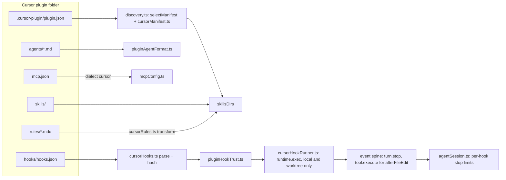

# Cursor Plugin Support in Xum

*   **Status:** Proposed

--------------------------------------------------------------------------------

## Overview

Xum loads plugins in three formats today: Agent Plugins (root `plugin.json`),
Codex (`.codex-plugin/plugin.json`) and Claude Code (`.claude-plugin/plugin.json`).
This design adds Cursor (`.cursor-plugin/plugin.json`) as a fourth format, plus
Cursor's marketplace file (`.cursor-plugin/marketplace.json`).

Xum does not run Cursor plugins as a separate system. It translates each Cursor
part into a part Xum already has: skills, agents, MCP servers and hooks. Rules
become skills. The user adds and installs Cursor plugins only from Xum's Plugins
tab, under the same install review and consent as other plugins.

One part is new. Cursor hooks are shell commands. Xum already starts a plugin's
stdio MCP servers as host processes, but it has never run a plugin's shell
command on a hook event. This design adds a host command runner for Cursor hooks on
Xum's existing hook points. It also turns Xum's fixed stop-hook continuation
limit into a per-hook limit with a per-turn ceiling.

### Terms

*   **Hook point**: a place in Xum's event spine
    (`src/node/services/events/eventSpine.ts`) where plugin hooks run:
    `tool.execute` around each tool call, `message.send` before a user message
    is sent, `compaction.prepare` before compaction, and `turn.stop` when a turn
    ends.
*   **Continuation**: a hook that asks Xum to start another model turn after a
    turn ends.
*   **User turn**: everything from one user message to the end of the turns it
    causes.
*   **Explore / Exec**: Xum's built-in read-only agent, and its default agent
    that can edit files.
*   **Install review**: the screen that lists what a plugin adds before the user
    installs or updates it.
*   **Fingerprint**: a hash of the fields shown in the install review. A changed
    fingerprint asks the user to review again.
*   **MCP dialect**: the `mcp.json` shape a plugin format uses (Codex, Claude,
    Cursor).
*   **Bug bash**: Xum's model-driven exploratory tests, which run with the
    `XUM_DISABLE_*` switches set.

## The Problem

A user who finds a plugin for Cursor cannot use it in Xum.

*   The official Cursor marketplace
    ([github.com/cursor/plugins](https://github.com/cursor/plugins), checked
    2026-10-30) lists 128 plugins: 17 from Cursor and 111 from third parties.
    Xum can read 2 of the 128 (`pstack` and `origin-apps`), because only those
    two also ship a manifest that Xum knows.
*   Discovery skips a folder whose only manifest is `.cursor-plugin/plugin.json`,
    with no message (`src/node/services/agentPlugins/discovery.ts:1236-1238`).
    A direct folder add offers a skills-only install
    (`installMethods.ts:309-313`), which loads the skills and nothing else. A
    marketplace add lists only the 2 plugins with a manifest Xum knows.
*   The plugins the user named need more than skills. `cursor-team-kit` ships
    18 skills (clone at `4dd1d05`, 2026-10-29), 2 agents (`thermo-nuclear-code-quality-review`, `ci-watcher`) and
    2 always-apply rules. `ralph-loop` and `advisor` need hooks that run and can
    continue a turn. 104 of the 111 third-party plugins declare MCP servers.
    All 104 point `mcpServers` to a `./mcp.json` file, and 102 of those servers
    are remote HTTP servers (for example `https://mcp.attio.com/mcp`). Most of
    them ask the user to sign in.
*   The named plugins: `cursor-team-kit` holds Cursor's own skills, review
    agents and rules. `ralph-loop` repeats a task until the reply contains a
    completion tag. `advisor` asks a second agent to review edits.
    `continual-learning` saves lessons from the transcript after each turn.
    `pstack` and `origin-apps` also ship an Agent Plugins manifest.

The workaround today is to ask each plugin author to add a second manifest. That
does not scale to 128 plugins, and it does nothing for rules, agent frontmatter
or hooks, which only the Cursor format describes.

The proposed solution: a Cursor reader that maps every Cursor part onto a Xum
part, a marketplace reader for the Plugins tab, and a hook runner that keeps
Xum's consent and safety rules. Parts with no Xum counterpart stay visible in
the install review as "not applied" and go into tracking issues.

## Goals

1.  **Marketplace install.** The user adds `https://github.com/cursor/plugins`
    in the Plugins tab, sees the plugins listed in its `marketplace.json`, and
    installs one of them.
2.  **Skills and rules.** Cursor skills load as Xum skills. Cursor commands are
    listed as not applied: no marketplace plugin ships one. Every rule file,
    always-apply rules included, loads as a skill under the skill consent that
    ships today. The install review labels a rule
    skill as "loaded on request in Xum", because Xum does not add it to every
    prompt.
3.  **Agents.** Cursor agents run as Xum sub-agents through the shipped mapping
    in `pluginAgentFormat.ts`. An agent with `model: fast` uses the model the
    user configured for Explore. With no Explore model configured, it resolves
    as today: the Exec model from Settings, else the parent model.
4.  **MCP servers.** Servers from the `mcp.json` file that the manifest's
    `mcpServers` names connect. Remote HTTP servers are the main case: 102 of
    the 104 marketplace servers. Xum also expands `${CURSOR_PLUGIN_ROOT}` and
    `${CLAUDE_PLUGIN_ROOT}` to the plugin's install folder in `command`, `args`,
    `env` and `cwd`, because the Cursor spec defines them. No marketplace
    `mcp.json` uses them today, so only a test fixture checks them.
5.  **Hooks.** After the user trusts a hook, Xum runs Cursor `command` hooks in
    local and worktree workspaces on the three events that marketplace plugins
    use and Xum can map: `afterAgentResponse` and `stop` on `turn.stop`, and
    `afterFileEdit` on `tool.execute`. Xum gives each hook the input fields and
    environment variables that Cursor documents, where Xum has the data.
6.  **Stop-loop limits.** Each stop hook has its own loop limit. A hook with no
    `loop_limit` uses Xum's one shared default of 3, whatever format it comes
    from. A number sets that hook's limit. `null` means no per-hook limit, but
    no hook can go past one Xum ceiling per user turn. Xum never continues a
    turn after a user Stop, an abort or an error.
7.  **Every part Xum does not apply is listed.** The install review and the plugin
    detail list every part, field and hook event that Xum does not apply.

Success means these checks pass. Tests 4 and 6 use fixtures. The rest use the
real marketplace:

1.  Install `cursor-team-kit`. Its 18 skills and 2 rule skills load, the
    install review labels both rules "loaded on request in Xum", and in a new
    chat the model loads a rule skill when the user asks for a code-quality
    review.
2.  `thermo-nuclear-code-quality-review` runs as a sub-agent.
3.  With an Explore model configured, `ci-watcher` runs on that model.
4.  A fixture copy of `ralph-loop` with `loop_limit: null` continues the turn
    until the reply contains its `<promise>` tag, then stops. A user Stop in
    the middle ends the current turn, and Xum adds no continuation. The loop
    stays active in the plugin's own state (`.cursor/ralph/`), so the next turn
    can resume it, and running the plugin's `cancel-ralph` skill ends it. The
    test checks the Stop and the cancel. The fixture changes only `hooks.json`, to
    `bash "${CURSOR_PLUGIN_ROOT}/hooks/<script>.sh"` (the change in the
    unmerged cursor/plugins PR #524, a ralph-loop path fix). Published ralph-loop runs its commands as
    written, which fails in Xum as in Cursor (D17).
5.  A remote HTTP MCP server from the marketplace with no `${...}`
    placeholders connects after the user signs in. The candidate is `attio`.
6.  A test fixture plugin with a stdio MCP server launched through
    `${CURSOR_PLUGIN_ROOT}` connects.
7.  The install review for `advisor` lists `subagentStop` as not applied.

## Non-Goals

1.  **Rules in the system prompt.** Always-apply rule injection and glob-based
    auto-attach are out of scope. Tracking issue T2.
2.  **Other hook events and matchers.** Tool, shell, MCP, prompt-submit and
    compaction events (`preToolUse`, `beforeShellExecution`,
    `beforeMCPExecution`, `postToolUse`, `afterShellExecution`,
    `afterMCPExecution`, `beforeSubmitPrompt`, `preCompact`), events with no
    Xum hook point (`sessionStart`, `sessionEnd`, `subagentStart`,
    `subagentStop`, `afterAgentThought`, the Tab hooks, `workspaceOpen`),
    prompt-type hooks and hook matchers stay inert and listed. Tracking issue
    T1.
3.  **A small-model table per provider** for `model: fast` when no Explore
    model is configured. Tracking issue T3.
4.  **`readonly` deny-at-execution** (all tools in the request, writes denied
    when they run). Tracking issue T4.
5.  **A Cursor-only default loop limit.** Raising the shared default from 3 to
    5 for every hook source is a separate discussion. Tracking issue T5.
6.  **Plugins that Cursor installed on disk** (for example under `~/.cursor`).
    Xum loads only plugins added from its own Plugins tab.
7.  **Cursor `variables`** (user-supplied values for MCP servers). Listed as
    not applied.
8.  **Hooks in remote workspaces** (SSH, Docker, devcontainer). Tracking issue
    T6.
9.  **`is_background` as an enforced default.** Xum shows it as a hint in the
    `task` tool's agent list (D12). Tracking issue T7.
10. **The Cursor MCP `auth` block.** Listed as not applied. Tracking issue T8.
11. **Cursor commands.** Listed as not applied. Tracking issue T9.

## Open Questions

None. The Decisions table under Technical Plan lists every decision.

## Critical User Journeys (CUJs)

### CUJ 1: Install a Cursor plugin from the Cursor marketplace

*   **Given**: Agent Plugins are enabled in Xum, and the user has not added any
    Cursor marketplace.
*   **When**: The user opens the Plugins tab, adds
    `https://github.com/cursor/plugins`, picks `cursor-team-kit` and confirms
    the install review.
*   **Then**: The install review lists 18 skills, 2 rule skills labeled "loaded
    on request in Xum", 2 agents, and no hooks or MCP servers. After install, a
    new chat can load the skills and spawn both agents.

### CUJ 2: Run a Cursor agent on a small model

*   **Given**: `cursor-team-kit` is installed, and the user set a model for the
    Explore agent in Settings.
*   **When**: The parent agent spawns `ci-watcher`, which declares
    `model: fast`.
*   **Then**: `ci-watcher` runs on the Explore model. The sub-agent header shows
    that model. If the user clears the Explore model, the next spawn uses the
    Exec model from Settings, else the parent model, as an Explore sub-agent
    does.

### CUJ 3: Loop a turn with a stop hook

*   **Given**: The fixture copy of `ralph-loop` (hook commands in the
    `${CURSOR_PLUGIN_ROOT}` form) is installed, its two hooks are trusted, and
    the user starts a loop with a completion promise.
*   **When**: Each turn ends.
*   **Then**: Xum runs `afterAgentResponse`, then `stop`. While the reply has no
    `<promise>` tag, the stop hook continues the turn, and the chat shows
    "plugin continued turn n of 50". When the tag appears, the loop ends. If the
    user presses Stop, the current turn ends and Xum adds no continuation. The
    loop stays active in the plugin's state (`.cursor/ralph/`), so the end of
    the next turn can resume it, because ralph's stop hook does not read
    `status`. The user ends the loop with the plugin's `cancel-ralph` skill,
    which deletes that state.

### CUJ 4: Connect a remote MCP server from a Cursor plugin

*   **Given**: The user installs a third-party plugin from the Cursor
    marketplace whose `mcp.json` names a remote HTTP server with no `${...}`
    placeholders (for example `attio`).
*   **When**: The user enables the server, signs in when Xum asks, and a chat
    calls one of its tools.
*   **Then**: The tool call returns a result. A plugin whose `mcp.json` needs
    user values (`${XERO_CLIENT_ID}`, `${BREVO_MCP_TOKEN}`) shows those servers as
    "needs values not supported in Xum" instead of failing to connect.

### CUJ 4b: Launch a local MCP server through `${CURSOR_PLUGIN_ROOT}`

*   **Given**: A test fixture plugin ships a stdio server whose `command` or
    `args` use `${CURSOR_PLUGIN_ROOT}`.
*   **When**: The user installs the fixture and enables the server.
*   **Then**: Xum starts the server from the plugin's install folder, and a tool
    call returns a result.

### CUJ 5: See what Xum does not apply

*   **Given**: The user previews `advisor` in the Plugins tab.
*   **When**: The install review opens.
*   **Then**: It lists `subagentStop` as "not applied in Xum", next to the hooks
    that will run. The user can install the plugin knowing which part will not
    work.

## Technical Plan (Architecture)

This plan was written against Xum `3d3a4cf2d8`. Line numbers are from that
commit. Lines that the 2026-10-30 review found moved were corrected against
`0f82063e7e`. Each owner decision is
marked "(Dn)" at the step it changes.

### Decisions

| ID | Decision | Section |
| --- | --- | --- |
| D1 | Hook trust hashes the `hooks.json` entry. The update review lists every changed file of a plugin with a runnable Cursor command hook. A local edit on disk outside an update is an accepted risk. | 5.1 |
| D2 | A ceiling of 50 continuations per user turn for all hooks. | 6 |
| D3 | One shared default stop-loop limit of 3 for every hook source. No second default or code path for Cursor hooks. | 6 |
| D4 | Continuations count per user turn, for every hook source. | 6 |
| D5 | After a user Stop or an error, Xum runs no stop hook. | 6 |
| D6 | The runner refuses to start any hook process when `XUM_DISABLE_AGENT_TOOLS`, `XUM_DISABLE_TERMINALS` or `XUM_DISABLE_PROJECT_AUTOMATION` is set. | 5.1 |
| D7 | Cursor command hooks run in local and worktree workspaces only. Remote workspaces list them as "does not run in remote workspaces" (T6). | 5.1, 5.6 |
| D8 | Cursor hooks follow Cursor's documented failure rule. A Codex `PreToolUse` hook whose output is malformed or fails its schema check blocks the tool call. Every other Codex failure keeps failing open. | 5.5, PR 6 |
| D9 | Only `afterFileEdit`, `afterAgentResponse` and `stop` run. Tool, message and compaction events and matchers are listed (T1). | 5.2, 5.3 |
| D10 | `beforeReadFile` and `postToolUseFailure` are not applied (T1). | 5.2 |
| D11 | `model: fast` agents use Explore as their AI settings base. | 7 |
| D12 | `is_background: true` is a hint, not enforced: the `task` tool's agent list shows "meant to run in the background (run_in_background=true)". The `task` schema and its default are unchanged (T7). | 7 |
| D13 | `readonly` agents get Explore's prompt before their own body. | 7 |
| D14 | Rule skills use the shipped skill consent. | 2 |
| D15 | Hooks run through `runtime.exec` on every platform (Git Bash on Windows). | 5.4 |
| D16 | Hooks use the shared timeout rule (10 s default, 30 s cap). | 5.4 |
| D17 | A hook `command` runs as written. Xum does not rewrite a leading `./`. | 5.4 |
| D18 | `CURSOR_VERSION` is `xum-<version>`. The transcript path points to the workspace's `chat.jsonl`. | 5.4 |
| D19 | The Cursor `auth` block is listed as not applied (T8). | 4 |
| D20 | A repository with both marketplace files shows one merged list. | 3 |
| D21 | A schema-less root `plugin.json` yields to a Cursor manifest, as it yields to Codex and Claude. | 1 |
| D22 | The turn-stop text keeps its shipped rule (the reply's trailing text run, `null` after a tool part, #6067). Only the cut changes: it keeps the last 16 × 1024 characters. | 5.4, PR 5 |
| D23 | `cursor-marketplace` is a preview selector only. A Cursor entry installs through its folder's own manifest, with no generated manifest or `generatedFrom` marker. An entry without a manifest is refused. | 3, PR 2 |
| D24 | Cursor manifest component paths (`skills`, `rules`, `agents`) are folder paths. Globs and file paths are listed as not applied (T10). | 1, PR 1 |
| D25 | `afterFileEdit` runs after `file_edit_replace_string` and `file_edit_insert` only. `edits` comes from the tool input. | 5.2, 5.4, PR 8 |
| D26 | An `ai.settingsBase` that names a missing agent, the agent itself, an agent whose chain contains the agent, or an agent whose chain declares its own `ai.settingsBase` is ignored with a warning. Xum follows one settings base, never a second. | 7, PR 4 |
| D27 | The sub-agent header shows the model only, not where it came from (T11). | 7, PR 4 |
| D28 | A Cursor hook failure logs a warning and shows one chat notice per workspace and hook. The hooks panel shows no failure state. | 5.5, PR 8 |
| D29 | The `cursor` MCP dialect has the Codex shape: `type: "http"` and a `url` without `type` both become `streamable-http`. Only the two plugin roots expand, so `${CURSOR_PLUGIN_DATA}` counts as a user value. | 4, PR 3 |
| D30 | A plugin's first file review lists every file. When the staged tree has a runnable Cursor command hook and the installed tree is missing or has none, the review compares the staged tree with an empty tree. That covers a first install and an update that adds the first such hook. | 5.1, PR 8 |

After the Goldfish review, the owner delegated the remaining trade-offs
(2026-10-31). The final set is D1-D30: the owner decided D1-D21, the Stage 9
re-audit added D22-D29, and the review of this RFC added D30, all under the
same delegation. The rule for D22-D30: build what the 128 marketplace plugins
use today, track the rest, and prefer the smaller and more secure option.

### Shape of the change

Xum treats a Cursor plugin as one more source format. Every part is translated
into a part Xum already has, at the points where the Claude format is
translated today. Only the hook runner adds new behavior.



### 1. Manifest reader

*   `selectManifest` (`discovery.ts:1178-1203`) gains
    `.cursor-plugin/plugin.json` as the **last** candidate, after root
    `plugin.json`, Codex and Claude (D21). A schema-less root `plugin.json`
    (no `$schema`) yields to the Cursor manifest, as it yields to Codex and
    Claude (`discovery.ts:1170-1177`). A root `plugin.json` with `$schema` keeps
    loading first, so `pstack` and `origin-apps` are unchanged. A folder with
    only a schema-less root and a Cursor manifest switches to the Cursor
    manifest. No marketplace plugin ships such a folder.
*   A new `cursorFallback` gate sits beside `codexFallback` and
    `claudeFallback` (`discovery.ts:1248-1249`). A Cursor package counts as
    `foreign` in `xumComponentGate` (`discovery.ts:1118-1124`), so Xum-only
    parts (`hooks.js`, `workflows/`) in a Cursor folder never run.
*   A new `cursorManifest.ts` normalizes the manifest, modeled on
    `normalizeClaudeManifest` (`claudeManifest.ts:298`).
*   Cursor rule
    ([reference/plugins.md](https://cursor.com/docs/reference/plugins.md)): a
    manifest path replaces folder discovery for that component. Each path is
    contained in the plugin folder, as for Claude. Xum applies folder paths only
    (D24): every marketplace manifest names folders. A glob, a file path or a
    path outside the folder is listed as not applied (T10).

| Cursor field | Xum field | Rule |
| --- | --- | --- |
| `name`, `version`, `description`, `author`, `homepage`, `repository`, `license`, `keywords` | plugin metadata | Same handling as Claude. |
| `displayName`, `logo` | none | Listed as not applied. The Agent Plugins manifest has no field for them, and the Plugins tab shows the plugin `name`. |
| `skills` (string or list of folder paths) | `skillsDirs` | Replaces the default `skills/` scan, as Cursor does. Without the field, Xum scans `skills/`. |
| `commands` (string or list) | none | Listed as not applied (T9). No marketplace plugin names `commands` or ships a `commands/` folder. |
| `rules` (string or list of folder paths) | `skillsDirs`, one rule root per file | Replaces the default `rules/` scan. Files `.md`, `.mdc`, `.markdown`. See section 2. |
| `agents` (string or list of folder paths) | `agentsDir` | Replaces the default `agents/` scan. The first folder path is used. Each later one is listed as not applied. |
| `mcpServers` (string) | `mcpConfigPath`, dialect `cursor` | See section 4. An inline object or list is not applied and listed, as for Claude (`claudeManifest.ts:166-181`). No marketplace plugin uses that form. |
| `hooks` (string or inline object) | `cursor.hooks` | See section 5. |
| `variables`, `category`, `tags`, `publisher`, `clientVersionRequirement`, `minClientVersions` | none | Listed as not applied (Goal 7). |

### 2. Rules as skills

*   A new `cursorRules.ts` turns each rule file (`.md`, `.mdc`, `.markdown`)
    into SKILL.md text when Xum
    reads it, the way `claudeCommands.ts` turns a command into a skill. Nothing
    new is written to disk.
*   The skill name is the file name without its extension. It must be a valid
    skill name (kebab-case). If a real skill in the same plugin has that name,
    the skill wins and the rule is listed as not applied. PR 1.1 gives the full
    rules.
*   Rule types map as follows:

| Rule frontmatter | Skill | Install review label |
| --- | --- | --- |
| `alwaysApply: true` | model-invocable, description from `description` | "always-apply rule, loaded on request in Xum" |
| `description` only | model-invocable | "rule" |
| `globs` set | model-invocable, globs added to the description | "glob rule, not attached by file in Xum" |
| none of the three | user-invocable only (`disable-model-invocation`) | "manual rule" |

*   Precedence: `alwaysApply: true` wins over `globs`, and `globs` wins over
    `description` only.

*   Rule consent (D14): the shipped skill
    consent. It fingerprints the converted frontmatter (name, description, the
    rule-type label, the user-only flag for manual rules) and any directive
    lines in the body (#6617 skill body consent, and its fix PR #6763). Prose edits load after an update
    without a new review, as for skills. The consent site must fingerprint the
    fields the conversion produces, so a change to `alwaysApply` or `globs`
    that changes the label asks for review.

### 3. Marketplace and install

*   A Cursor marketplace path constant sits beside
    `CLAUDE_MARKETPLACE_RELATIVE_PATH` (`claudeMarketplace.ts:33`). The Claude
    parser, its 8 MiB cap and its 500-entry cap (`claudeMarketplace.ts:38-40`)
    are reused. The Cursor file has 128 entries, so the cap holds.
*   `marketplaceListingAt` (`installService.ts:3542`), which `previewSource`
    (`:3494`) calls, reads both marketplace
    files when both exist, and shows one merged list (D20). `cursor/plugins` ships both: the Claude file lists 2 entries
    (`origin-apps`, and `pstack` at `./harness/pstack/claude-code`), the Cursor
    file lists 128 (`pstack` at `./pstack`).
    *   A name in only one file shows once, with that file's preview action.
    *   A name in both files shows once, with two preview actions: "Preview
        Cursor build" and "Preview Claude build". Each one previews that file's
        entry.
    *   Same-name guard: install folders are named after the plugin
        (`targetPathFor(entry.name)`), so only one build of a name can be
        installed. A second install of the same name is refused until the user
        uninstalls the first. Xum reuses `collisionReason`
        (`installService.ts:3791-3800`): "A managed plugin named '<name>' is
        already installed. Uninstall it first."
    *   Updates: an installed folder with its own manifest updates by tracking
        that folder at the new commit (`installService.ts:6378-6384`). Every
        Cursor entry is such a folder. An install made through a generated
        Claude manifest keeps reading its entry from the Claude file.
    *   Merged-list caps: each file keeps its own 8 MiB and 500-entry cap. The
        merged list has at most 1000 entries.
*   A Cursor entry installs through its folder's own manifest (D23): all 128
    Cursor entries point to a folder with `.cursor-plugin/plugin.json` (or a root
    `plugin.json` with `$schema`, for `pstack`). `detectInstallMethods`
    (`installMethods.ts:299-316`) gains the method `cursor-plugin`.
    `cursor-marketplace` names a Cursor entry for a preview, as
    `claude-marketplace` does for a Claude entry, and install never gets it
    back. Xum writes no generated manifest and no `generatedFrom` marker for
    Cursor entries. A Cursor entry whose folder has no manifest is refused.
*   The install review shows every not-applied part, field and hook event. The
    preview schema gains one list for them (`common/orpc/schemas/agentPlugins.ts`).

### 4. MCP servers

*   A new MCP dialect `cursor` joins `claude` (`discovery.ts:988-1005`,
    `:1354`).
*   The ternary in `pluginPlaceholderValues` (`mcpConfig.ts:366-375`) becomes a
    per-dialect table. The `cursor` dialect expands `CURSOR_PLUGIN_ROOT` and
    `CLAUDE_PLUGIN_ROOT` to the install folder, and no data folder names
    (D29). The `${CLAUDE_PLUGIN_ROOT}/<path>` rewrite to `./<path>`
    (`mcpConfig.ts:346-363`) applies to both names. Its cwd rewrite maps only
    these two root names for `cursor`, so a cwd anchored at a data folder name
    stays as written, and Xum skips the server.
*   Transport (D29): the `cursor` dialect has the Codex shape, so `type:
    "http"` and a `url` without `type` (the `gong` server) both become
    `streamable-http`. 101 of the 104 marketplace servers set `type: "http"`.
*   Any other `${NAME}` placeholder (user values such as `${CLIENT_ID}`) in
    `command`, `args`, `env`, `cwd`, `url` or `headers`, including
    `${NAME:-default}`, gives that server the status "needs values not
    supported in Xum". Xum skips the server with the existing per-server
    diagnostic (`reportEntry`, `mcpConfig.ts:788`), and does not read the value
    from the environment. The check is new and runs for the `cursor` dialect
    only. Cursor `variables` are a non-goal.
*   Remote HTTP servers go through the existing plugin MCP path, with its
    https rule for auth URLs.
*   The Cursor `auth` block (D19) is not applied. Xum ignores it, lists "auth
    not applied in Xum" on the server, and connects the server through the
    existing plugin MCP path. Sign-in then works only with a provider that
    supports dynamic client registration. 14 marketplace servers have an `auth`
    block: 4 with a fixed client ID (`x`, `x-ads`, `meta-ads`, `gopuff`) and 10
    with a placeholder. Translating the block is tracking issue T8.

### 5. Hooks

Sections 5.1 to 5.6 are the contract for Cursor hooks: what runs, its input and
output, and the rules it must keep. PR 8 builds the contract under its own
security review and settles each mechanism there. PR 8.7 has a test for each
rule.

#### 5.1 Parse, list and trust

*   Format: a new `cursorHooks.ts` parses Cursor `hooks.json`:
    `{version: 1, hooks: {<event>: [{command, type?, matcher?, timeout?,
    loop_limit?, failClosed?}]}}`, from `hooks/hooks.json` or the manifest's
    `hooks` value (a path or an inline object). Invalid entries drop with a
    warning, as in `codexHooks.ts`. The Codex loader (`loadPluginCodexHooks`)
    returns no hooks for a Cursor package, so only `cursorHooks.ts` reads them.
*   Hook-source reads: Xum reads a hooks file only inside the plugin folder. A
    path that leaves the folder, through `..` or a symlink, gives no hooks and
    a warning. The read keeps the Codex loader's caps: 256 KiB per file
    (`MAX_HOOKS_FILE_BYTES`), 256 hooks (`MAX_PLUGIN_HOOKS`) and 50 kept
    warnings (`MAX_HOOK_WARNINGS`, `codexHooks.ts:116-131`).
*   Keys: each hook's trust key is `cursor:<source>#<event>[<index>]`, where
    `<source>` is the hooks file path or `plugin.json#hooks`. A Cursor key
    cannot collide with a Codex key.
*   Trust (D1): `pluginHookTrust.ts` (`{hash, state}` per hook) with today's
    hash, `hashHookDefinition` (`codexHooks.ts:696-699`): the event, the
    matcher and the handler entry exactly as declared. A change to any declared
    field, unknown fields included, asks for trust again. The hash covers the
    `hooks.json` entry only, not the scripts that the command runs.
*   Trust display: the trust prompt and the hooks panel show every field that
    the hook hash covers. That is the event, the matcher and the entry as
    declared, with its unknown fields and the declared value of each field
    that Xum clamps. A hook with `loop_limit: 80` shows 80 and runs with 50.
    Two entries with different hashes never look the same. Invisible and bidi
    controls in the entry show as visible marks, as in every review.
*   Status: each hook gets one from the existing enum
    (`common/orpc/schemas/agentPlugins.ts:79-84`). `runnable` is a mapped event
    with a `command` handler and no `matcher`. `ignored-event` is an unmapped
    event or a hook with a `matcher` (D9). `unsupported-handler` is
    `type: "prompt"`. A hook that does not run has one reason: "prompt hooks
    are not applied in Xum", "event not applied in Xum" or "matcher not applied
    in Xum". The install review, the plugin card and the hooks panel show that
    reason. The hooks panel never shows the shared Codex status note for a
    Cursor hook, because that note describes Codex handlers and events.
*   File review (D1, D30): a hook can run or source any file in the plugin, so
    a plugin whose staged tree has a runnable Cursor command hook gets a review
    of its files.
    *   An update review lists every file that the update adds, removes or
        changes. It skips no folder, so files under skill, rule, agent and
        workflow folders are listed too. A skill row shows only the frontmatter
        and directive lines (`componentConsent.ts:238-246`), and an agent row
        only the frontmatter (`:310-319`). Neither shows a body or a helper
        such as `skills/foo/lib.sh`, and a component root can be the plugin
        root.
    *   First file review (D30): when the installed tree is missing or has no
        runnable Cursor command hook, the review compares the staged tree with
        an empty tree, so it lists every staged file as added. That covers a
        first install and an update that adds the plugin's first runnable hook.
        The user sees every file of the plugin before any of its hooks can be
        trusted.
    *   Rows: a UTF-8 text file of at most 64 × 1024 bytes shows its text (the
        new text of an added file, the old text of a removed one, both for a
        change), with invisible controls marked as in every review. A symlink
        shows its link text, never its target. Any other file shows only
        "added", "removed" or "changed".
    *   Change detection compares per-file records: the path relative to the
        plugin folder, the mode, and the content hash or link text. A record
        does not depend on the folder that the tree sits in, so an unchanged
        file compares equal between the installed tree and the staged tree.
    *   Reads: Xum opens a file for the review only when it is a regular file
        inside the plugin folder, never through a symlink. The text shown is
        the text hashed, and a file that changes during the walk fails the
        review. Every file counts against the staged-tree quota
        (`STAGED_TREE_MAX_BYTES`, `STAGED_TREE_MAX_FILES`). No byte from
        outside the plugin folder reaches a review.
    *   Size: the review keeps its cap (`assertReviewFits`,
        `installService.ts:586-597`). A review too large to show fails closed
        with its existing message, at install and at update.
    *   The review runs once per install or update, not on each hook run.
    *   Accepted risk: a script edited on disk after install, outside an update
        (`stop-hook.sh`, the `lib.sh` it sources, a `bun` import), runs on the
        host with no new review.
    *   Reason for accepting it: anything that can write a plugin folder under
        the Xum home can also change Xum's config and the hook trust file, so a
        check before each run does not stop that attacker. The check also costs a
        folder walk on every hook run.
    *   Accepted gap: a Cursor plugin installed by a build that has PR 2 and
        not PR 8 got no file review. After the upgrade its hooks show as `new`,
        and its next update review lists only the files that the update
        changes. Reinstalling the plugin shows the first file review.
    *   Rejected: hashing the whole plugin folder before each run, and hashing
        each script a command names. See Alternatives Considered.
*   Kill switches (D6): the runner refuses to start any hook process when
    `XUM_DISABLE_AGENT_TOOLS` (read by `isAgentToolsDisabled`,
    `src/node/utils/agentToolsDisabled.ts:15-17`), `XUM_DISABLE_TERMINALS`
    (read inline in `src/node/services/terminalService.ts:75-76`) or
    `XUM_DISABLE_PROJECT_AUTOMATION` (read by `projectAutomationDisabled`,
    `src/node/utils/projectAutomation.ts:20-24`) is set. AGENTS.md requires
    that model-driven bug-bash runs never reach a host shell.
*   Remote workspaces (D7): Cursor command hooks do not run in SSH, Docker or
    devcontainer workspaces, as for all plugin hooks today
    (`remoteProjectPlugins.ts:1-16`, #7218: remote plugins load skills and
    agents only). See 5.6.

#### 5.2 Event mapping

| Cursor event | Xum point | Phase | Can block or change |
| --- | --- | --- | --- |
| `afterFileEdit` | `tool.execute` (`file_edit_replace_string` and `file_edit_insert`, D25) | after | none |
| `afterAgentResponse` | `turn.stop` | first | none |
| `stop` | `turn.stop` | after `afterAgentResponse` | `followup_message` |
| `preToolUse`, `beforeShellExecution`, `beforeMCPExecution`, `postToolUse`, `afterShellExecution`, `afterMCPExecution`, `beforeSubmitPrompt`, `preCompact` | none in this version (D9) | | listed as not applied (T1) |
| `beforeReadFile`, `postToolUseFailure` | none (D10) | | listed as not applied (T1) |
| all other events | none | | listed as not applied (T1) |

*   Reason for the short list (D9): the three hook plugins in the marketplace
    use only `afterFileEdit`, `afterAgentResponse`, `stop` and `subagentStop`.
    No marketplace plugin uses a tool, message or compaction event.
*   Matchers (D9): a hook with a `matcher` does not run. Its status is
    `ignored-event`, and the install review lists it as "matcher not applied in
    Xum". No marketplace hook sets a matcher on the three mapped events.

#### 5.3 Tool names for matchers (not in this version)

Matchers are not applied (D9), so this version has no Cursor-to-Xum tool-name
table. The table (`Shell`, `Read`, `Write`, `Task`, `MCP:<tool>`) comes with the
tool events in T1.

#### 5.4 The runner

*   Hook points: a new `cursorHookRunner.ts` runs `afterAgentResponse` and then
    `stop` on `turn.stop`, and `afterFileEdit` on `tool.execute` after the tool
    runs (D25). A failed tool call runs no hook. Matching hooks run in
    sequence, as Codex hooks do. The runner shares the Codex runner's spine
    registration, its project-trust gate and its chat notice route
    (`plugin.hook.notice`).
*   Process: each hook call starts one process through the workspace runtime's
    `exec`, with the input JSON on stdin and the output JSON read from stdout.
    Today plugin code starts two kinds of processes: the install-time `git`
    call (`installService.ts:1031`) and plugin stdio MCP servers
    (`prepareStdioLaunch`, `mcpServerManager.ts:1026-1036`, with
    `hostEnv: "minimal"`). This runner is the first to run a plugin command on
    a hook event. It uses the same minimal host environment.
*   Start conditions: a hook process starts only when all of these hold at the
    time of the call. A call that fails one starts no process. Only the
    input-size and trust-store cases warn (5.5). The others show no notice,
    because bug-bash runs set the kill switches and the hooks panel shows the
    remote and trust state.
    *   No kill switch is set (D6, 5.1).
    *   The workspace is local or a worktree (D7). SSH, Docker and devcontainer
        workspaces start no Cursor hook process (5.6).
    *   The chat is not a `/side` chat, and plugin MCP is allowed, as for Codex
        hooks (`canRunCodexHooks`, `codexHookService.ts:67-70`).
    *   The project-trust gate that Codex hooks use passes.
    *   The user trusts the hook, and the plugin still declares it with the
        same key and hash. The check rereads the hooks in the plugin's own
        format on every call (PR 8.3), so a trusted Cursor hook passes and a
        changed entry fails.
    *   The input fits `HOOK_INPUT_MAX_CHARS`, and Xum can read its trust store
        (5.5).
    *   No user Stop has landed (see Cancellation).
*   Cancellation: a user Stop at any time before or during a hook call kills
    the hook's process group and applies nothing. A call that has not started a
    process when Stop lands never starts one. That holds at every point: before
    the `turn.stop` chain starts, between two hooks, while `exec` prepares the
    process, and while the process runs. An aborted call shows no notice. Both
    hook points carry an abort signal that a user Stop aborts. `tool.execute`
    has one today (`eventSpine.ts:94`), and `turn.stop` gets one in PR 8.
*   Output capture: Xum reads stdout and stderr while the hook runs. It keeps
    at most 64 × 1024 bytes of stdout and no stderr, and it discards the rest
    without blocking the hook, so a hook that writes past a cap never stalls on
    a full pipe. Stdout of more than 64 × 1024 bytes is invalid output (5.5).
*   Exit code 127 (command not found) is a failure (5.5) with the reason
    "`<command>`: a command or one of its dependencies was not found (exit
    127)". The shell gives 127 both when the declared command is missing and
    when a command it runs (`jq`, `bun`) is missing, and Xum keeps no stderr,
    so the reason names both causes.
*   Shell (D15): `runtime.exec` on every
    platform. On Windows, local `exec` runs through Git Bash (`getBashPath`,
    `LocalBaseRuntime.ts:250`, `:631`), so there is no Windows-only path. A
    hook written in PowerShell syntax fails, which is logged with the exit
    code. No marketplace hook uses PowerShell.
*   Timeout (D16): the shared rule,
    `effectiveHookTimeoutSeconds` (`src/constants/pluginHooks.ts:2-7`): a
    declared `timeout` in seconds, else 10 s, capped at 30 s, the same as Codex
    hooks. A timeout counts as a crash under the failure rules (5.5).
*   Working folder: the plugin folder, except `stop` (and, later,
    `subagentStop`), which run from the workspace root, as Cursor documents.
*   `command` runs as written (D17). Xum does not
    rewrite a leading `./`. A `./hooks/x.sh` in a `stop` hook therefore looks
    in the workspace root, is not found (exit 127), counts as a crash under the
    failure rules (5.5), and shows the exit-127 reason for `./hooks/x.sh`
    once. This matches Cursor's real behavior (cursor/plugins
    PR #315, advisor hook paths). Published ralph-loop is affected: its
    `afterAgentResponse` hook runs (it runs from the plugin folder), but its
    `stop` hook is not found, so the loop never continues, as in Cursor.
*   Environment: a minimal set, not Xum's full environment. Cursor documents
    each variable below in the "Environment Variables" table of
    [hooks.md](https://cursor.com/docs/hooks.md).
    `CURSOR_PROJECT_DIR` and `CLAUDE_PROJECT_DIR` are the workspace root.
    `CURSOR_PLUGIN_ROOT` is the plugin folder. `PATH` and `HOME` pass through.
    `CURSOR_USER_EMAIL` is never set. Xum never sets `CURSOR_CODE_REMOTE`,
    because Cursor hooks do not run in remote workspaces.
*   `CURSOR_VERSION` and the transcript (D18):
    *   `CURSOR_VERSION` is `xum-<version>`. A hook that parses it as a Cursor
        version fails visibly instead of trusting a fake one. No marketplace
        hook reads it today.
    *   `transcript_path` (input) and `CURSOR_TRANSCRIPT_PATH` (environment)
        point to the workspace's `~/.xum/sessions/<workspace>/chat.jsonl`.
    *   Reason: continual-learning triggers only when `transcript_path` is set
        and its modification time advanced
        (`continual-learning-stop.ts:210-219`). Advisor forwards it to its
        consult agent (`lib.sh:55-58`).
    *   Known gap: `chat.jsonl` is JSON Lines, not Cursor's transcript format.
        A plugin agent that parses the transcript reads a format it was not
        written for.
*   Input fields: the common fields Xum can fill (`conversation_id` = workspace
    ID, `generation_id` = turn ID, `model`, `hook_event_name`,
    `cursor_version`, `workspace_roots`) plus each event's own fields.
    `user_email` is `null`. `transcript_path` follows D18.
    *   `afterAgentResponse`: `text` is the reply's trailing text run, from
        `lastAssistantText` (`promptHooks.ts:173-182`), cut to its **last**
        16 × 1024 characters (D22). At `0f82063e7e` it keeps the **first**
        16 × 1024 characters (`promptHooks.ts:128`). A completion promise sits
        at the end of a reply, so the first 16 × 1024 characters can miss it.
        A turn that ends on a tool part still gives `null` (#6067), and Xum
        then passes `text: ""`.
    *   `stop`: `status` is `"completed"` (D5: no stop hook runs after a user
        Stop or an error). `loop_count` is `turnContinuations` (section 6), the
        number of continuations in this user turn from any source, a plugin
        hook or a Xum nudge. An observer hook that never continues the turn
        therefore sees a nonzero count on every continued turn. Each hook's
        limit still counts only its own continuations (`hookContinuations`).
    *   `afterFileEdit` (D25): `file_path` is the tool's resolved `path`
        (absolute). For `file_edit_replace_string`, `edits` is
        `[{old_string, new_string}]` from the tool input. For
        `file_edit_insert`, it is `[{old_string: "", new_string: content}]`.
        `file_edit_replace_lines` is disabled in Xum
        (`toolDefinitions.ts:3502`), and `bash` edits fire no hook, as in
        Cursor.
*   Exit codes and bad output: see 5.5.

#### 5.5 Failure rules for plugin hooks (D8)

Cursor hooks follow Cursor's documented rule
([hooks.md](https://cursor.com/docs/hooks.md), "Exit code behavior"). Codex
hooks change in one case only (PR 6): a Codex `PreToolUse` hook whose output is
malformed or fails its schema check blocks the tool call. Today `applyOutput`
(`codexHookRunner.ts:560-571`) warns and ignores such output, and a `parse`
throw lands in `invoke`'s catch (`:552-554`) and fails open. Every other Codex
failure keeps failing open: a timeout, an error from the MCP call, a missing or
unavailable server, and malformed output from `PostToolUse`,
`UserPromptSubmit` or `Stop`. An `updatedInput` that fails the tool's schema
already blocks today (`blockRewrite`, `:387`, `:401`), so it does not change.
The owner chose the more secure option for Codex hooks too.

Cursor hooks:

No Cursor event in this version is a permission hook (5.2), so no Cursor hook
failure blocks anything.

| Result | `afterFileEdit`, `afterAgentResponse`, `stop` |
| --- | --- |
| Exit 0 with valid output, or with empty stdout | apply the output (`followup_message` for `stop`) |
| Exit 0 with invalid JSON, or output that fails the event's schema | ignore the output, warn |
| Exit 2, or `permission: "deny"` | ignore (these events cannot block), warn |
| Crash, timeout, other non-zero exit, command not found | ignore, warn |
| Aborted by a user Stop | kill the process group, ignore, no notice |
| Input too large (over `HOOK_INPUT_MAX_CHARS`, 64 × 1024 characters, `codexHookRunner.ts:47`) | skip the call, warn |
| Xum cannot read its own trust store | skip the call, warn. This is Xum's failure, not the hook's. |

*   Output schemas: `stop` accepts `{followup_message?: string}`.
    `afterAgentResponse` and `afterFileEdit` have no output fields, so Xum
    ignores their stdout after the JSON check. Unknown fields are ignored.
*   "Warn" means (D28): Xum logs the failure and, once per workspace and hook,
    shows the chat notice "<plugin>: hook <event> failed (<reason>). Turn the
    hook off in Settings > Plugins." The hooks panel shows no failure state.
*   `failClosed` has no effect on these events, as in Cursor. It is parsed and
    hashed, so a change to it asks for trust again. When T1 adds permission
    hooks, they follow Cursor's rule: invalid JSON or schema-failing output
    blocks, and other failures block only with `failClosed: true`.
*   A Codex `PreToolUse` block caused by malformed output shows one chat line:
    "<plugin>: hook PreToolUse blocked this call (its output is malformed:
    <detail>). Turn the hook off in Settings > Plugins." Without that line a
    broken guard looks like a stalled agent.

#### 5.6 Remote workspaces (not in this version)

Cursor hooks do not run in SSH, Docker or devcontainer workspaces (D7), as for
all plugin hooks today. The install review and the hooks panel show "does not
run in remote workspaces" for each Cursor hook. Running them there needs a copy
of the plugin inside the workspace (Alternative M) and is tracked in T6.

### 6. Stop-loop limits

*   Today one counter (`agentSession.ts:1646`) and one cap
    (`MAX_STOP_HOOK_CONTINUATIONS = 3`, `:706`, checked at `:10810`) cover every
    stop-hook continuation in a user turn.
*   New rule, one code path for every hook source:
    1.  Each continuation reason carries the hook that produced it, as the
        key `<plugin instance id>:<hook key>`. A hook key names a place inside
        one plugin (`cursor:hooks/hooks.json#stop[0]`), so two plugins can
        have the same one. The plugin instance ID keeps their counts apart.
    2.  A hook with no `loop_limit` uses the shared default (3). A number sets
        that hook's limit. `null` sets no per-hook limit.
    3.  A per-user-turn ceiling of 50 stops all continuations, whatever the
        hooks say (D2). It is one
        constant beside `MAX_STOP_HOOK_CONTINUATIONS`. Reaching it pauses the
        loop: the next user message starts a new user turn, and the hooks can
        continue again.
    4.  The chat shows "plugin continued turn n of 50" for each continuation
        that a plugin hook asked for. A continuation made only of Xum's own
        TODO or status nudges shows no notice, and still counts toward n.
*   Counting scope (D4): per user turn, for
    every hook source, as today. Each hook's count and the 50 ceiling reset
    when a user turn starts, and stay in memory. `loop_count` in a Cursor
    `stop` hook's input is `turnContinuations`, the number of continuations in
    the current user turn from any source, a plugin hook or a Xum nudge. A
    hook's limit counts only that hook's own continuations
    (`hookContinuations`). Xum puts both counts on the `turn.stop` context
    before the chain runs, because a Cursor hook builds its input while the
    chain runs.
    *   Reason: Cursor's own plugins expect this, although Cursor's docs say
        "for this conversation". Continual-learning counts a stop as a user
        turn only when `loop_count === 0` (`continual-learning-stop.ts:137-139`),
        and advisor expects to nudge again after the user answers
        (`stop-hook.sh:32-37`). Both break if the count never resets.
        Continual-learning also breaks if a continuation by another hook or a
        nudge leaves its count at 0, because it then treats each continued
        turn as a new user turn and repeats its transcript work.
    *   A Codex hook continues a user turn at most 3 times, as today, but the
        count is that hook's own. A nudge or another hook does not count
        against it, so one user turn can have more than 3 continuations
        (section 8).
    *   Xum's own nudges keep their check: they run only when no hook
        continued the current user turn.
*   A user Stop or abort already skips `turn.stop` (`handleTurnAbort`, called
    at `agentSession.ts:1590`, defined at `:10288`), so no continuation follows
    a Stop today.
*   After a user Stop or an error, Xum runs no Cursor hook (D5). Cursor would
    call `stop` with `status: "aborted"` or `"error"`. No marketplace plugin
    needs it: advisor and continual-learning exit early on those values, and
    ralph ignores `status`.
*   Xum's own TODO and status nudges keep their rule: they run only when no
    hook has continued the turn (`agentSession.ts:10874-10881`).

### 7. Agents

*   The shipped mapping in `pluginAgentFormat.ts` stays: no `readonly` maps to
    Exec, `readonly: true` maps to Explore (`:347`).
*   `model: fast` (D11): a `fast` agent
    resolves its AI settings, model and thinking level, as if its base were
    Explore. Its tools stay those of its real base (Exec, or Explore when
    `readonly: true`).
    *   Today `mapModel` (`pluginAgentFormat.ts:297-303`) finds no `fast` alias,
        and the agent takes the Exec model from Settings, then the parent model.
        The parent chat's Exec choice is skipped for Exec-derived agents on
        purpose (`src/common/utils/ai/resolveAgentAiSettings.ts:99-111`).
    *   Mechanism: the Cursor mapping writes a new optional Xum frontmatter
        field, `ai.settingsBase: "explore"`, for `model: fast`. Where Xum turns
        an agent's inheritance chain into AI-settings layers, a set
        `settingsBase` replaces the chain after the agent's own entries with
        the settings-base agent's chain. One pure helper,
        `applySettingsBaseChain` (new, in
        `src/common/utils/ai/agentAncestorLayers.ts`), does this for every
        consumer, so the consumers cannot disagree. Tool policy still follows
        `base`.
    *   The consumers (checked against `main` at `85abd10b10`):
        1.  Model and thinking level for a run and for a task reawaken:
            `loadAgentDefinitionAiLayers`
            (`src/node/services/agentDefinitions/resolveNodeAgentAiSettings.ts:104`),
            called from `resolveNodeAgentAiSettings` (`:206`) and
            `taskService.ts:10577`.
        2.  The Anthropic prompt-cache TTL (#7767):
            `resolveChainAgentCacheTtl` (`resolveNodeAgentAiSettings.ts:78`),
            called from `turnRequestBuilder.ts:2291` and
            `continuousCompactionSummary.ts:123` with the chain from
            `resolveAgentForStream` (`agentResolution.ts:259`).
        3.  The agent descriptor's `aiLayers` (#7767), built at
            `agentDefinitionsService.ts:1432` and shown in Settings > Tasks
            (`TasksSection.tsx:460`).
        4.  Paths that walk the declared `base` of listed agents instead of a
            read chain: the renderer's configured defaults
            (`resolveConfiguredAiDefaults`,
            `src/browser/utils/workspaceModeAi.ts:38-51`, fed by
            `setAgentBases`, `src/browser/utils/aiSelectionIntent.ts:145`,
            from `AgentContext.tsx:174`), the Settings > Tasks fallback walk
            (`TasksSection.tsx:460-476`) and ACP
            (`src/node/acp/resolveAgentAiSettings.ts:68`). The descriptor gets
            a new field, `aiSettingsBase`, and each of these uses
            `aiSettingsBase ?? base` when it builds its map. `agents.list`
            sets the field only when the settings base applies. An ignored
            settings base (D26) is left out, so these walks follow `base`, as
            a run does. A child workspace of a `fast` agent then shows the
            same configured model as a run uses.
    *   New lookup order for a `fast` agent: its own saved choice, its own
        Settings entry, its own frontmatter defaults, then Explore's Settings
        (Delegated override, then base entry) and Explore's definition, then
        Exec's Settings and definition, then the parent model, then
        fallbacks. Exec comes in because the built-in Explore agent declares
        `base: exec` (`src/node/builtinAgents/explore.md`), so a `fast` agent
        resolves its model as an Explore sub-agent does.
    *   The built-in Explore agent sets no model. With no Explore model in
        Settings, a `fast` agent resolves as today: the Exec model from
        Settings, else the parent model.
    *   The renderer, Settings > Tasks and ACP walk the declared bases
        (`collectDeclaredAncestorLayers`, `agentAncestorLayers.ts:22-42`), so
        their walk through `aiSettingsBase` reaches Exec too, and every
        consumer shows the model a run uses.
    *   The built-in Explore agent sets `ai.cacheTtl: 5m` (#7767). A `fast`
        agent therefore also uses a 5-minute prompt-cache TTL unless its own
        Settings entry or frontmatter sets one. This fits short sub-agent runs
        and follows from D11 ("AI settings" covers every field in those
        layers).
    *   Consent: the mapped frontmatter is fingerprinted
        (`pluginAgentFormat.ts:361-362`), so each installed `fast` agent asks
        for consent once after the update that ships this field.
    *   Downgrade: an older Xum build ignores `ai.settingsBase` and resolves as
        today. `AgentDefinitionAiDefaultsSchema` and
        `AgentDefinitionSubagentSchema` are `.strip()` at `85abd10b10`
        (`src/common/orpc/schemas/agentDefinition.ts:21-42`), so an older build
        drops the new fields instead of rejecting the file.
    *   An `ai.settingsBase` that names a missing agent, the agent itself, an
        agent whose chain contains the agent, or an agent whose chain declares
        its own `ai.settingsBase` is ignored with a warning, and the agent
        resolves as without it (D26).
    *   The sub-agent header shows the resolved model, as for every sub-agent.
        It does not name where the model came from (D27, T11).
    *   `model: inherit` and every other `model` value keep today's behavior.
*   `is_background: true` (D12): a hint, not enforced. The `task` tool's schema
    and its default (`run_in_background` defaults to `false`,
    `toolDefinitions.ts:423`) do not change. The parent still chooses
    `run_in_background` for each spawn.
    *   The Cursor mapping writes a new optional Xum field,
        `subagent.background_hint: true`. The agent descriptor carries it as
        `backgroundHint`. The `task` tool's agent list
        (`buildTaskDescription`, `src/node/services/tools/task.ts:102-124`)
        shows it as "[meant to run in the background
        (run_in_background=true)]" after the agent's description.
    *   3 marketplace agents set it: `cursor-team-kit/ci-watcher`,
        `dyl-stack/dyl-agent` and `pstack/poteto-agent`.
    *   The field is part of the mapped frontmatter, so it is fingerprinted, and
        each installed agent that sets it asks for consent once after this
        update. An older Xum build strips it (`AgentDefinitionSubagentSchema`
        is `.strip()`).
    *   Enforcing it as a default is tracking issue T7.
*   `readonly` agent prompt (D13): for
    `readonly: true` agents only, the mapping sets `prompt.append: true`
    instead of `false` (`pluginAgentFormat.ts:340-372`). The model sees the
    body of `src/node/builtinAgents/explore.md` (leave the checkout unchanged,
    no writes through redirects or `tee`, no `rm`/`mv`/installs, check
    `git status` after verification) before the plugin's own body.
    *   Agents without `readonly` keep `append: false`. Their body is the whole
        prompt, as in Cursor and Claude Code.
    *   The mapped frontmatter changes, so each installed `readonly` agent asks
        for consent once after this update.
    *   Known conflict: a plugin body that asks a `readonly` agent to write a
        file gets two conflicting orders. Checked 2026-10-30: none of the 6
        marketplace `readonly` agents asks to write, save or create a file.
    *   A later edit of `explore.md` reaches every `readonly` plugin agent.

### 8. Changes to shipped behavior

These change what Xum does today for users who never install a Cursor plugin.
Each one needs a line in the release notes.

| Change | Who sees it | Decision |
| --- | --- | --- |
| A Codex `PreToolUse` hook whose output is malformed or fails its schema check now blocks the tool call instead of being ignored. A chat line names the plugin and the hook. | Users of Codex plugins with `PreToolUse` hooks | D8 |
| Adding a repository with both marketplace files shows one merged list. `cursor/plugins` goes from 2 entries to 128. | Users of the Plugins tab | D20 |
| A folder with a schema-less root `plugin.json` and a Cursor manifest loads the Cursor manifest. | Users with such a folder (none in the marketplace) | D21 |
| The turn-stop text passed to hooks keeps the last 16 × 1024 characters of the reply's trailing text run instead of the first. Codex `Stop` hooks receive the same text. | Users of Codex `Stop` hooks | D22 |
| Stop-hook continuations are counted per hook, with a ceiling of 50 per user turn. A hook without `loop_limit`, every Codex hook included, continues a user turn at most 3 times. Each continuation that a plugin hook asks for shows the chat notice "plugin continued turn n of 50", for Codex `Stop` hooks too. A Xum TODO or status nudge does not count against a hook's 3. After a nudge continues a turn, a Codex `Stop` hook can still continue it 3 times, so one user turn can reach 4 continuations. Two Codex `Stop` hooks can continue one user turn up to 6 times. Today it stops at 3. | Users of Codex `Stop` hooks | D2, D3, D4 |

## Risks & Mitigations

| Risk | Failure mode | Mitigation | Owner |
| --- | --- | --- | --- |
| Hook scripts run on the host | A script changed by an upstream update, or by a local edit, runs on the host. | The first file review lists every file, and each update review lists every changed file (5.1). A local edit outside an update is an accepted risk. | D1, D30 |
| Cost of stop loops | A `loop_limit: null` hook continues up to 50 paid turns per user message. After a user Stop the loop stays active (CUJ 3), so each later message can spend up to 50 more until the plugin ends it. | The ceiling of 50, the chat notice on each continuation, and the user Stop. | D2, D4 |
| Hook process load | One process per hook call. Matching hooks run in sequence (`codexHookRunner.ts:17-19`), and each call is capped at 30 s. | The shared timeout rule. The kill switches stop all hook processes. | D16 |
| A broken Codex guard blocks the agent | Malformed output from a Codex `PreToolUse` hook blocks every matching tool call. | One chat line names the plugin, the hook and how to turn it off (5.5). | D8 |
| A broken hook fails quietly | A crashed or misconfigured hook does nothing. | One chat notice per workspace and hook names the failure (5.5). | D28 |
| Sign-in fails for servers with an `auth` block | A provider without dynamic client registration rejects sign-in. | The server shows "auth not applied in Xum" (section 4). | D19 |
| Transcript format | `chat.jsonl` is not Cursor's transcript format. | Known gap. No marketplace plugin parses the format. | D18 |
| `readonly` conflict | A plugin body that asks a `readonly` agent to write gets two conflicting orders. | None of the 6 marketplace agents asks to write. | D13 |

## Alternatives Considered

Sources: options the owner rejected while drafting. Each entry gives its reason
and names the decision that rejected it.

### Scope

#### Alternative A: Ask plugin authors to add a root `plugin.json`

*   **Pros**: Xum loads Agent Plugins today, and Cursor loads them too, so no
    Xum code is needed.
*   **Cons**: 126 of the 128 marketplace plugins would each need a change from
    their author. The root format has no rules, agent frontmatter or hooks. A
    skills-only install already works for folder adds, but it loads no rules,
    agents, MCP servers or hooks.
*   **Reason for Rejection**: 126 authors would each need to ship a change, and
    the root format cannot express rules, agent frontmatter or hooks.

#### Alternative B: Keep Cursor command hooks inert, as Claude hooks are

*   **Pros**: No new code that runs plugin commands. Same rule as Claude and
    Codex `command` hooks today.
*   **Cons**: ralph-loop, advisor and continual-learning do nothing.
*   **Reason for Rejection**: The three hook plugins in the marketplace would do
    nothing, and they are the reason for this RFC.

#### Alternative C: Rules in the system prompt now

*   **Pros**: Always-apply rules would behave as in Cursor.
*   **Cons**: Needs a new rules component, consent on the exact text, an order
    against `AGENTS.md`, a token budget, and cache churn on every rule change.
*   **Reason for Rejection**: Deferred to tracking issue T2. Rules load as
    skills instead, which needs no new component.

#### Alternative D: Drop rules from the first version

*   **Pros**: Less code.
*   **Cons**: `cursor-team-kit`'s two rules would not load at all.
*   **Reason for Rejection**: Loading them as skills costs one read-time
    transform and keeps them usable.

### Marketplace

#### Alternative E: The Cursor marketplace file wins over the Claude file

*   **Pros**: One file per repository, simple to explain. `cursor/plugins` lists
    128 entries.
*   **Cons**: A plugin listed only in the Claude file disappears.
*   **Reason for Rejection**: D20 merges both lists, so nothing disappears.

#### Alternative F: The Claude marketplace file wins, as today

*   **Pros**: No change for existing users.
*   **Cons**: `cursor/plugins` keeps listing 2 plugins. Success test 1 fails.
*   **Reason for Rejection**: D20.

#### Alternative G: An `origin` discriminant instead of a fourth boolean gate

*   **Pros**: Replaces `codexFallback`, `claudeFallback` and a new
    `cursorFallback` with one field. Fewer gate combinations to test.
*   **Cons**: A refactor of `discovery.ts` (1985 lines) before any Cursor code
    lands, with no user-visible change.
*   **Reason for Rejection**: Not needed for this feature. The plan adds
    `cursorFallback` beside the existing gates. The refactor is listed under
    Future Improvements.

### Hooks

#### Alternative H: Run Cursor hooks in the QuickJS sandbox

*   **Pros**: No shell, no host process. Xum's own `hooks.js` runs there.
*   **Cons**: The sandbox has no shell. Every Cursor hook is a bash or `bun`
    command.
*   **Reason for Rejection**: The sandbox has no shell, and every marketplace
    hook runs `bash` or `bun`.

#### Alternative I: Translate Cursor hooks into Codex `mcp_tool` hooks

*   **Pros**: Reuses the Codex runner as it ships.
*   **Cons**: Each hook needs an MCP server to wrap its command.
*   **Reason for Rejection**: Each hook would need a generated MCP server
    process that wraps one command, which is one more process and one more
    config per hook.

#### Alternative J: Run hooks through `TerminalService` or project lifecycle hooks

*   **Pros**: Existing code that already starts processes.
*   **Cons**: Both use a PTY. Hooks would show in the terminal UI, and lifecycle
    hooks inject project secrets.
*   **Reason for Rejection**: A PTY mixes stdout with terminal control output,
    so JSON output cannot be read reliably, and lifecycle hooks inject project
    secrets into the environment.

#### Alternative K: Hash the whole plugin folder before each hook run

*   **Pros**: Catches a changed script, a sourced `lib.sh` or a `bun` import,
    including a local edit.
*   **Cons**: A folder walk on every hook run, and advisor runs on every edit.
    Misses tools outside the folder.
*   **Reason for Rejection**: D1. The update review already shows every changed
    file of an update, once per update. A local edit needs write access to the
    Xum home, which can also change the trust file.

#### Alternative L: Hash each script a hook command names

*   **Pros**: One file read per run.
*   **Cons**: Misses sourced files and imports. Xum has to guess the script path
    from a shell command.
*   **Reason for Rejection**: D1. The update review covers every file, not only
    the named script.

#### Alternative M: Hooks in remote workspaces through a plugin copy

*   **Pros**: ralph-loop and advisor work in SSH, Docker and devcontainer
    workspaces.
*   **Cons**: Needs a copy step (a file walk, modes, symlinks, cleanup, a quota
    and its own time limit) and adds a trust gap: a copy edited inside the
    workspace is not detected. No success test needs it.
*   **Reason for Rejection**: D7. Deferred to tracking issue T6.

#### Alternative N: Always run hooks on the host, even for remote workspaces

*   **Pros**: No copy step, host tools available.
*   **Cons**: The workspace path does not exist on the host. All three hook
    plugins read and write workspace state.
*   **Reason for Rejection**: D7. The hooks would act on the wrong folder.

#### Alternative O: Codex hooks keep the shipped rule

*   **Pros**: No shipped behavior changes, and Codex hooks follow Codex's
    documentation, which says failures do not block.
*   **Cons**: A Codex `PreToolUse` guard with broken output lets every call
    through.
*   **Reason for Rejection**: D8. The owner asked for the more secure option for
    Codex hooks too.

#### Alternative P: Tool, message and compaction events and matchers now

*   **Pros**: Guards such as `preToolUse` deny hooks, prompt checks and
    compaction notes work as in Cursor.
*   **Cons**: A tool-name table, input and output mapping for each event,
    `updated_input` rewrites, permission-hook failure rules, and one process per
    tool call. No marketplace plugin uses these events.
*   **Reason for Rejection**: D9. Tracked in T1.

#### Alternative Q: Support `beforeReadFile` and `postToolUseFailure` now

*   **Pros**: Secret-scanning read guards and failure hints work.
*   **Cons**: Every guarded read reads the file twice, which costs time over
    SSH. `attachments` stays empty.
*   **Reason for Rejection**: D10. Tracked in T1.

#### Alternative R: PowerShell on Windows, as Cursor does

*   **Pros**: Same shell as Cursor on Windows.
*   **Cons**: All 7 marketplace hook commands use POSIX shell syntax and fail. A second spawn
    path for one platform.
*   **Reason for Rejection**: D15.

#### Alternative S: Separate or raised timeouts for Cursor hooks

*   **Pros**: More room for slow hooks and remote workspaces.
*   **Cons**: A second rule beside the Codex one, or a change for every hook
    source. No marketplace hook declares a `timeout`.
*   **Reason for Rejection**: D16.

#### Alternative T: Resolve a leading `./` against the plugin folder

*   **Pros**: Published ralph-loop would loop in Xum. Same rule as `mcp.json`.
*   **Cons**: Xum would run plugins that fail in Cursor, and a workspace-relative
    `./script` would break.
*   **Reason for Rejection**: D17. The loop test uses a fixture copy of
    ralph-loop instead.

#### Alternative U: No transcript path, or no `CURSOR_VERSION`

*   **Pros**: No Xum data handed to plugin hooks beyond the event input.
*   **Cons**: Continual-learning never triggers without `transcript_path`.
*   **Reason for Rejection**: D18.

#### Alternative V: Observe-only stop calls after a user Stop or an error

*   **Pros**: Hooks see `aborted` or `error`, as in Cursor.
*   **Cons**: A process on the abort path and a new call site beside
    `handleTurnAbort`. Ralph's iteration count rises on each Stop, and advisor
    and continual-learning exit early on those values.
*   **Reason for Rejection**: D5. No marketplace plugin needs the status.

### Stop-loop limits

#### Alternative W: One cap of 3 for every stop hook, as today

*   **Pros**: No change to `agentSession.ts`.
*   **Cons**: `loop_limit`, including `null`, is ignored. ralph-loop stops after
    3 continuations.
*   **Reason for Rejection**: ralph-loop needs more than 3 continuations, and
    Cursor's `loop_limit` would be ignored.

#### Alternative X: `null` with no outer limit

*   **Pros**: Exactly what Cursor's `null` means.
*   **Cons**: A missed promise runs paid turns until the user presses Stop.
*   **Reason for Rejection**: D2. A ceiling of 50 per user turn.

#### Alternative Y: A default of 5 for Cursor hooks

*   **Pros**: Cursor's documented default (`hooks.md`, stop section: 5 per
    script).
*   **Cons**: Two defaults and two code paths.
*   **Reason for Rejection**: D3. Raising the shared default for all hooks is
    tracking issue T5.

#### Alternative Z: Count continuations per conversation

*   **Pros**: The scope Cursor's docs describe.
*   **Cons**: Stored per-hook state. Continual-learning would trigger once per
    chat and advisor would go quiet after 3 nudges, because both expect the
    count to reset with each user message.
*   **Reason for Rejection**: D4.

#### Alternative AA: Xum mutes a plugin's follow-ups after a user Stop

*   **Pros**: A Stop would end a ralph loop for good.
*   **Cons**: New stored state per plugin and chat, and Xum overriding
    plugin-owned state.
*   **Reason for Rejection**: CUJ 3 decision. Ralph's own `cancel-ralph` skill
    ends the loop.

### Agents

#### Alternative AB: `model: fast` as a hint in the agent's prompt

*   **Pros**: No change to the model lookup.
*   **Cons**: A prompt hint selects no model.
*   **Reason for Rejection**: A prompt hint does not select a model.

#### Alternative AC: Map `fast` to a fixed alias such as `haiku`

*   **Pros**: Always a small model.
*   **Cons**: Provider-specific, and wrong for users without that provider.
*   **Reason for Rejection**: A fixed alias is wrong for users without that
    provider. A per-provider table is tracking issue T3.

#### Alternative AD: Place the Explore model before or after the Exec ancestor, model only

*   **Pros**: Smaller change than an AI settings base. Thinking resolves as
    today.
*   **Cons**: Before Exec: `fast` silently overrides an Exec setting. After
    Exec: `fast` has no effect for users with an Exec model.
*   **Reason for Rejection**: D11. `fast` agents use Explore as their AI
    settings base.

#### Alternative AE: `is_background` sets a background default

*   **Pros**: `ci-watcher` runs in the background without the parent asking, as
    in Cursor.
*   **Cons**: The `task` tool's parse-time default changes for every parent
    agent, and a new frontmatter field (`subagent.defaultBackground`) is needed.
    No success test needs it.
*   **Reason for Rejection**: D12. Xum shows `is_background` as a hint in the
    `task` tool's agent list instead. Enforcing it is tracking issue T7.

#### Alternative AF: `readonly` keeps the plugin body only, or gets a separate notice

*   **Pros**: The agent runs as the author wrote it, or with a short notice
    independent of `explore.md`.
*   **Cons**: Nothing tells the agent not to write through `bash`, or a second
    copy of the read-only rules to keep in step.
*   **Reason for Rejection**: D13. Explore's body comes first.

#### Alternative AG: `readonly` deny-at-execution

*   **Pros**: All tools stay in the request, so the prompt cache stays valid.
*   **Cons**: A second enforcement point beside tool policy, and `bash` commands
    cannot be classified by name.
*   **Reason for Rejection**: Deferred to tracking issue T4.

### MCP and consent

#### Alternative AH: Translate the Cursor `auth` block

*   **Pros**: Providers without dynamic client registration can sign in.
*   **Cons**: Untested for the 4 servers with a fixed client ID. A provider that
    binds the client ID to Cursor's redirect URLs rejects Xum's random loopback
    redirect.
*   **Reason for Rejection**: D19. Deferred to tracking issue T8.

#### Alternative AI: A full body hash for rule skills

*   **Pros**: Every rule edit gets a review.
*   **Cons**: A second consent rule beside #6617, and more re-reviews on update.
*   **Reason for Rejection**: D14.

--------------------------------------------------------------------------------

## Non-Functional Requirements

*   **Security.** This design adds the first plugin command that runs on a hook
    event (section 5.4). Plugin stdio MCP servers already start host processes,
    and this design does not change how they start.
    *   A hook runs only after the user trusts its exact `hooks.json` entry.
    *   The update review lists every changed file of a plugin with a runnable
        Cursor command hook (D1), and the first file review lists every file
        (D30).
    *   Cursor hooks run only in local and worktree workspaces (D7).
    *   All three `XUM_DISABLE_*` switches stop every hook process. This RFC does
        not change whether the switches stop plugin stdio MCP servers.
    *   The environment is minimal (`hostEnv: "minimal"`), and
        `CURSOR_USER_EMAIL` is never set.
    *   Accepted risk (D1): a script edited on disk after install, outside an
        update, runs with no new review.
    *   The PR that adds the runner gets its own security review.
*   **Cost.**
    *   Each hook call is one process start.
    *   Each stop-hook continuation is one paid model turn: at most 50 per user
        message, with no limit across messages (see Risks & Mitigations).
    *   Hooks keep the shared 10 s default and 30 s cap.
*   **Rollout and rollback.**
    *   Every new frontmatter field (`ai.settingsBase`,
        `subagent.background_hint`) is optional, and an older build strips it:
        both objects are `.strip()` at `85abd10b10`
        (`agentDefinition.ts:21-42`).
    *   An older build skips a folder whose only manifest is a Cursor manifest,
        as at `0f82063e7e`, so an installed Cursor plugin loads nothing there.
    *   The registry entry of a Cursor install stays readable by an older
        build. The entry records no install method
        (`AgentPluginInstallEntrySchema`, `agentPluginInstalls.ts:81-122` at
        `85abd10b10`), and this design adds no field to it. The `cursor-plugin`
        kind exists only in preview and install requests. Xum detects the
        Cursor format from the plugin's files each time it loads or updates the
        plugin (`selectManifest`, `detectInstallMethods`). After a downgrade the
        older build lists the plugin as a managed install with a missing folder
        (`installService.ts:5391`), and the user can uninstall it there.
    *   Xum writes no generated manifest or marker for Cursor plugins (D23).
    *   The changes to shipped behavior are listed in section 8.

### Additional Resources

*   Cursor docs, read 2026-10-30:
    [hooks.md](https://cursor.com/docs/hooks.md),
    [reference/plugins.md](https://cursor.com/docs/reference/plugins.md),
    [plugins.md](https://cursor.com/docs/plugins.md),
    [reference/third-party-hooks.md](https://cursor.com/docs/reference/third-party-hooks.md).
*   [github.com/cursor/plugins](https://github.com/cursor/plugins) at its commit
    of 2026-10-29 (`4dd1d05`): PR #315 (advisor
    hook paths), PR #524 (ralph-loop fix, closed unmerged), issues #50 and
    #282.
*   Xum precedents: the Claude plugin reader (`claudeManifest.ts`,
    `claudeMarketplace.ts`, `claudeCommands.ts`), the Codex hook runner
    (`codexHookRunner.ts`), #6617 and PR #6763 (skill body consent), #7218
    (remote plugins).

### Future Improvements

*   **T1, unmapped hook events and matchers.** The tool, shell, MCP,
    prompt-submit and compaction events (`preToolUse`, `beforeShellExecution`,
    `beforeMCPExecution`, `postToolUse`, `afterShellExecution`,
    `afterMCPExecution`, `beforeSubmitPrompt`, `preCompact`) with the matcher
    table and permission-hook failure rules, plus `sessionStart`, `sessionEnd`,
    `subagentStart`, `subagentStop`, `afterAgentThought`, the Tab hooks,
    `workspaceOpen`, prompt-type hooks, `beforeReadFile` and
    `postToolUseFailure`. Trigger: a plugin the owner uses needs one. Advisor's
    `subagentStop` is the first known consumer.
*   **T2, rules in the system prompt.** Always-apply injection (consent on the
    exact text, order against `AGENTS.md`, a size budget, cache churn) and glob
    auto-attach. Trigger: a rule skill that models fail to load when it
    matters.
*   **T3, a small model per provider for `model: fast`** when Explore has no
    model in Settings. Trigger: users who run `fast` agents without an Explore
    model.
*   **T4, `readonly` deny-at-execution.** All tools stay in the request, and
    writes are denied when they run. Trigger: a measured prompt-cache loss from
    the Explore tool list.
*   **T5, the shared default stop-loop limit.** Raising it from 3 to 5 for
    every hook source. Trigger: a plugin without `loop_limit` that needs more
    than 3 continuations.
*   **T6, hooks in remote workspaces** through a plugin copy (Alternative M).
    Trigger: a user who runs a hook plugin in a remote workspace.
*   **T7, `is_background` as an enforced background default** (Alternative AE). Trigger:
    a parent agent that waits on a Cursor background agent.
*   **T8, the Cursor MCP `auth` block** (Alternative AH). Trigger: a user of one
    of the 4 servers with a fixed client ID.
*   **T9, Cursor commands.** Trigger: a marketplace plugin that ships one.
*   **T10, globs and file paths in Cursor manifest component fields** (D24).
    Trigger: a marketplace manifest that uses one.
*   **T11, the model source in the sub-agent header** ("model from Explore
    settings", D27). Trigger: users who cannot tell which settings a `fast`
    agent used.
*   **An `origin` discriminant for plugin formats** in `discovery.ts`, in place
    of the `codexFallback`, `claudeFallback` and `cursorFallback` booleans
    (Alternative G).
*   **Cursor `variables`** for MCP servers that need `${CLIENT_ID}`-style user
    values (20 of the 104 marketplace servers).

--------------------------------------------------------------------------------

## Detailed Implementation Plan

Paths are repo-relative. "Create" means a new file. Each PR below is a
reviewable unit. Its files are listed with it, and every PR ships its own tests.
Line numbers are from `0f82063e7e`.

Order: PR 1 first. PR 2, 3 and 4 need PR 1. PR 5 and PR 6 need no other PR. PR 7
needs no other PR. PR 8 needs PRs 1, 5 and 7. PR 9 (docs) is last. PR 6 and PR 7
both edit `codexHookRunner.ts`, in different functions (`invoke` and
`runToolHooks` for PR 6, the `Stop` push at line 170 for PR 7). The one that lands
second rebases. PR 4 modifies `pluginAgentFormat.test.ts`, which PR 1 creates.

Each PR with a row in section 8 puts that row's text in its PR description under
"Release note".

### PR 1: Cursor manifest reader, rules as skills, agent prompt

Files: `src/node/services/agentPlugins/discovery.ts` (Modify),
`src/node/services/agentPlugins/cursorManifest.ts` (Create),
`src/node/services/agentPlugins/cursorRules.ts` (Create),
`src/node/services/agentPlugins/claudeCommands.ts` (Modify),
`src/node/services/agentPlugins/codexHooks.ts` (Modify),
`src/node/services/agentSkills/agentSkillsService.ts` (Modify),
`src/node/services/tools/agent_skill_list.ts` (Modify),
`src/node/services/workflows/workflowScriptResolver.ts` (Modify),
`src/node/services/agentPlugins/installService.ts` (Modify),
`src/node/services/agentPlugins/testFixtures.ts` (Modify),
`src/node/services/agentDefinitions/pluginAgentFormat.ts` (Modify), and the
tests in 1.6.

#### 1.1 `src/node/services/agentPlugins/discovery.ts` (Modify)

*   **Type / Scope**: TypeScript module, plugin discovery.
*   **Proposed Changes**:
    *   Add `CURSOR_PLUGIN_MANIFEST_RELATIVE_PATH = ".cursor-plugin/plugin.json"`
        beside the constants at lines 79-86.
    *   Add it as the last entry of the candidate list in `selectManifest`
        (lines 1178-1203). The loop's schema-less root rule then yields to it,
        as it yields to Codex and Claude (D21). No other change to the loop.
    *   Add `const cursorFallback = manifestRelative ===
        CURSOR_PLUGIN_MANIFEST_RELATIVE_PATH;` beside lines 1248-1249. In that
        branch, normalize with `normalizeCursorManifest` (1.2).
    *   Pass `foreign: true` to `xumComponentGate` (lines 1118-1124) for a
        Cursor package, so `hooks.js` and `workflows/` never load.
    *   For a Cursor package, call `resolvePluginMcpConfig` (lines 984-1007)
        with no root `mcp.json` until PR 3: set `mcp = {}` and add the
        `notApplied` entry `{part: "mcp", name: "mcp.json", reason: "MCP
        servers of Cursor plugins load in a later Xum build"}`. PR 3 removes
        this step.
    *   Add `resolveRuleRoots`, modeled on `resolveCommandRoots` (lines
        907-929), and call it for a Cursor package after the skills roots,
        where `resolveCommandRoots` runs for a Claude package (lines
        1336-1340). It reads each rules folder that `normalizeCursorManifest`
        returns (default `rules`). For each file ending in `.md`, `.mdc` or
        `.markdown`, in byte order of the file name:
        *   the name is the file name without its extension;
        *   a name that fails `SkillNameSchema` (line 831) is dropped with the
            warning "Rule '<file>' has no valid skill name (kebab-case);
            ignoring it" and the `notApplied` entry `{part: "rule", name:
            <file>, reason: "not a valid skill name"}`;
        *   a name that a skill, a command or an earlier rule already has is
            dropped with the warning "Rule '<file>' is ignored: a skill or rule
            named '<name>' comes first" and a `notApplied` entry with reason
            "a skill or rule of the same name comes first";
        *   rules count toward `MAX_PLUGIN_COMMANDS` (line 785) together with
            commands. Past the cap, the rest are dropped with the warning
            "More than <n> rules; ignoring the rest";
        *   each kept rule becomes the root `{dir, single: true, name, rule:
            <file>}`.
    *   Extend the single variant of `PluginSkillsRoot` (lines 445-455) with
        `rule?: string` (the rule's file name, for example `prefer-const.mdc`).
        `command` and `rule` are never both set.
    *   Pass `rule` beside `command` at `discovery.ts:522`.
    *   Add `notApplied: AgentPluginNotApplied[]` to `AgentPluginInfo` (line
        362), with `type AgentPluginNotApplied = {part: "field" | "rule" |
        "agent" | "hook" | "mcp" | "command", name: string, reason: string}`.
        Every other package kind gets `[]`.

#### 1.2 `src/node/services/agentPlugins/cursorManifest.ts` (Create)

*   **Type / Scope**: TypeScript module.
*   **Proposed Changes**: `normalizeCursorManifest(raw: unknown):
    CursorManifestResult`, modeled on `normalizeClaudeManifest`
    (`claudeManifest.ts:298`):

    ```ts
    interface CursorManifestResult {
      manifest: unknown; // the Agent Plugins manifest validatePluginManifest reads
      warnings: string[];
      skillsDirs: string[]; // folder paths; default ["skills"]
      ruleDirs: string[]; // default ["rules"]
      agentsDir?: string; // default "agents"
      mcpConfigPath?: string; // the `mcpServers` string
      hooks?: string | Record<string, unknown>; // path or inline object; default "hooks/hooks.json"
      notApplied: AgentPluginNotApplied[];
    }
    ```

    *   Fields follow the table in Technical Plan section 1. An invalid field
        is one whose JSON type is not the type in that table (for example
        `skills: 3`). It is dropped with the warning "'<field>' must be
        <type>; ignoring it" and the `notApplied` entry `{part: "field", name:
        <field>, reason: "must be <type>"}`, so the install review and the
        plugin card still list it (Goal 7).
    *   Component paths (D24): `skills`, `rules` and `agents` take a string or
        a list of folder paths. A path is a folder path when it contains none
        of `*`, `?`, `[` and does not end in `.md`, `.mdc` or `.markdown`. A
        glob or file path gets the `notApplied` entry `{part: "field", name:
        "<field>: <path>", reason: "only folder paths are applied in Xum"}`.
        A path outside the plugin folder gets the reason "path is outside the
        plugin folder". `agents` uses the first folder path. Each later one
        gets the reason "only one agents folder is applied in Xum".
    *   `commands`, a `commands/` folder (checked by discovery), `variables`,
        `category`, `tags`, `publisher`, `clientVersionRequirement` and
        `minClientVersions` get `{part: "field", name: <field>, reason: "not
        applied in Xum"}`. `commands` uses `part: "command"`.
    *   An inline `mcpServers` object or list gets `{part: "mcp", name:
        "mcpServers", reason: "inline mcpServers is not applied in Xum; use a
        ./mcp.json file"}`.

#### 1.3 `src/node/services/agentPlugins/cursorRules.ts` (Create) and the scan sites

*   **Type / Scope**: TypeScript module, plus the sites that read plugin skill
    files.
*   **Proposed Changes**:
    *   `cursorRuleSkillMarkdown(name: string, content: string): string` returns
        SKILL.md text. It parses the rule frontmatter with the helper that
        `claudeCommands.ts` uses (`stripUtf8Bom`, `normalizeNewlines` and the
        frontmatter split). Frontmatter that fails to parse, or is not an
        object, makes the rule invalid: the scan site drops it with the warning
        "Rule '<file>' has invalid frontmatter; ignoring it".
    *   The SKILL.md frontmatter it writes:
        *   `name`: the rule name;
        *   `description`: the rule's `description`; else the first non-empty
            body line (at most 1024 characters, as `claudeCommands.ts` cuts
            it); else "Cursor rule <name>". When `globs` is set, append
            "\n\nApplies to files matching: <glob>, <glob>";
        *   `disable-model-invocation: true` for a manual rule only;
        *   `metadata: {cursor-rule-type: <type>}`, where `<type>` is
            `always-apply`, `description`, `glob` or `manual`, chosen by the
            precedence in section 2.
    *   The body is the rule body unchanged.
    *   Size cap: before it returns, `cursorRuleSkillMarkdown` checks the UTF-8
        size of the rewritten text against `MAX_FILE_SIZE`, as
        `claudeCommandSkillMarkdown` does (`claudeCommands.ts:86-94`). YAML
        aliases can make `YAML.stringify` write a frontmatter far larger than
        the file, and the scan sites pass the file's own size to
        `parseSkillMarkdown` (`installService.ts:3259-3261`). Over the cap it
        throws `AgentSkillParseError` "Rule '<file>' is larger than <n> bytes
        once its frontmatter is rewritten as a skill. It does not load.", and
        the scan site drops the rule with that warning.
    *   `pluginSkillFileName` and `pluginSkillMarkdown` (`claudeCommands.ts:27`,
        `:32`) take `root: {command?: true; rule?: string}` instead of
        `command`. A rule's file is `root.rule`, and its markdown is
        `cursorRuleSkillMarkdown`.
    *   Every scan site that carries `commandSkill?: true` carries `ruleFile?:
        string` the same way and passes both to the two helpers:
        `agentSkillsService.ts:350`, `:482`, `:806-813`, `:993`, `:1023`,
        `:1265`, `:1380-1406`, `:1438-1457`, `:1563`;
        `agent_skill_list.ts:79`, `:208-232`, `:414`, `:429`, `:468` (a
        separate folder scanner, so a naming change must reach it, see PR
        #7399, skill scanner naming); `installService.ts:3254` (approved
        copy); `testFixtures.ts:85`. `workflowScriptResolver.ts:198` treats
        `ruleFile !== undefined` like `commandSkill === true`.
*   **Consent**: the converted frontmatter is the skill's frontmatter, and the
    shipped skill consent fingerprints the whole frontmatter (#6498) plus
    directive lines (#6617, D14). The rule type sits in
    `metadata.cursor-rule-type`, so a change to `alwaysApply` or `globs` that
    changes the type asks for review. `componentConsent.ts` does not change.
*   **Install review label**: the review shows the label of section 2 for each
    rule skill, read from `metadata.cursor-rule-type`. PR 2 carries it to the
    renderer as the preview skill's `ruleType` (2.4) and renders it.

#### 1.4 `src/node/services/agentPlugins/codexHooks.ts` (Modify)

*   **Type / Scope**: Codex hook loader.
*   **Proposed Changes**: Add `"cursorFallback"` to the `Pick` of
    `loadPluginCodexHooks` (lines 171-176), and return `{hooks: [], warnings:
    []}` when it is `true`, next to the `skillsOnly` check (line 178). Until
    PR 8, discovery adds `{part: "hook", name: "hooks/hooks.json", reason:
    "Cursor hooks run in a later Xum build"}` to `notApplied` when the file
    exists.

#### 1.5 `src/node/services/agentDefinitions/pluginAgentFormat.ts` (Modify)

*   **Type / Scope**: Agent frontmatter mapping.
*   **Proposed Changes**: For `readonly: true`, set `prompt.append: true`
    (D13). Agents without `readonly` keep `false`. Replace the comment at
    lines 352-354 with: "`readonly` agents get Explore's prompt before their own
    body (Cursor plugin RFC, D13). Other agents keep append: false."

#### 1.6 Tests for PR 1

*   `src/node/services/agentPlugins/discovery.test.ts` (Modify):
    *   a folder with only `.cursor-plugin/plugin.json` and a `skills/` folder
        loads, with its skills;
    *   a folder with a root `plugin.json` that declares `$schema` and a Cursor
        manifest loads the root manifest;
    *   a folder with a schema-less root `plugin.json` and a Cursor manifest
        loads the Cursor manifest (D21);
    *   `hooks.js` and `workflows/` in a Cursor folder do not load;
    *   a Cursor folder with `variables`, `category` and a `commands/` folder
        has three `notApplied` entries with the reasons from 1.2;
    *   a Cursor folder's `hooks/hooks.json` produces no Codex hooks and one
        `notApplied` entry with part `hook`;
    *   a Cursor folder's `mcp.json` produces no MCP config and one
        `notApplied` entry with part `mcp`;
    *   a manifest `rules: "./my-rules/"` loads rules from `my-rules/` and not
        from `rules/`;
    *   `rules/a.mdc`, `rules/b.md` and `rules/c.markdown` load as rule skills
        `a`, `b` and `c`;
    *   `rules/Bad_Name.mdc` is dropped with the warning from 1.1;
    *   `rules/x.md` and `rules/x.mdc` keep `x.md` and drop `x.mdc`;
    *   a rule `review.mdc` beside a skill `review/` keeps the skill and drops
        the rule.
*   `src/node/services/agentPlugins/cursorManifest.test.ts` (Create): each row
    of the section 1 table; `skills` as a string and as a list of two folders;
    `agents` as a list of two folders keeps the first and lists the second;
    `rules: "./rules/*.mdc"` and `skills: "./skills/a/SKILL.md"` give the
    "only folder paths" entry; `skills: "../x"` gives the "outside the plugin
    folder" entry; `skills: 3` warns, is dropped and gives one `notApplied`
    entry with part `field` and name `skills`; an inline `mcpServers` object
    gives its `notApplied` entry.
*   `src/node/services/agentPlugins/cursorRules.test.ts` (Create):
    *   `alwaysApply: true` gives type `always-apply`, a model-invocable skill
        and its `description`;
    *   `description` only gives type `description`;
    *   `globs: ["**/*.ts"]` gives type `glob` and the description suffix
        "Applies to files matching: **/*.ts";
    *   `alwaysApply: true` with `globs` gives `always-apply` (precedence);
    *   no `alwaysApply`, `description` or `globs` gives `manual`,
        `disable-model-invocation: true`, and the first body line as the
        description;
    *   frontmatter `: [` is invalid and the scan drops the rule;
    *   a rule under `MAX_FILE_SIZE` whose frontmatter aliases one long value
        many times throws `AgentSkillParseError`, and the scan drops it with
        the warning.
*   `src/node/services/agentPlugins/componentConsent.test.ts` (Modify): a rule
    whose `alwaysApply` changes from `true` to absent changes the skill
    fingerprint, and a prose-only body change does not.
*   `src/node/services/agentDefinitions/pluginAgentFormat.test.ts` (Create):
    *   `readonly: true` maps to base Explore with `prompt.append: true`;
    *   an agent without `readonly` keeps `prompt.append: false`;
    *   the mapped fingerprint differs between the two.
*   `tests/bugbash/pluginInstallFixtures.ts` (Modify): add the fixture
    `cursor-team-kit-mini`: `.cursor-plugin/plugin.json` (`{"name":
    "cursor-team-kit-mini"}`), `skills/alpha/SKILL.md`, `skills/beta/SKILL.md`,
    `agents/ci-watcher.md` (`model: fast`, `is_background: true`),
    `agents/reviewer.md` (`readonly: true`), `rules/a.mdc` (`alwaysApply:
    true`, `description: Rule A`) and `rules/b.mdc` (`globs: "**/*.ts"`).

### PR 2: Cursor marketplace, merged list

Files: `src/node/services/agentPlugins/claudeMarketplace.ts`,
`src/node/services/agentPlugins/installService.ts`,
`src/node/services/agentPlugins/installMethods.ts`,
`src/common/orpc/schemas/agentPlugins.ts`,
`src/common/constants/agentPluginInstallMethods.ts`,
`src/browser/features/Settings/Sections/PluginInstallMethods.tsx`,
`src/browser/features/Settings/Sections/PluginsSettingsSection.tsx`,
`src/browser/features/Settings/Sections/PluginMarketplaceListing.tsx` (all
Modify), and the tests in 2.7.

The design (D23): `cursor-marketplace` is a preview selector only. It names an
entry of the Cursor marketplace file, as `claude-marketplace` names an entry of
the Claude file. All 128 Cursor entries point to a folder with its own
manifest, so a Cursor entry always installs through that manifest's method
(`cursor-plugin`, or `agent-plugin` for a root `plugin.json` with `$schema`).
No `cursor-marketplace` install method, generated manifest or `generatedFrom`
marker exists. An update tracks the entry's folder, as for every installed
folder with its own manifest (`installService.ts:6378-6384`). A Cursor entry
whose folder has no manifest is refused.

#### 2.1 `src/node/services/agentPlugins/claudeMarketplace.ts` (Modify)

*   **Type / Scope**: Marketplace parser.
*   **Proposed Changes**:
    *   Add `CURSOR_MARKETPLACE_RELATIVE_PATH = ".cursor-plugin/marketplace.json"`
        beside line 33. The Cursor file uses the Claude file's format, so
        `parseClaudeMarketplace` (line 181) reads both, with the same caps
        (lines 38-40), applied per file. A file with more than 500 entries
        keeps its first 500 and warns, as today (lines 194-202).
    *   `parseClaudeMarketplace` and `marketplaceListing` (line 538) take a
        second parameter, `relativePath`, default
        `CLAUDE_MARKETPLACE_RELATIVE_PATH`. The three diagnostics that name the
        file (lines 187, 191, 217) use it, so a broken Cursor file names
        `.cursor-plugin/marketplace.json`. Every Cursor caller passes
        `CURSOR_MARKETPLACE_RELATIVE_PATH`.
    *   Export `mergeMarketplaces(cursor: ClaudeMarketplace | null, claude:
        ClaudeMarketplace | null): MergedMarketplaceEntry[]`, with
        `interface MergedMarketplaceEntry {name: string; builds:
        Array<{file: "cursor" | "claude"; entry: ClaudeMarketplaceEntry}>}`.
        Order: the Cursor file's entries in file order, then each Claude entry
        whose name the Cursor file lacks, in file order. A name in both files
        has two builds, Cursor first. The merged list has at most 1000
        entries.

#### 2.2 `src/node/services/agentPlugins/installService.ts` (Modify)

*   **Type / Scope**: Preview and install.
*   **Proposed Changes**:
    *   `marketplaceListingAt` (line 3542, called by `previewSource` at line
        3522) reads both files when present, merges them with
        `mergeMarketplaces`, and returns one listing row per merged entry
        (D20). When both files exist and one of them fails
        `parseClaudeMarketplace`, the listing shows the other file's entries
        and adds the error as a warning.
    *   The manifest guard in `marketplaceListingAt` (lines 3551-3555) also
        returns no listing when `detectInstallMethods` returns `cursor-plugin`
        (2.3). A root with `.cursor-plugin/plugin.json` and a marketplace file
        then previews the root plugin, as a root with a Claude manifest does.
    *   Each build of a row gets its status from its own file entry: the
        per-entry code of today (`describeMarketplaceEntries`,
        `claudeMarketplace.ts:428`, and `withAcceptedSkillCount`,
        `installService.ts:3579`) runs once per build.
    *   Add the parameter `file: "cursor" | "claude"` to each function that
        reads the marketplace file at a commit: the read at lines 2452-2478,
        `cloneExactSha` (lines 2401-2440), `cloneWithEntry` (lines
        2486-2502), `stageMarketplaceEntry` (lines 3650-3654) and the install
        path (lines 3835-3840). `"claude"` reads
        `CLAUDE_MARKETPLACE_RELATIVE_PATH`, and `"cursor"` reads
        `CURSOR_MARKETPLACE_RELATIVE_PATH`. Every existing caller passes
        `"claude"`.
    *   A preview with `{kind: "cursor-marketplace", entry}` stages that entry
        with `file: "cursor"`. When the staged folder has no own manifest
        (`detectInstallMethods` returns neither `agent-plugin` nor
        `cursor-plugin`), the preview fails with "The Cursor marketplace entry
        '<name>' has no plugin manifest in its folder. Xum does not install
        it."
    *   `marketplaceEntryOf` (lines 1139-1143) maps a `cursor-marketplace`
        selector to its entry name, as it does for `claude-marketplace`.
    *   Installing a second build of an installed name is refused by
        `collisionReason` (lines 3791-3800): "A managed plugin named '<name>'
        is already installed. Uninstall it first." No new refusal path.

#### 2.3 `src/node/services/agentPlugins/installMethods.ts` (Modify)

*   **Type / Scope**: Install methods.
*   **Proposed Changes**:
    *   In `detectInstallMethods` (lines 300-313), add `const cursorManifest =
        await entryExists(stagedDir, CURSOR_PLUGIN_MANIFEST_RELATIVE_PATH)`.
        `ownManifest` becomes `codexManifest || (rootEntry &&
        !((claudeManifest || cursorManifest) && (await
        rootManifestIsSchemaLess(stagedDir))))` (D21). After the
        `claude-plugin` push (line 311), push `{kind: "cursor-plugin"}` when
        `cursorManifest && !claudeManifest`, because discovery loads a Claude
        manifest before a Cursor one.
    *   `entryInstallMethods` (lines 496-530) treats `cursor-plugin` as an own
        method beside `agent-plugin` and `claude-plugin`.
    *   `sameInstallMethod` (lines 337-347) adds `case "cursor-plugin"` to the
        kinds compared by kind only, and `case "cursor-marketplace"` compared by
        kind and entry.
    *   `chooseUpdateMethod` (lines 376-391): when `generated` is undefined,
        the own-manifest choices become `["claude-plugin", "cursor-plugin"]`.
        Cursor installs never have a `generatedFrom` marker, and the staged
        tree of a Cursor plugin detects only `cursor-plugin`, so without this
        an update finds no method and fails validation.

#### 2.4 `src/common/orpc/schemas/agentPlugins.ts` and `src/common/constants/agentPluginInstallMethods.ts` (Modify)

*   **Type / Scope**: oRPC schemas and labels.
*   **Proposed Changes**:
    *   Add `z.object({kind: z.literal("cursor-plugin")})` and
        `z.object({kind: z.literal("cursor-marketplace"), entry:
        z.string().min(1)})` to `AgentPluginInstallMethodSchema` (line 168). The
        doc comment says `cursor-marketplace` is a preview selector that
        install never gets back. Neither kind is stored. The registry entry
        records no install method, and PR 2 adds no field to
        `AgentPluginInstallEntrySchema` (Non-Functional Requirements).
    *   Add `builds` to `AgentPluginMarketplaceEntrySchema` (lines 242-266):
        `z.array(z.object({file: z.enum(["cursor", "claude"]), sourceKind,
        source, skillCount, installable, reason})).min(1)`, one element per
        file that lists the name, Cursor first. The five fields after `file`
        keep today's schemas and move from the row into each build, so a
        malformed or refused entry in one file never disables or enables the
        other file's build. The row keeps `name` and `description`, from the
        first build.
    *   Add `AgentPluginNotAppliedSchema = z.object({part: z.enum(["field",
        "rule", "agent", "hook", "mcp", "command"]), name: z.string(), reason:
        z.string()})`, and a field `notApplied:
        z.array(AgentPluginNotAppliedSchema)` on three payloads, each filled
        from `AgentPluginInfo.notApplied`:
        *   `AgentPluginInstallPreviewSchema` (line 184), from the staged
            plugin;
        *   `AgentPluginUpdateReviewSchema` (line 388), from the staged plugin
            in `previewUpdate` (`installService.ts:6600`). The field is
            optional there: an update with no new commit and a component
            review (`previewComponentReview`, line 6416) stage no plugin;
        *   `AgentPluginListItemSchema` (line 291), from the installed plugin
            in `list()` (`installService.ts:5306`), for the plugin card. The
            field is optional there: a managed entry whose folder is gone has
            no plugin.
    *   Add `ruleType: z.enum(["always-apply", "description", "glob",
        "manual"]).optional()` to `AgentPluginPreviewSkillSchema` (lines
        17-25). `collectSkills` (`installService.ts:3189`, the record at lines
        3268-3292) sets it from the parsed `metadata.cursor-rule-type` of a
        rule root only (`rule` set), so an ordinary skill never gets a rule
        label. The preview passes it through (`omitConsentFingerprint`, line
        3771), and the installed component list copies it beside `directives`
        (line 4603).
    *   Add `"cursor-plugin": "Cursor plugin"` and `"cursor-marketplace":
        "Cursor marketplace entry"` to `AGENT_PLUGIN_INSTALL_METHOD_LABELS`
        (`agentPluginInstallMethods.ts:4-10`).

#### 2.5 `src/browser/features/Settings/Sections/PluginMarketplaceListing.tsx` and `PluginsSettingsSection.tsx` (Modify)

*   **Type / Scope**: Renderer.
*   **Proposed Changes**:
    *   The listing shows one row per merged entry. A row with one build keeps
        its single preview action. A row with two builds shows two actions,
        "Preview Cursor build" and "Preview Claude build". Each one calls
        `onPreviewEntry` with `{kind: "cursor-marketplace", entry}` or
        `{kind: "claude-marketplace", entry}`.
    *   Each action reads its own build: it is disabled unless that build is
        `installable`, and it shows that build's `reason` and `skillCount`. A
        row counts as installable for the initial selection
        (`PluginMarketplaceListing.tsx:35-41`) when one of its builds is.
    *   `onPreviewEntry` (`PluginsSettingsSection.tsx:740`) takes the selector
        instead of building `{kind: "claude-marketplace", entry}`, and
        `setPreviewedEntry` (line 674) records the entry for both selector
        kinds.
    *   `PreviewDisclosures` (line 1036), `UpdateReviewPanel` (line 1335) and
        the installed plugin card (lines 2129-2148) show the `notApplied` list
        as rows "<part> <name>: <reason>". `PreviewDisclosures` shows each
        rule skill's label from section 2, chosen by its `ruleType`.
    *   The same view shows the label "edit tools removed, shell still
        available" for `readonly` agents.

#### 2.6 `src/browser/features/Settings/Sections/PluginInstallMethods.tsx` (Modify)

*   **Type / Scope**: Renderer.
*   **Proposed Changes**: The row key (line 34) becomes `kind:entry` for both
    `claude-marketplace` and `cursor-marketplace`. `installMethodLabel` (line
    28) reads the new labels from `AGENT_PLUGIN_INSTALL_METHOD_LABELS`.

#### 2.7 Tests and stories for PR 2

*   `src/node/services/agentPlugins/claudeMarketplace.test.ts` (Modify):
    *   `mergeMarketplaces` with Cursor `[a, b]` and Claude `[b, c]` returns
        `a` (cursor), `b` (cursor, claude), `c` (claude), in that order;
    *   a Cursor file with 501 entries keeps its first 500 and warns, as a
        Claude file does;
    *   a Cursor file that is not valid JSON fails with a message that names
        `.cursor-plugin/marketplace.json`, not
        `.claude-plugin/marketplace.json`.
*   `src/node/services/agentPlugins/installMethods.test.ts` (Modify):
    *   a folder with only a Cursor manifest gets `[cursor-plugin]`;
    *   a folder with a Claude and a Cursor manifest gets `[claude-plugin]`;
    *   a folder with a schema-less root `plugin.json` and a Cursor manifest
        gets `[cursor-plugin]`;
    *   `sameInstallMethod` matches two `cursor-marketplace` selectors only
        with the same entry;
    *   an `update` request with no `generatedFrom` over methods
        `[cursor-plugin]` returns `cursor-plugin`.
*   `src/node/services/agentPlugins/installService.marketplace.test.ts`
    (Modify):
    *   a repository with both files previews a listing with `pstack` once and
        two builds, `cursor` then `claude`;
    *   a root with `.cursor-plugin/plugin.json` and
        `.cursor-plugin/marketplace.json` previews the root plugin, not a
        listing;
    *   a Cursor `pstack` entry with an `npm` source and a valid Claude
        `pstack` entry give one row: the Cursor build is not installable and
        has the `npm` reason, and the Claude build is installable;
    *   a Cursor file that is not valid JSON beside a valid Claude file lists
        the Claude entries, with the Cursor file's error as a warning;
    *   a `cursor-marketplace` preview of `pstack` stages `./pstack`, and a
        `claude-marketplace` preview stages `./harness/pstack/claude-code`;
    *   a Cursor entry whose folder has no manifest fails with the message from
        2.2;
    *   installing the Claude build after the Cursor build fails with the
        `collisionReason` message;
    *   an update of an installed Cursor entry stages the same folder at the
        new commit;
    *   for an installed Cursor entry whose manifest sets `variables`, both
        `list()` and the update review carry its `notApplied` entry;
    *   a preview of a Cursor folder with `rules/a.mdc` (`alwaysApply: true`),
        `rules/b.mdc` (`globs`) and one skill gives the rules the `ruleType`
        values `always-apply` and `glob`, and the skill none.
    *   An installed Cursor plugin whose `.cursor-plugin/plugin.json` is
        removed, which is the folder as an older build reads it, is still
        listed as a managed install and uninstalls.
*   `src/browser/features/Settings/Sections/PluginsSettingsSection.stories.tsx`
    (Modify): a story with a two-build row and a `notApplied` list, at desktop
    and phone widths (AGENTS.md mobile rule).
*   `tests/bugbash/repros/cursorMarketplaceMerge.e2e.ts` (Create, tags
    `bugbash` and `cursor-marketplace-merge`): a fixture repository with
    `.cursor-plugin/marketplace.json` listing `pstack` (`./pstack`, a folder
    with a Cursor manifest and one skill) and `.claude-plugin/marketplace.json`
    listing `pstack` (`./claude/pstack`, a folder with a Claude manifest). Expect
    one `pstack` row with two preview actions. Preview the Cursor build and
    install it. Expect the installed plugin to list its one skill.

### PR 3: MCP dialect `cursor`

Files: `src/node/services/agentPlugins/mcpConfig.ts`,
`src/node/services/agentPlugins/expansion.ts`,
`src/node/services/agentPlugins/openaiMcpAuth.ts`,
`src/node/services/agentPlugins/discovery.ts` (all Modify), and the tests in
3.2.

#### 3.1 Changes

*   **Type / Scope**: Plugin MCP config.
*   **Proposed Changes**:
    *   `discovery.ts`: widen `mcpConfigDialect` (line 427) to `"codex" |
        "claude" | "cursor"`. Remove PR 1's `mcp = {}` step, and pass
        `manifestDialect: "cursor"` to `resolvePluginMcpConfig` for a Cursor
        package.
    *   `expansion.ts`: add `CURSOR_PLUGIN_ROOT?: string` to
        `PluginPlaceholderValues` (lines 13-18), and change
        `PLUGIN_PLACEHOLDER_PATTERN` (line 22) to
        `/\$\{((?:CLAUDE_|CURSOR_)?PLUGIN_(?:ROOT|DATA))\}/g`.
    *   `mcpConfig.ts`, `pluginPlaceholderValues` (lines 366-375): the
        `cursor` dialect gets `CURSOR_PLUGIN_ROOT` and `CLAUDE_PLUGIN_ROOT` set
        to the install folder. It gets no `CURSOR_PLUGIN_DATA` or
        `CLAUDE_PLUGIN_DATA`, because Cursor documents only the two roots.
    *   `mcpConfig.ts`, `claudeStdioEntry` (lines 346-363) takes the dialect.
        Line 646 applies it when the dialect is `"claude"` or `"cursor"`. The
        `"claude"` rewrite does not change. For `"cursor"`, it rewrites a
        command that starts with `${CURSOR_PLUGIN_ROOT}/` or
        `${CLAUDE_PLUGIN_ROOT}/` to `./<rest>`, and a cwd anchored at either
        root name to `${PLUGIN_ROOT}`. It rewrites no data name. A Cursor cwd
        anchored at `${CLAUDE_PLUGIN_DATA}` or `${CURSOR_PLUGIN_DATA}` stays as
        written and fails the cwd form check (line 421), and Xum skips the
        server with that error (line 828). `CWD_FORM_PATTERN` (line 185) does
        not change, because the rewrite runs first.
    *   Transport (D29): the `cursor` dialect has the Codex shape, so line 742
        (`codexDialect = plugin.mcpConfigDialect !== undefined`) already applies
        `translateCodexMcpEntry`: `type: "http"` becomes `streamable-http`, a
        `url` without `type` becomes `streamable-http` (the `gong` server), and
        a `command` becomes `stdio`. The Claude-only rule at lines 806-815 stays
        Claude-only.
    *   Needs values (new check, `cursor` dialect only): after placeholder
        expansion, a server whose `command`, `args`, `env` values, `cwd`,
        `url` or `headers` values still match
        `/\$\{[A-Za-z_][A-Za-z0-9_]*(?::-[^}]*)?\}/` is skipped through
        `reportEntry("warning", "needs values not supported in Xum (${NAME})")`
        (line 788), the existing per-server diagnostic. `${NAME:-default}`
        counts too.
    *   `auth` (D19, `cursor` dialect only): before `translateCodexMcpEntry`,
        remove the `auth` key from the entry and add "auth not applied in Xum"
        to the server's `ignored` list, which the consent preview shows as the
        server's warning (line 616-629). The server still connects.
    *   Reserved names (`cursor` dialect only): Xum supplies
        `CURSOR_PLUGIN_ROOT` and `CLAUDE_PLUGIN_ROOT` to a Cursor server, so the
        server must not set them in `env` or forward them in `env_vars`.
        `stdioEnvError` already refuses a supplied name in `env`
        (`mcpConfig.ts:313`). `readCodexEnvVars` (`openaiMcpAuth.ts:326`) also
        refuses a forwarded name that the dialect supplies, with its
        reserved-variable error (line 338). `RESERVED_ENV_NAMES` (line 285)
        does not change, so Codex and Agent Plugin servers can still set or
        forward both names.

#### 3.2 Tests for PR 3

*   `src/node/services/agentPlugins/mcpConfig.test.ts` (Modify):
    *   `${CURSOR_PLUGIN_ROOT}` and `${CLAUDE_PLUGIN_ROOT}` expand to the install
        folder in `args`, `env` and `cwd`, and a command
        `${CURSOR_PLUGIN_ROOT}/bin/server` becomes `./bin/server`;
    *   a `cursor` server with `cwd: "${CLAUDE_PLUGIN_DATA}/state"` is skipped
        with the cwd form error, and the same server in the `claude` dialect
        loads with its cwd in the plugin data folder;
    *   a server with `"env": {"TOKEN": "${BREVO_MCP_TOKEN}"}` is skipped with
        the diagnostic "needs values not supported in Xum (${BREVO_MCP_TOKEN})";
    *   `${CLIENT_SECRET:-}` in a header skips the server the same way;
    *   `{"url": "https://x.example/mcp"}` with no `type` loads as
        `streamable-http`;
    *   a server with an `auth` block loads, and its consent warning includes
        "auth not applied in Xum";
    *   the `claude` and `codex` dialects keep their results for the same
        inputs (their existing tests pass unchanged).
    *   A `cursor` server that forwards `CURSOR_PLUGIN_ROOT` in `env_vars` is
        skipped with the reserved-variable error. A `codex` server that
        forwards it, or sets `CLAUDE_PLUGIN_ROOT` in `env`, still loads.
*   `src/node/services/agentPlugins/expansion.test.ts` (Modify):
    `${CURSOR_PLUGIN_ROOT}` expands only when supplied.
*   `tests/bugbash/pluginInstallFixtures.ts` (Modify): add the fixture
    `cursor-stdio-mcp`: `.cursor-plugin/plugin.json` with `"mcpServers":
    "./mcp.json"`, and `mcp.json` with one stdio server `echo` whose command is
    `node` and whose `args` are `["${CURSOR_PLUGIN_ROOT}/server.mjs"]`.
    `server.mjs` is a minimal MCP server with one tool `echo` that returns its
    `text` argument (success test 6).

### PR 4: `model: fast` and the `is_background` hint

Anchors checked against `main` at `85abd10b10`, after #7767 (per-agent
prompt-cache TTL) moved the AI-settings layer code.

Files: `src/common/orpc/schemas/agentDefinition.ts`,
`src/node/services/agentDefinitions/pluginAgentFormat.ts`,
`src/common/utils/ai/agentAncestorLayers.ts`,
`src/node/services/agentDefinitions/resolveNodeAgentAiSettings.ts`,
`src/node/services/agentResolution.ts`,
`src/node/services/turnRequestBuilder.ts`,
`src/node/services/continuousCompactionSummary.ts`,
`src/node/services/agentDefinitions/agentDefinitionsService.ts`,
`src/node/services/turnContextAssembler.ts`,
`src/node/services/tools/task.ts`,
`src/browser/utils/aiSelectionIntent.ts`,
`src/browser/features/Settings/Sections/TasksSection.tsx`,
`src/node/acp/resolveAgentAiSettings.ts` (all Modify), and the tests in 4.10.

#### 4.1 `src/common/orpc/schemas/agentDefinition.ts` (Modify)

*   **Type / Scope**: Agent frontmatter schema.
*   **Proposed Changes**:
    *   Add `settingsBase: AgentIdSchema.optional()` to
        `AgentDefinitionAiDefaultsSchema` (lines 34-42), beside `model`,
        `thinkingLevel` and `cacheTtl`.
    *   Add `background_hint: z.boolean().optional()` to
        `AgentDefinitionSubagentSchema` (lines 21-32).
    *   Add `backgroundHint: z.boolean().optional()` and
        `aiSettingsBase: AgentIdSchema.optional()` to
        `AgentDefinitionDescriptorSchema` (starts at line 95), beside
        `subagentRunnable` (line 103) and `base`.

#### 4.2 `src/node/services/agentDefinitions/pluginAgentFormat.ts` (Modify)

*   **Type / Scope**: Agent frontmatter mapping.
*   **Proposed Changes**: `mapAiDefaults` (line 306) returns
    `{settingsBase: "explore"}` (plus `thinkingLevel` when set) for `model:
    fast` (D11). In the `subagent` literal (line 351), `is_background: true`
    adds `background_hint: true` (D12). Claude's `background` field stays
    ignored. Replace the comment at lines 366-367 with: "`is_background: true`
    becomes a hint in the task tool's agent list (Cursor plugin RFC, D12).
    `background` stays ignored: the parent chooses `run_in_background` per
    spawn."

#### 4.3 `src/common/utils/ai/agentAncestorLayers.ts` (Modify)

*   **Type / Scope**: Pure helper, shared by the chain consumers in 4.4-4.6.
*   **Proposed Changes**: Add
    `applySettingsBaseChain(agentId, ownChain, settingsBaseChain)`. Both chains
    have the shape `collectDefinitionLayers` (line 79) takes
    (`{id, ai?}[]`, target first). `settingsBaseChain` is `null` when the
    settings-base agent could not be read. It returns
    `{chain, ignored?: "missing" | "self" | "cycle" | "nested"}`:
    1.  `settingsBaseChain === null`: own chain, `ignored: "missing"`.
    2.  `settingsBaseChain[0].id === agentId`: own chain, `ignored: "self"`.
    3.  `agentId` appears anywhere in `settingsBaseChain`: own chain,
        `ignored: "cycle"`.
    4.  An entry of `settingsBaseChain` has `ai.settingsBase`: own chain,
        `ignored: "nested"`. Xum does not follow a second settings base. A
        run, the descriptor list and the walks in 4.9 then agree: every
        honored settings base leads to a chain that only follows `base`, and
        a loop made only of `settingsBase` links is ignored at its first hop.
    5.  Otherwise: the leading entries of `ownChain` whose `id` equals
        `agentId` (the agent and its same-ID scope refinements), then all of
        `settingsBaseChain`. For `explore` that chain is `[explore, exec]`, so
        Exec's layers stay after Explore's, as in an Explore run.
    *   `collectDefinitionLayers` does not change. Callers pass it the returned
        chain.

#### 4.4 `src/node/services/agentDefinitions/resolveNodeAgentAiSettings.ts` (Modify)

*   **Type / Scope**: Node AI-settings loader.
*   **Proposed Changes**:
    *   Add `resolveAgentAiSettingsChain(agentDefinition, chain, context)`. When
        `agentDefinition.frontmatter.ai?.settingsBase` is unset, it returns
        `chain` unchanged. Otherwise:
        1.  It reads the settings-base agent with `readAgentDefinition` and
            resolves its chain with `resolveAgentInheritanceChain`, with the
            same read options and abort signal as the caller.
        2.  A not-found read passes `null` to `applySettingsBaseChain`. A
            transport `RuntimeError` rethrows, as the doc comment of
            `loadAgentDefinitionAiLayers` requires.
        3.  When the result has `ignored`, it logs
            `log.warn("settingsBase ignored", {agentId, settingsBase, reason})`
            (D26).
        4.  It returns the result's `chain`.
    *   `loadAgentDefinitionAiLayers` (line 104): pass the chain from
        `resolveAgentInheritanceChain` (line 124) through
        `resolveAgentAiSettingsChain` before `collectDefinitionLayers`
        (line 134). This covers runs (`resolveNodeAgentAiSettings`, line 206)
        and task reawaken (`taskService.ts:10577`).
    *   `resolveChainAgentCacheTtl` (line 78) does not change. Its callers pass
        the AI-settings chain (4.5).
    *   Tool policy keeps following `base`: only AI-settings consumers read
        `settingsBase`.

#### 4.5 Stream resolution and the prompt-cache TTL (Modify)

*   **Type / Scope**: `agentResolution.ts`, `turnRequestBuilder.ts`,
    `continuousCompactionSummary.ts`.
*   **Proposed Changes**:
    *   `resolveAgentForStream` (`agentResolution.ts:259`) returns a new field,
        `agentAiSettingsChain`, beside `agentInheritanceChain` (type at
        line 103, value at line 707). It is
        `resolveAgentAiSettingsChain(agentDefinition, agentInheritanceChain,
        ...)`. `agentInheritanceChain` keeps its meaning (capability checks
        and tool policy).
    *   `turnRequestBuilder.ts:2291` and `continuousCompactionSummary.ts:123`
        pass `agentAiSettingsChain` to `resolveChainAgentCacheTtl` instead of
        `agentInheritanceChain`. The Compact agent has no `settingsBase`, so
        compaction keeps its TTL. The second call site changes only so that
        both callers read the same field.

#### 4.6 `src/node/services/agentDefinitions/agentDefinitionsService.ts` (Modify)

*   **Type / Scope**: Agent descriptor list.
*   **Proposed Changes**:
    *   Descriptor `aiLayers` (line 1432): keep each resolved entry's
        `aiChain` until all descriptors have resolved. Then, for an entry whose
        `resolvedFrontmatter.ai?.settingsBase` is set, build `aiLayers` from
        `applySettingsBaseChain(id, entry.aiChain, settingsBaseEntry?.aiChain
        ?? null)`, where `settingsBaseEntry` is the resolved entry with that ID
        in the same list. The lookup includes agents that the list hides as
        disabled (lines 1424-1428), because `readAgentDefinition` reads a
        disabled agent too (4.4). Log the same warning when `ignored` is set.
        Other entries keep `collectDefinitionLayers(id, aiChain)`. This adds
        no file reads: the list resolves every descriptor already.
    *   `aiSettingsBase`: the list (line 1450) sets it to
        `frontmatter.ai.settingsBase` only when `applySettingsBaseChain`
        returned no `ignored`. An ignored settings base is left out, so the
        walks in 4.9 follow `base`, as a run does (D26). The descriptors built
        at lines 622 and 653, and a list entry whose definition did not
        resolve (line 1435), never carry it.
    *   `backgroundHint`: each place that sets `subagentRunnable` on a
        descriptor (lines 622, 653, 1450) also sets `backgroundHint: true`
        when the frontmatter has `subagent.background_hint === true`. It is
        omitted otherwise.

#### 4.7 `src/node/services/turnContextAssembler.ts` (Modify)

*   **Type / Scope**: Turn context descriptors.
*   **Proposed Changes**: Where the descriptor sets `subagentRunnable`
    (line 1697), also set `backgroundHint: true` when the resolved frontmatter
    has `subagent.background_hint === true`. These descriptors reach only the
    tool configuration (`availableSubagents`), and `buildTaskDescription`
    reads no AI settings from them, so they carry no `aiSettingsBase`.

#### 4.8 `src/node/services/tools/task.ts` (Modify)

*   **Type / Scope**: Task tool description.
*   **Proposed Changes**: In `buildTaskDescription` (line 102), an agent
    with `backgroundHint: true` gets the line
    `- <id>: <description> [meant to run in the background (run_in_background=true)]`.
    Without a description the line is
    `- <id> [meant to run in the background (run_in_background=true)]`. Other
    lines do not change. The `task` schema (`toolDefinitions.ts:423`) does not
    change.

#### 4.9 Base-map walks in the renderer and ACP (Modify)

*   **Type / Scope**: `src/browser/utils/aiSelectionIntent.ts`,
    `src/browser/features/Settings/Sections/TasksSection.tsx`,
    `src/node/acp/resolveAgentAiSettings.ts`.
*   **Proposed Changes**: Each map from agent ID to base uses
    `agent.aiSettingsBase ?? agent.base`:
    *   `setAgentBases` (`aiSelectionIntent.ts:145`, the map at line 150, with
        `aiSettingsBase?` added to its parameter type), which feeds
        `resolveConfiguredAiDefaults` and `workspaceAiSettingsSync.ts`;
    *   the fallback walk in `TasksSection.tsx` (lines 460-476);
    *   the ACP map (`acp/resolveAgentAiSettings.ts:68`).
    *   These maps serve AI settings only. Tool policy and capability checks do
        not read them.

#### 4.10 Tests for PR 4

*   `src/common/utils/ai/agentAncestorLayers.test.ts` (Create):
    `applySettingsBaseChain` with
    *   no settings-base chain (`null`): own chain, `ignored: "missing"`;
    *   a settings-base chain that starts with the agent's ID: own chain,
        `ignored: "self"`;
    *   a settings-base chain that contains the agent's ID later: own chain,
        `ignored: "cycle"`;
    *   a settings-base chain `[b, c]` where `b` or `c` has
        `ai.settingsBase`: own chain, `ignored: "nested"`;
    *   own chain `[a(project), a(plugin), exec]` with settings-base chain
        `[explore, exec]`: result `[a(project), a(plugin), explore, exec]`.
*   `src/node/services/agentDefinitions/resolveNodeAgentAiSettings.test.ts`
    (Modify):
    *   a `fast` agent with no Settings entry takes Explore's Settings model and
        thinking level;
    *   with no Explore model and an Exec model in Settings, it takes the Exec
        model;
    *   with no Explore or Exec model in Settings, it takes the parent model;
    *   the `fast` agent's own Settings entry wins over Explore's;
    *   `settingsBase: "missing-agent"` and `settingsBase` equal to the agent's
        own ID each log the warning and resolve as without the field;
    *   a transport `RuntimeError` while reading the settings-base agent
        rethrows;
    *   the agent's resolved tool policy is the same with and without
        `settingsBase`.
*   `src/node/services/agentResolution.test.ts` (Modify): `agentAiSettingsChain` equals
    `agentInheritanceChain` for an agent without `settingsBase`, and starts
    with the agent then `explore` for a `fast` agent. A `fast` agent's
    `resolveChainAgentCacheTtl` over that chain returns `5m` (Explore's
    built-in value) when no Settings entry sets a TTL.
*   `src/node/services/agentDefinitions/agentDefinitionsService.test.ts`
    (Modify):
    *   the descriptor list for a plugin agent with `settingsBase: "explore"`
        has `aiLayers.ancestors` starting with `explore`,
        `aiSettingsBase: "explore"`, and `backgroundHint: true` when
        `background_hint` is set;
    *   with Explore disabled, that agent still has
        `aiSettingsBase: "explore"`;
    *   an agent with `base: exec` and `settingsBase: "missing-agent"` has no
        `aiSettingsBase`, and its `aiLayers.ancestors` start with `exec`;
    *   agents `a` (`settingsBase: b`) and `b` (`settingsBase: a`) both have
        no `aiSettingsBase`.
*   `src/browser/utils/workspaceModeAi.test.ts` (Modify): after
    `setAgentBases` with a descriptor `{id: "ci-watcher", base: "exec",
    aiSettingsBase: "explore"}`, `resolveConfiguredAiDefaults("ci-watcher",
    {explore: {modelString: "m-explore"}, exec: {modelString: "m-exec"}},
    getAgentBases(scope))` returns `m-explore`.
*   `src/node/services/agentDefinitions/pluginAgentFormat.test.ts` (Modify):
    `model: fast` writes `ai.settingsBase: "explore"`; `is_background: true`
    writes `subagent.background_hint: true`; `background: true` writes
    nothing; each written field changes the mapped fingerprint.
*   `src/node/services/tools/task.test.ts` (Modify): with `availableSubagents`
    holding one runnable agent with `backgroundHint: true` and one without, the
    `task` description has the hint line for the first and the plain line for
    the second, and `run_in_background` still parses to `false` when omitted.

### PR 5: Turn-stop text (changes shipped behavior)

Files: `src/node/services/agentPlugins/promptHooks.ts` (Modify) and its test.

#### 5.1 `src/node/services/agentPlugins/promptHooks.ts` (Modify)

*   **Type / Scope**: Turn-stop text.
*   **Proposed Changes** (D22): `lastAssistantText` (lines 173-182) keeps its
    rule: the trailing text run, and `null` when the turn ends on a tool part
    (#6067). Only the cut changes: it keeps the last `TURN_STOP_TEXT_MAX_CHARS`
    (16 × 1024, line 128) characters, with `text.slice(-TURN_STOP_TEXT_MAX_CHARS)`.
    When the first character of the cut is a low surrogate (U+DC00-U+DFFF),
    the cut drops it. Update the doc comment to say the end is kept, because a
    completion promise sits at the end of a reply.

#### 5.2 Tests for PR 5

*   `src/node/services/agentPlugins/promptHooks.test.ts` (Modify):
    *   a trailing run of 20,000 characters ending in `<promise>DONE</promise>`
        returns its last 16,384 characters, which end with the tag;
    *   a run whose cut starts inside a surrogate pair returns 16,383
        characters and no lone low surrogate;
    *   a turn that ends on a tool part still returns `null`.

### PR 6: Codex `PreToolUse` blocks on malformed output (changes shipped behavior)

Files: `src/node/services/agentPlugins/codexHookRunner.ts` (Modify) and its
test.

#### 6.1 `src/node/services/agentPlugins/codexHookRunner.ts` (Modify)

*   **Type / Scope**: Codex hook runner.
*   **Proposed Changes** (D8):
    *   In `invoke` (lines 486-558), add `malformed?: (detail: string) => T` to
        the `call` options, beside `inputTooLarge`.
    *   Call `parse(result)` in its own `try` block inside `invoke`. When
        `parse` throws, or `applyOutput` (lines 560-571) sees `output.invalid`,
        return `call.malformed(detail)` when it is set. `detail` is the thrown
        message or `output.invalid`. When `call.malformed` is not set, warn and
        return `null`, as at `0f82063e7e`.
    *   Errors from the trust check, the MCP call and the timeout stay in the
        outer `catch` (lines 552-554) and keep failing open.
    *   In `runToolHooks` (line 180), `preCall` sets `malformed` to a function
        that returns the `PreToolUseOutput`
        `{denyReason: "its output is malformed: " + detail}`. `PostToolUse`,
        `UserPromptSubmit` and `Stop` calls do not set it.
    *   On that deny, emit one `plugin.hook.notice` through
        `registration.deps.notifyUser` (line 69): "<plugin>: hook PreToolUse
        blocked this call (its output is malformed: <detail>). Turn the hook
        off in Settings > Plugins."
    *   Replace the "Failure rule" paragraph of the header comment (lines
        10-15) with: "Failure rule: every event fails OPEN, with one exception:
        a PreToolUse output that is malformed or fails its schema check blocks
        the call (Cursor plugin RFC, D8). An updatedInput that fails the tool's
        schema also blocks (blockRewrite)."

#### 6.2 Tests for PR 6

*   `src/node/services/agentPlugins/codexHookRunner.test.ts` (Modify):
    *   a `PreToolUse` output that `parse` rejects blocks the call, with the
        deny reason and one notice;
    *   a `PreToolUse` output with an unsupported `permissionDecision` (an
        `invalid` output) blocks the call;
    *   malformed `PostToolUse`, `UserPromptSubmit` and `Stop` output is
        ignored with a warning;
    *   a `PreToolUse` timeout, an MCP call error and a missing server let the
        call through;
    *   an `updatedInput` that fails the tool's schema blocks the call (it
        blocks at `0f82063e7e` too).

### PR 7: Per-hook stop limits

Files: `src/constants/pluginHooks.ts`, `src/node/services/events/eventSpine.ts`,
`src/node/services/agentPlugins/promptHooks.ts`,
`src/node/services/agentPlugins/codexHookRunner.ts`,
`src/node/services/agentPlugins/codexHookService.ts`,
`src/node/services/aiService.ts`,
`src/node/services/agentSession.ts` (all Modify), and the tests in 7.4.

#### 7.1 `src/constants/pluginHooks.ts` (Modify)

*   **Type / Scope**: Shared constants.
*   **Proposed Changes**: Move `MAX_STOP_HOOK_CONTINUATIONS` (3) here from
    `agentSession.ts:706` as the shared per-hook default (D3). Add
    `MAX_PLUGIN_CONTINUATIONS_PER_USER_TURN = 50` (D2).

#### 7.2 `eventSpine.ts`, `promptHooks.ts`, `codexHookRunner.ts`, `codexHookService.ts` and `aiService.ts` (Modify)

*   **Type / Scope**: Continuation reasons.
*   **Proposed Changes**:
    *   `continueReasons` in `TurnStopContext` (`eventSpine.ts:200`) becomes
        `Array<{text: string; hookKey: string; loopLimit?: number | null}>`.
        `hookKey` is `<plugin instance id>:<hook key>`: the plugin's instance
        ID (`instanceIdOf`, `codexHookService.ts:252-254`) and the hook's
        `AgentPluginHookSchema.key` (its stable location, the trust record's
        key). A hook key alone can repeat across plugins. `loopLimit` absent
        means the shared default. The snapshot and restore at
        `eventSpine.ts:247-250` copy the objects.
    *   `TurnStopContext` gains `turnContinuations: number` (the
        continuations in this user turn, all sources) and
        `hookContinuations: ReadonlyMap<string, number>` (the continuations
        per `hookKey` in this user turn). Both are set before `spine.run`, so
        a hook reads both counts while the chain runs. `stopHookActive` is
        `turnContinuations > 0`. A Cursor `stop` hook sends
        `turnContinuations` as `loop_count` (5.4, PR 8).
    *   `CodexHookRegistration` (`codexHookRunner.ts:72-79`) gains
        `instanceId`. `codexHookService.ts` sets it from
        `instanceIdOf(entry.plugin)` where it registers each plugin (line 125).
    *   `codexHookRunner.ts:170` pushes `{text: output.continueWith, hookKey}`,
        where `hookKey` joins `registration.instanceId`, `:` and `hook.key`.
    *   `runTurnStopHooks` (`promptHooks.ts:138-165`) takes `hookContinuations`
        in its input (the `Pick` at lines 141-144), so the context has it
        before `spine.run`. After the run, it drops a reason whose hook has
        reached its limit: `hookContinuations.get(hookKey) ?? 0` is at least
        `loopLimit ?? MAX_STOP_HOOK_CONTINUATIONS`, and `loopLimit === null`
        never reaches a limit. It builds the prompt from the kept reasons with
        the existing cut at `TURN_STOP_PROMPT_MAX_CHARS`, and keeps each
        reason's key beside its text through that cut. It returns
        `{kind: "continue", prompt, hookKeys}` with the key of each kept
        reason that has some text in the final prompt, each key once. A reason
        cut off entirely does not count toward its hook's limit.
    *   The input `Pick` of the `aiService.runTurnStopHooks` contract
        (`agentSession.ts:1075-1078`) and of its implementation
        (`aiService.ts:608-616`) adds `hookContinuations`.

#### 7.3 `src/node/services/agentSession.ts` (Modify)

*   **Type / Scope**: Turn lifecycle.
*   **Proposed Changes**:
    *   Keep `stopHookContinuations` (line 1646) as the count of
        continuations in this user turn, and add `stopHookCountsByKey = new
        Map<string, number>()`. Every place that resets
        `stopHookContinuations` (lines 5193, 10757, 10769, 10778, 10793, 10802,
        10807, 10814) also clears the map (D4).
    *   The cap check at line 10810 compares with
        `MAX_PLUGIN_CONTINUATIONS_PER_USER_TURN` instead of
        `MAX_STOP_HOOK_CONTINUATIONS`. At the increment (line 10817), add 1 to
        `stopHookCountsByKey` for each key in `hookKeys`.
    *   Pass a copy of `stopHookCountsByKey` as `hookContinuations` in the input
        of `aiService.runTurnStopHooks`, the call in `readTurnStopContinuation`
        (line 10852). The hooks then see the counts before they run.
    *   After the increment, emit `plugin.hook.notice` "plugin continued turn
        <n> of 50", where `<n>` is `stopHookContinuations`, only when the
        continuation keeps at least one plugin hook's reason (`hookKeys` is not
        empty). A continuation of Xum's TODO or status nudge alone counts
        toward `<n>` and emits no notice (section 6, rule 4).
    *   The reads at lines 10857 and 10876 keep reading
        `stopHookContinuations > 0`. A continuation refused at admission
        (`admissionStale`, line 10827) keeps the counts, as the single counter
        does at `0f82063e7e`.

#### 7.4 Tests for PR 7

*   `src/node/services/agentSession.turnStopHooks.test.ts` (Modify). Each test
    registers a `turn.stop` middleware on the spine that pushes reasons with a
    chosen `hookKey` and `loopLimit`:
    *   a hook without `loopLimit` continues 3 times, then the turn ends;
    *   `loopLimit: 2` continues 2 times;
    *   `loopLimit: null` continues 50 times, then the turn ends;
    *   two hook keys each continue 3 times in the same user turn;
    *   two Codex plugins whose `Stop` hooks have the same hook key,
        registered through `registerCodexPluginHooks` with different
        `instanceId` values, each continue 3 times in the same user turn;
    *   a middleware reads `ctx.hookContinuations.get(hookKey)` as 0, 1 and 2 on
        the first three stops of a user turn;
    *   a new user message resets both counts;
    *   a user Stop adds no continuation;
    *   a Codex `Stop` hook (pushed by `codexHookRunner.ts`) without
        `loop_limit` continues 3 times;
    *   each continuation emits "plugin continued turn <n> of 50" with
        `<n>` = 1, 2, 3.
    *   a continuation made only of Xum's TODO nudge counts toward `<n>` and
        emits no notice.

### PR 8: Cursor hooks: parse, trust, update review and runner (security review)

Files: `src/common/orpc/schemas/agentPlugins.ts`,
`src/constants/pluginHooks.ts`,
`src/node/services/agentPlugins/cursorHooks.ts` (Create),
`src/node/services/agentPlugins/cursorHookRunner.ts` (Create),
`src/node/services/agentPlugins/codexHookRunner.ts`,
`src/node/services/agentPlugins/codexHookService.ts`,
`src/node/services/agentPlugins/discovery.ts`,
`src/node/services/agentPlugins/treeHash.ts`,
`src/node/services/agentPlugins/installService.ts`,
`src/node/services/events/eventSpine.ts`,
`src/node/services/agentPlugins/promptHooks.ts`,
`src/node/services/aiService.ts`, `src/node/services/agentSession.ts`,
`src/node/runtime/LocalBaseRuntime.ts`,
`src/node/utils/agentToolsDisabled.ts`, `src/node/services/terminalService.ts`,
`src/browser/features/Settings/Sections/PluginHooksPanel.tsx`,
`src/browser/features/Settings/Sections/PluginsSettingsSection.tsx`,
`src/node/runtime/fakeRuntime.testHarness.ts` (all Modify unless marked), and
the tests in 8.7.

Section 5 is the contract for this PR. The PR builds it, and its security review
settles each mechanism. The subsections below say what each file must provide.
8.7 states each test as an input and the expected result.

#### 8.0 `src/common/orpc/schemas/agentPlugins.ts` (Modify)

*   **Type / Scope**: oRPC schemas.
*   **Proposed Changes**:
    *   `PluginHookHandlerSchema` gains the variant `{type: "cursor-command",
        command: string, timeoutSeconds?: number, loopLimit?: number | null,
        failClosed?: boolean, declared: string}`. `declared` is the handler
        entry as the canonical JSON that `hashHookDefinition` hashes, so the
        hooks panel can show every field that the hash covers (5.1). The size
        cap of its source bounds it. `"cursor-command"` is a new discriminator
        value. The existing `"command"` value stays for Codex command handlers,
        which never run.
    *   The `PluginHookStatusSchema` doc comment says that `runnable` also
        covers a `cursor-command` handler on a mapped event.
    *   `AgentPluginInstallPreviewSchema` gains `fileChanges:
        z.array(AgentPluginCapabilityChangeSchema)`, the rows of the first file
        review (D30). The list is empty for a plugin without a runnable Cursor
        command hook. The update review keeps its rows in its existing
        `changes` list.

#### 8.1 `src/node/services/agentPlugins/cursorHooks.ts` (Create)

*   **Type / Scope**: TypeScript module.
*   **Proposed Changes**:
    *   `loadPluginCursorHooks(plugin)` reads the hooks source that
        `normalizeCursorManifest` names (a path, default `hooks/hooks.json`, or
        an inline object) under the read rules of 5.1. It parses the source
        into `AgentPluginHookSchema` entries. Discovery calls it for Cursor
        packages, in place of the PR 1 `notApplied` entry.
    *   `type` defaults to `"command"`. A `command` entry becomes a
        `cursor-command` handler. `type: "prompt"` gets the status
        `unsupported-handler`.
    *   `key`, `hash`, `status` and `declared` follow 5.1 and 8.0. `source` is
        the hooks file path or `plugin.json#hooks`.
    *   Each hook that does not run gets a `notApplied` entry with part `hook`
        and one reason from 5.1, checked in this order: "prompt hooks are not
        applied in Xum", "event not applied in Xum", "matcher not applied in
        Xum".
    *   `loop_limit` rules: a whole number from 0 to 50 is the limit, and 0
        means the hook never continues. A value above 50 runs as 50, and
        `declared` keeps the value as written. `null` is stored as `null`. A
        negative number, a fraction or a non-number drops the hook with the
        warning "hook <event>[<index>]: loop_limit must be a whole number or
        null; ignoring this hook".
    *   `timeout`: a positive number of seconds, else the warning "timeout must
        be a positive number" and the shared default. An entry without a string
        `command` is dropped with a warning.

#### 8.2 `src/node/services/agentPlugins/cursorHookRunner.ts` (Create)

*   **Type / Scope**: TypeScript module, and the `turn.stop` hook point.
*   **Proposed Changes**:
    *   The runner registers on `turn.stop` (`afterAgentResponse`, then
        `stop`) and on `tool.execute` after the tool runs (`afterFileEdit`,
        D25). It builds each event's input and environment as 5.4 says.
    *   A hook process starts only when every start condition of 5.4 holds,
        checked on each call.
    *   For `stop`, a non-empty `followup_message` string becomes one
        continuation reason with the key `<plugin instance id>:<hook key>` and
        the hook's `loopLimit` (section 6, 7.2).
    *   Output capture, failures and notices follow 5.4 and 5.5. A failure
        warns once per workspace and hook key (D28).
    *   Cancellation (5.4): the `turn.stop` context gains an abort signal, as
        `tool.execute` has, through `eventSpine.ts`, `promptHooks.ts`,
        `aiService.ts` and `agentSession.ts`. A user Stop, which is a hard
        `interruptStream`, aborts it. A Stop that lands after the stream ends
        and before the chain starts gives the chain an aborted signal.
    *   The local `Runtime.exec` honors an abort at any point of the call. At
        `0f82063e7e` it checks the signal before it awaits the working-folder
        check (`LocalBaseRuntime.ts:235-245`) and adds its listener after the
        spawn (`:381`). An abort between the two lets the process run to its
        end.
    *   `XUM_DISABLE_TERMINALS` is read in one place. `agentToolsDisabled.ts`
        exports the check, and `terminalService.ts` uses it.
    *   `HOOK_INPUT_MAX_CHARS` (`codexHookRunner.ts:47`) moves to
        `src/constants/pluginHooks.ts`, so both runners use one limit.

#### 8.3 `src/node/services/agentPlugins/codexHookService.ts` and `discovery.ts` (Modify)

*   **Type / Scope**: Hook registration.
*   **Proposed Changes**:
    *   The Cursor runner registers beside the Codex runner in the
        per-workspace step, behind the same `isHookAllowed` gate.
    *   The gate's declaration check rereads the hooks in the plugin's own
        format: `loadPluginCursorHooks` for a Cursor package, else
        `loadPluginCodexHooks`. It still matches both `key` and `hash`. The
        Codex loader returns no hooks for a Cursor package (1.4), so a check
        through it alone fails every Cursor hook.
    *   Discovery stores Cursor hooks where it stores Codex hooks, so the hooks
        panel lists them.

#### 8.4 `src/node/services/agentPlugins/treeHash.ts` (Modify)

*   **Type / Scope**: Plugin tree hash.
*   **Proposed Changes**: `treeHash.ts` gives the file review its per-file
    records (5.1) from the walk that `hashPluginTree` does. The review then
    shows the bytes that the walk hashed and opens no file through a symlink.
    A record names its path relative to the plugin folder, never the folder.
    `hashPluginTree` keeps its result for every folder.

#### 8.5 `src/node/services/agentPlugins/installService.ts` (Modify)

*   **Type / Scope**: Install preview and update review (D1, D30).
*   **Proposed Changes**: For a staged plugin with at least one `runnable`
    `cursor-command` hook, the install preview and the update review carry the
    file review of 5.1.
    *   The install preview lists every staged file as an added row in
        `fileChanges`.
    *   The update review adds a row to `changes` for each file that the update
        adds, removes or changes. When the installed tree has no runnable Cursor
        command hook, every staged file is an added row.
    *   Each row has the summary "file <path> added", "file <path> removed" or
        "file <path> changed". The rows stay within the quota of
        `STAGED_TREE_MAX_BYTES` and `STAGED_TREE_MAX_FILES` and the cap of
        `assertReviewFits`. A review over the cap fails with its existing
        message.

#### 8.6 `src/browser/features/Settings/Sections/PluginHooksPanel.tsx` and `PluginsSettingsSection.tsx` (Modify)

*   **Type / Scope**: Renderer.
*   **Proposed Changes**:
    *   The hooks panel lists Cursor hooks. A Cursor hook that does not run
        shows its own reason from 5.1, not the shared Codex note
        (`PLUGIN_HOOK_STATUS_NOTE`, `PluginHooksPanel.tsx:87`). PR 8 derives
        the reason from the hook or carries it in the schema.
    *   Each Cursor hook shows its `declared` entry beside its event and
        matcher, with invisible and bidi controls marked, so the user sees
        every field that the hash covers (5.1).
    *   Each Cursor hook shows the note "does not run in remote workspaces"
        (SSH, Docker and devcontainer). The trust prompt of a `cursor-command`
        hook says "runs a command in your workspace".
    *   `PreviewDisclosures` (`PluginsSettingsSection.tsx`) shows the install
        preview's `fileChanges` rows, as `UpdateReviewPanel` shows its file
        rows.

#### 8.7 Tests for PR 8

Each case names its input and the expected result.

*   `src/node/services/agentPlugins/cursorHooks.test.ts` (Create):
    *   ralph-loop's `hooks.json` gives two `runnable` hooks, and `stop` has
        `loopLimit: null`.
    *   advisor's `hooks.json` gives three `runnable` hooks and one
        `ignored-event` (`subagentStop`) with the reason "event not applied in
        Xum".
    *   A reformatted file keeps every hash. Changing `loop_limit` from 3 to 4
        changes that hook's hash.
    *   `loop_limit: 80` runs as 50, and its `declared` shows 80.
        `loop_limit: 90` gives a different `declared` value. `-1` and `1.5`
        drop the hook with the warning.
    *   An unknown field in an entry appears in `declared`, and changing it
        changes the hash.
    *   A `preToolUse` hook gets `ignored-event` and the reason "event not
        applied in Xum".
    *   A manifest `hooks` path with `..`, and a `hooks/hooks.json` that is a
        symlink to a file outside the plugin, each give no hooks and one
        warning.
    *   A hooks file over 256 KiB gives no hooks and one warning. A file with
        300 hooks keeps the first 256 and warns.
*   `src/node/runtime/fakeRuntime.testHarness.ts` (Modify): accept `hostEnv`
    and record what is written to stdin.
*   `src/node/services/agentPlugins/cursorHookRunner.test.ts` (Create), with
    that fake runtime unless a case names the local runtime:
    *   stdin has `conversation_id`, `generation_id`, `hook_event_name`,
        `cursor_version`, `workspace_roots` and `transcript_path`.
    *   The environment has `CURSOR_PROJECT_DIR`, `CLAUDE_PROJECT_DIR`,
        `CURSOR_PLUGIN_ROOT`, `CURSOR_TRANSCRIPT_PATH`, `CURSOR_VERSION`,
        `PATH` and `HOME`, and no `CURSOR_USER_EMAIL` or `CURSOR_CODE_REMOTE`.
    *   `stop` runs in the workspace root, and `afterAgentResponse` and
        `afterFileEdit` run in the plugin folder.
    *   `afterFileEdit` runs after `file_edit_replace_string` with its
        `old_string` and `new_string`, and after `file_edit_insert` with
        `old_string: ""`. It does not run after `bash` or a failed edit.
    *   `stop` output `{"followup_message": "again"}` adds one reason with the
        key `<instance id>:<hook key>` and the hook's `loopLimit`. Empty stdout
        adds none.
    *   `stop` input `loop_count` is 0 on the first stop of a user turn. After
        another hook or a Xum nudge continued the turn once, `loop_count` is 1
        (the context's `turnContinuations`), and this hook's
        `hookContinuations` entry is still 0.
    *   A context `abortSignal` that aborts while `stop` runs reaches `exec`.
        The call adds no reason and shows no notice.
    *   A Stop that lands while the first of two `stop` hooks runs starts no
        process for the second.
    *   With the local runtime, a `stop` hook whose command sleeps 1 s and then
        writes a marker file is aborted at three points: before the call, while
        `exec` prepares the process, and while the process runs. In each case,
        once the call settles, the marker file does not exist, and the call
        adds no reason and shows no notice.
    *   Exit 2, `{"permission": "deny"}`, invalid JSON,
        `{"followup_message": 3}` and exit 1 from `stop` each add no reason and
        show one notice.
    *   Exit 127 shows the exit-127 notice once for two calls.
    *   A hook that sleeps past its timeout is killed, and the turn proceeds.
    *   `stop` stdout of 64 × 1024 + 1 bytes adds no reason and shows one
        notice.
    *   With the local runtime, a `stop` hook that writes 1 MiB to stderr and
        then prints `{"followup_message": "again"}` adds its reason before its
        timeout.
    *   With the local runtime, a `stop` hook that writes 1 MiB to stdout exits
        before its timeout. It adds no reason, and its notice names invalid
        output, not a timeout.
    *   Each of `XUM_DISABLE_AGENT_TOOLS=1`, `XUM_DISABLE_TERMINALS=1` and
        `XUM_DISABLE_PROJECT_AUTOMATION=1` starts no process.
    *   A devcontainer or remote runtime starts no process.
    *   An untrusted hook starts no process, and revoking trust between two
        calls stops the second call.
    *   With `failClosed: true`, a crash in `stop` adds no reason and shows one
        notice.
    *   An input over `HOOK_INPUT_MAX_CHARS` and an unreadable trust store each
        skip the call with one notice.
    *   After a user Stop, no Cursor hook runs (D5).
*   `src/node/services/agentPlugins/codexHookService.test.ts` (Modify): for a
    Cursor package, `isHookAllowed` allows a trusted hook that
    `hooks/hooks.json` still declares, and refuses it after the entry's
    `command` changes on disk.
*   `src/node/services/agentSession.turnStopHooks.test.ts` (Modify):
    *   A hard `interruptStream` while the `turn.stop` chain runs aborts the
        context's `abortSignal`.
    *   A Stop that changes the stop epoch after the stream ends and before the
        chain starts gives the chain an already aborted `abortSignal`.
*   `src/node/services/agentPlugins/treeHash.test.ts` (Create): one fixture
    tree copied into two temporary folders gives equal file records. A change
    to one file's bytes, mode or link text changes only that file's record.
    Two `hashPluginTree` calls on one folder give the same value. The test
    writes no expected hash value.
*   `src/node/services/agentPlugins/installService.test.ts` (Modify), for a
    plugin with a runnable `cursor-command` hook:
    *   A first install preview lists every file of the plugin as added in
        `fileChanges`, with the text of `hooks/stop.sh` and of a helper under
        `skills/`.
    *   An update that adds the plugin's first runnable hook lists every staged
        file as added, the files that the update does not change included.
    *   An update that changes `hooks/lib.sh` lists "file hooks/lib.sh changed"
        with its before and after text.
    *   An added and a removed file under `hooks/` are listed as "added" and
        "removed".
    *   A changed binary file is listed with no text.
    *   A staged `hooks/lib.sh` that is a symlink to a file outside the plugin
        is listed with its link text as `after`, and the target's content
        appears nowhere in the review.
    *   A prose-only change to `skills/a/SKILL.md` and a changed
        `skills/a/lib.sh` each get a file row, beside any skill row.
    *   An unchanged file gets no row, although the installed tree and the
        staged tree sit in different folders.
    *   A plugin without a runnable Cursor hook gets no file rows at install or
        update.
    *   An install preview or an update with more text than `assertReviewFits`
        allows fails with its message.
*   `src/browser/features/Settings/Sections/PluginHooksPanel.test.ts`
    (Modify): a Cursor `type: "prompt"` hook, a `stop` hook with a `matcher`
    and a `subagentStop` hook show "prompt hooks are not applied in Xum",
    "matcher not applied in Xum" and "event not applied in Xum". None of them
    shows the Codex note "Xum runs only mcp_tool hooks". A Cursor hook shows
    its `declared` entry.
*   `tests/bugbash/pluginHookFixtures.ts` (Modify): add the fixture
    `ralph-loop-cursor`, copied from cursor/plugins `ralph-loop` at `4dd1d05`
    (`.cursor-plugin/plugin.json`, `hooks/hooks.json`, `hooks/stop-hook.sh`,
    `hooks/capture-response.sh`, and the `ralph-loop` and `cancel-ralph`
    skills). Change only the two commands to
    `bash "${CURSOR_PLUGIN_ROOT}/hooks/<script>.sh"`.
*   `tests/bugbash/repros/cursorStopHookLoop.e2e.ts` (Create, tags `bugbash`,
    `cursor-stop-loop` and `mock-only`): mock AI mode, with a `[mock:...]`
    prompt whose reply has `<promise>DONE</promise>` on its third turn. The
    `mock-only` tag puts it in the mock phase of `make test-bugbash-repros`,
    which sets no `XUM_DISABLE_*` switch (`tests/bugbash/startApp.ts:228-229`).
    It is not a `tools-on` repro. Expect two "plugin continued turn n of 50"
    notices, then no continuation. In a second run, press the user Stop after
    the first continuation and expect no continuation. Then run `cancel-ralph`
    and send a message, and expect no continuation.

### PR 9: Docs

Files: `docs/hooks/plugins.mdx`, `docs/config/mcp-servers.mdx`,
`docs/agents/agent-skills.mdx` (all Modify).

#### 9.1 `docs/hooks/plugins.mdx` (Modify)

*   **Type / Scope**: User docs.
*   **Proposed Changes**: A section "Cursor plugins" with these headings and
    facts:
    *   "What loads": skills, rules as skills (section 2 labels), agents, MCP
        servers and three hook events; the "not applied" list in the install
        review;
    *   "Hooks": `afterFileEdit`, `afterAgentResponse` and `stop` run in local
        and worktree workspaces after the user trusts them; the failure table of
        5.5; the install review lists every file of a plugin with command
        hooks, and the update review lists its changed files;
    *   "Stop-loop limits": the default of 3 per hook, `loop_limit`, and the
        ceiling of 50 per user turn;
    *   "Codex hooks": a `PreToolUse` hook with malformed output blocks the
        call.

#### 9.2 `docs/config/mcp-servers.mdx` (Modify)

*   **Type / Scope**: User docs.
*   **Proposed Changes**: A section "Cursor plugin servers": the `cursor`
    dialect, `${CURSOR_PLUGIN_ROOT}` and `${CLAUDE_PLUGIN_ROOT}`, the status
    "needs values not supported in Xum", and "auth not applied in Xum".

#### 9.3 `docs/agents/agent-skills.mdx` (Modify)

*   **Type / Scope**: User docs.
*   **Proposed Changes**: A section "Cursor agents": `model: fast` uses
    Explore's model settings, `is_background: true` shows the background hint
    in the `task` tool's agent list, and `readonly` gets Explore's tool policy
    and Explore's prompt.

`docs/docs.json` needs no change: all three pages are already in the
navigation.

### Verification Plan

*   **Build**: `make typecheck` and `make build` for every PR.
*   **Unit tests**: `bun test <file>` on each PR's test files listed above,
    then `make test` before each push.
*   **Static analysis**: `make static-check` before each push, `make
    lint-eslint` for type-aware rules, and `make crap-check`, `make dry-check`
    and `make mutate-check` on the changed functions.
*   **Repros**: `make test-bugbash-repros` with `BUGBASH_AI=mock` (PR 2 and
    PR 8).
*   **Docs (PR 9)**: `make static-check-full`, which includes
    `mintlify broken-links`.
*   **Dogfood** (dev-server sandbox from the `dev-server-sandbox` skill; oRPC at
    `/orpc/agentPlugins/preview` and `/orpc/agentPlugins/install`). Each step
    names the PR that makes it pass:
    1.  PR 2: add `https://github.com/cursor/plugins`. Expect 128 rows, one
        `pstack` row with "Preview Cursor build" and "Preview Claude build", and
        one `origin-apps` row (success test 1).
    2.  PR 1 and PR 2: install `cursor-team-kit`. Expect 18 skills, 2 rule
        skills labeled "always-apply rule, loaded on request in Xum", and 2
        agents. Spawn `thermo-nuclear-code-quality-review` and expect a report
        from it (success tests 1, 2).
    3.  PR 4: set an Explore model in Settings, then spawn `ci-watcher`. Expect
        the sub-agent header to show that model, Settings > Tasks to show the
        same model for `ci-watcher`, and the `task` tool's agent list to show
        `ci-watcher` with "[meant to run in the background
        (run_in_background=true)]" (success test 3, CUJ 2).
    4.  PR 7 and PR 8: install the `ralph-loop-cursor` fixture, and expect
        the install review to list each of its files as added (D30). Trust
        both hooks, and run a loop to its promise. Expect "plugin continued turn n of
        50" until the promise, then no continuation. Press the user Stop
        mid-loop and expect no continuation. Run `cancel-ralph`, send a
        message, and expect no continuation (success test 4, CUJ 3).
    5.  PR 3: install `attio` and sign in, and install the `cursor-stdio-mcp`
        fixture. Call an `attio` tool and expect a result without an error.
        Call `echo` with `text: "hi"` and expect `hi` (success tests 5, 6, CUJ 4,
        4b).
    6.  PR 8: change `hooks/stop-hook.sh` in the fixture's source and update
        the plugin. Expect the update review to list "file hooks/stop-hook.sh
        changed" with its before and after text (D1).
    7.  PR 1 and PR 2: preview `advisor`. Expect `subagentStop` in the
        `notApplied` list with "event not applied in Xum" (success test 7,
        CUJ 5).
    8.  PR 2: check the Plugins tab and the install review at 390 px wide.
        Expect no horizontal scroll, and each `notApplied` row on its own line
        with its part, name and reason.
*   **Evidence**: screenshots of steps 1, 2, 4, 6, 7 and 8, and a recording of
    step 4. Attach each to the PR named in its step, with
    `gh pr comment <pr> --body-file <file> --attach <file>`.

--------------------------------------------------------------------------------

<!-- Provenance: Indicates initial structural drafting via EGM. -->

*Drafted with EGM*
