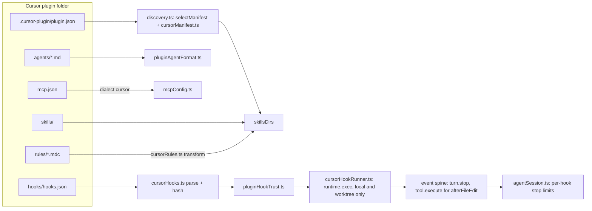

# Cursor Plugin Support in Xum

*   **Status:** Proposed

--------------------------------------------------------------------------------

## Overview

Xum loads plugins in three formats today: Agent Plugins (root `plugin.json`),
Codex (`.codex-plugin/plugin.json`) and Claude Code (`.claude-plugin/plugin.json`).
This design adds Cursor (`.cursor-plugin/plugin.json`) as a fourth format, plus
Cursor's marketplace file (`.cursor-plugin/marketplace.json`).

Xum does not run Cursor plugins as a separate system. It translates each Cursor
part into a part Xum already has: skills, agents, MCP servers and hooks. Rules
become skills. The user adds and installs Cursor plugins only from Xum's Plugins
tab, under the same install review and consent as other plugins.

One part is new. Cursor hooks are shell commands. Xum already starts a plugin's
stdio MCP servers as host processes, but it has never run a plugin's shell
command on a hook event. This design adds a host command runner for Cursor hooks on
Xum's existing hook points. It also turns Xum's fixed stop-hook continuation
limit into a per-hook limit with a per-turn ceiling.

### Terms

*   **Hook point**: a place in Xum's event spine
    (`src/node/services/events/eventSpine.ts`) where plugin hooks run:
    `tool.execute` around each tool call, `message.send` before a user message
    is sent, `compaction.prepare` before compaction, and `turn.stop` when a turn
    ends.
*   **Continuation**: a hook that asks Xum to start another model turn after a
    turn ends.
*   **User turn**: everything from one user message to the end of the turns it
    causes.
*   **Explore / Exec**: Xum's built-in read-only agent, and its default agent
    that can edit files.
*   **Install review**: the screen that lists what a plugin adds before the user
    installs or updates it.
*   **Fingerprint**: a hash of the fields shown in the install review. A changed
    fingerprint asks the user to review again.
*   **MCP dialect**: the `mcp.json` shape a plugin format uses (Codex, Claude,
    Cursor).
*   **Bug bash**: Xum's model-driven exploratory tests, which run with the
    `XUM_DISABLE_*` switches set.

## The Problem

A user who finds a plugin for Cursor cannot use it in Xum.

*   The official Cursor marketplace
    ([github.com/cursor/plugins](https://github.com/cursor/plugins), checked
    2026-10-30) lists 128 plugins: 17 from Cursor and 111 from third parties.
    Xum can read 2 of the 128 (`pstack` and `origin-apps`), because only those
    two also ship a manifest that Xum knows.
*   Discovery skips a folder whose only manifest is `.cursor-plugin/plugin.json`,
    with no message (`src/node/services/agentPlugins/discovery.ts:1236-1238`).
    A direct folder add offers a skills-only install
    (`installMethods.ts:309-313`), which loads the skills and nothing else. A
    marketplace add lists only the 2 plugins with a manifest Xum knows.
*   The plugins the user named need more than skills. `cursor-team-kit` ships
    18 skills (clone at `4dd1d05`, 2026-10-29), 2 agents (`thermo-nuclear-code-quality-review`, `ci-watcher`) and
    2 always-apply rules. `ralph-loop` and `advisor` need hooks that run and can
    continue a turn. 104 of the 111 third-party plugins declare MCP servers.
    All 104 point `mcpServers` to a `./mcp.json` file, and 102 of those servers
    are remote HTTP servers (for example `https://mcp.attio.com/mcp`). Most of
    them ask the user to sign in.
*   The named plugins: `cursor-team-kit` holds Cursor's own skills, review
    agents and rules. `ralph-loop` repeats a task until the reply contains a
    completion tag. `advisor` asks a second agent to review edits.
    `continual-learning` saves lessons from the transcript after each turn.
    `pstack` and `origin-apps` also ship an Agent Plugins manifest.

The workaround today is to ask each plugin author to add a second manifest. That
does not scale to 128 plugins, and it does nothing for rules, agent frontmatter
or hooks, which only the Cursor format describes.

The proposed solution: a Cursor reader that maps every Cursor part onto a Xum
part, a marketplace reader for the Plugins tab, and a hook runner that keeps
Xum's consent and safety rules. Parts with no Xum counterpart stay visible in
the install review as "not applied" and go into tracking issues.

## Goals

1.  **Marketplace install.** The user adds `https://github.com/cursor/plugins`
    in the Plugins tab, sees the plugins listed in its `marketplace.json`, and
    installs one of them.
2.  **Skills and rules.** Cursor skills load as Xum skills. Cursor commands are
    listed as not applied: no marketplace plugin ships one. Every rule file,
    always-apply rules included, loads as a skill under the skill consent that
    ships today. The install review labels a rule
    skill as "loaded on request in Xum", because Xum does not add it to every
    prompt.
3.  **Agents.** Cursor agents run as Xum sub-agents through the shipped mapping
    in `pluginAgentFormat.ts`. An agent with `model: fast` uses the model the
    user configured for Explore. With no Explore model configured, it uses the
    parent model, as today.
4.  **MCP servers.** Servers from the `mcp.json` file that the manifest's
    `mcpServers` names connect. Remote HTTP servers are the main case: 102 of
    the 104 marketplace servers. Xum also expands `${CURSOR_PLUGIN_ROOT}` and
    `${CLAUDE_PLUGIN_ROOT}` to the plugin's install folder in `command`, `args`,
    `env` and `cwd`, because the Cursor spec defines them. No marketplace
    `mcp.json` uses them today, so only a test fixture checks them.
5.  **Hooks.** After the user trusts a hook, Xum runs Cursor `command` hooks in
    local and worktree workspaces on the three events that marketplace plugins
    use and Xum can map: `afterAgentResponse` and `stop` on `turn.stop`, and
    `afterFileEdit` on `tool.execute`. Xum gives each hook the input fields and
    environment variables that Cursor documents, where Xum has the data.
6.  **Stop-loop limits.** Each stop hook has its own loop limit. A hook with no
    `loop_limit` uses Xum's one shared default of 3, whatever format it comes
    from. A number sets that hook's limit. `null` means no per-hook limit, but
    no hook can go past one Xum ceiling per user turn. Xum never continues a
    turn after a user Stop, an abort or an error.
7.  **Every part Xum does not apply is listed.** The install review and the plugin
    detail list every part, field and hook event that Xum does not apply.

Success means these checks pass. Tests 4 and 6 use fixtures. The rest use the
real marketplace:

1.  Install `cursor-team-kit`. Its 18 skills and 2 rule skills load, the
    install review labels both rules "loaded on request in Xum", and in a new
    chat the model loads a rule skill when the user asks for a code-quality
    review.
2.  `thermo-nuclear-code-quality-review` runs as a sub-agent.
3.  With an Explore model configured, `ci-watcher` runs on that model.
4.  A fixture copy of `ralph-loop` with `loop_limit: null` continues the turn
    until the reply contains its `<promise>` tag, then stops. A user Stop in
    the middle ends the current turn, and Xum adds no continuation. The loop
    stays active in the plugin's own state (`.cursor/ralph/`), so the next turn
    can resume it, and running the plugin's `cancel-ralph` skill ends it. The
    test checks the Stop and the cancel. The fixture changes only `hooks.json`, to
    `bash "${CURSOR_PLUGIN_ROOT}/hooks/<script>.sh"` (the change in the
    unmerged cursor/plugins PR #524, a ralph-loop path fix). Published ralph-loop runs its commands as
    written, which fails in Xum as in Cursor (D17).
5.  A remote HTTP MCP server from the marketplace with no `${...}`
    placeholders connects after the user signs in. The candidate is `attio`.
6.  A test fixture plugin with a stdio MCP server launched through
    `${CURSOR_PLUGIN_ROOT}` connects.
7.  The install review for `advisor` lists `subagentStop` as not applied.

## Non-Goals

1.  **Rules in the system prompt.** Always-apply rule injection and glob-based
    auto-attach are out of scope. Tracking issue T2.
2.  **Other hook events and matchers.** Tool, shell, MCP, prompt-submit and
    compaction events (`preToolUse`, `beforeShellExecution`,
    `beforeMCPExecution`, `postToolUse`, `afterShellExecution`,
    `afterMCPExecution`, `beforeSubmitPrompt`, `preCompact`), events with no
    Xum hook point (`sessionStart`, `sessionEnd`, `subagentStart`,
    `subagentStop`, `afterAgentThought`, the Tab hooks, `workspaceOpen`),
    prompt-type hooks and hook matchers stay inert and listed. Tracking issue
    T1.
3.  **A small-model table per provider** for `model: fast` when no Explore
    model is configured. Tracking issue T3.
4.  **`readonly` deny-at-execution** (all tools in the request, writes denied
    when they run). Tracking issue T4.
5.  **A Cursor-only default loop limit.** Raising the shared default from 3 to
    5 for every hook source is a separate discussion. Tracking issue T5.
6.  **Plugins that Cursor installed on disk** (for example under `~/.cursor`).
    Xum loads only plugins added from its own Plugins tab.
7.  **Cursor `variables`** (user-supplied values for MCP servers). Listed as
    not applied.
8.  **Hooks in remote workspaces** (SSH, Docker, devcontainer). Tracking issue
    T6.
9.  **`is_background`** as a background default. Listed as not applied.
    Tracking issue T7.
10. **The Cursor MCP `auth` block.** Listed as not applied. Tracking issue T8.
11. **Cursor commands.** Listed as not applied. Tracking issue T9.

## Open Questions

The owner (@ThomasK33) decided D1-D21. The Decisions table under Technical
Plan lists each one. Open item:

1.  The text of D6, and a confirmation of D3 (see the Decisions table). Owner:
    @ThomasK33.

## Critical User Journeys (CUJs)

### CUJ 1: Install a Cursor plugin from the Cursor marketplace

*   **Given**: Agent Plugins are enabled in Xum, and the user has not added any
    Cursor marketplace.
*   **When**: The user opens the Plugins tab, adds
    `https://github.com/cursor/plugins`, picks `cursor-team-kit` and confirms
    the install review.
*   **Then**: The install review lists 18 skills, 2 rule skills labeled "loaded
    on request in Xum", 2 agents, and no hooks or MCP servers. After install, a
    new chat can load the skills and spawn both agents.

### CUJ 2: Run a Cursor agent on a small model

*   **Given**: `cursor-team-kit` is installed, and the user set a model for the
    Explore agent in Settings.
*   **When**: The parent agent spawns `ci-watcher`, which declares
    `model: fast`.
*   **Then**: `ci-watcher` runs on the Explore model. The sub-agent header shows
    the model and where it came from. If the user clears the Explore model, the
    next spawn uses the parent model.

### CUJ 3: Loop a turn with a stop hook

*   **Given**: The fixture copy of `ralph-loop` (hook commands in the
    `${CURSOR_PLUGIN_ROOT}` form) is installed, its two hooks are trusted, and
    the user starts a loop with a completion promise.
*   **When**: Each turn ends.
*   **Then**: Xum runs `afterAgentResponse`, then `stop`. While the reply has no
    `<promise>` tag, the stop hook continues the turn, and the chat shows
    "plugin continued turn n of 50". When the tag appears, the loop ends. If the
    user presses Stop, the current turn ends and Xum adds no continuation. The
    loop stays active in the plugin's state (`.cursor/ralph/`), so the end of
    the next turn can resume it, because ralph's stop hook does not read
    `status`. The user ends the loop with the plugin's `cancel-ralph` skill,
    which deletes that state.

### CUJ 4: Connect a remote MCP server from a Cursor plugin

*   **Given**: The user installs a third-party plugin from the Cursor
    marketplace whose `mcp.json` names a remote HTTP server with no `${...}`
    placeholders (for example `attio`).
*   **When**: The user enables the server, signs in when Xum asks, and a chat
    calls one of its tools.
*   **Then**: The tool call returns a result. A plugin whose `mcp.json` needs
    user values (`${XERO_CLIENT_ID}`, `${BREVO_MCP_TOKEN}`) shows those servers as
    "needs values not supported in Xum" instead of failing to connect.

### CUJ 4b: Launch a local MCP server through `${CURSOR_PLUGIN_ROOT}`

*   **Given**: A test fixture plugin ships a stdio server whose `command` or
    `args` use `${CURSOR_PLUGIN_ROOT}`.
*   **When**: The user installs the fixture and enables the server.
*   **Then**: Xum starts the server from the plugin's install folder, and a tool
    call returns a result.

### CUJ 5: See what Xum does not apply

*   **Given**: The user previews `advisor` in the Plugins tab.
*   **When**: The install review opens.
*   **Then**: It lists `subagentStop` as "not applied in Xum", next to the hooks
    that will run. The user can install the plugin knowing which part will not
    work.

## Technical Plan (Architecture)

This plan was written against Xum `3d3a4cf2d8`. Line numbers are from that
commit. Lines that the 2026-10-30 review found moved were corrected against
`0f82063e7e`. Each owner decision is
marked "(Dn)" at the step it changes.

### Decisions

| ID | Decision | Section |
| --- | --- | --- |
| D1 | Hook trust hashes the `hooks.json` entry. The update review lists every changed file of a plugin with a runnable Cursor command hook. A local edit on disk outside an update is an accepted risk. | 5.1 |
| D2 | A ceiling of 50 continuations per user turn for all hooks. | 6 |
| D3 | One shared default stop-loop limit of 3 for every hook source. (Inferred from Alternative Y and section 8. Owner to confirm.) | 6 |
| D4 | Continuations count per user turn, for every hook source. | 6 |
| D5 | After a user Stop or an error, Xum runs no stop hook. | 6 |
| D6 | Not recorded in this RFC. Owner to supply. | - |
| D7 | Cursor command hooks run in local and worktree workspaces only. Remote workspaces list them as "does not run in remote workspaces" (T6). | 5.1, 5.6 |
| D8 | Cursor hooks follow Cursor's documented failure rule. Codex hooks keep the shipped rule. | 5.5 |
| D9 | Only `afterFileEdit`, `afterAgentResponse` and `stop` run. Tool, message and compaction events and matchers are listed (T1). | 5.2, 5.3 |
| D10 | `beforeReadFile` and `postToolUseFailure` are not applied (T1). | 5.2 |
| D11 | `model: fast` agents use Explore as their AI settings base. | 7 |
| D12 | `is_background` is listed as not applied (T7). | 7 |
| D13 | `readonly` agents get Explore's prompt before their own body. | 7 |
| D14 | Rule skills use the shipped skill consent. | 2 |
| D15 | Hooks run through `runtime.exec` on every platform (Git Bash on Windows). | 5.4 |
| D16 | Hooks use the shared timeout rule (10 s default, 30 s cap). | 5.4 |
| D17 | A hook `command` runs as written. Xum does not rewrite a leading `./`. | 5.4 |
| D18 | `CURSOR_VERSION` is `xum-<version>`. The transcript path points to the workspace's `chat.jsonl`. | 5.4 |
| D19 | The Cursor `auth` block is listed as not applied (T8). | 4 |
| D20 | A repository with both marketplace files shows one merged list. | 3 |
| D21 | A schema-less root `plugin.json` yields to a Cursor manifest, as it yields to Codex and Claude. | 1 |

After the Goldfish review, the owner changed D1, D5, D7, D8, D9, D12 and D19
and added D21 (2026-10-31). Commands are not applied, and the Codex failure rule
is unchanged.

### Shape of the change

Xum treats a Cursor plugin as one more source format. Every part is translated
into a part Xum already has, at the points where the Claude format is
translated today. Only the hook runner adds new behavior.

### 1. Manifest reader

*   `selectManifest` (`discovery.ts:1178-1203`) gains
    `.cursor-plugin/plugin.json` as the **last** candidate, after root
    `plugin.json`, Codex and Claude (D21). A schema-less root `plugin.json`
    (no `$schema`) yields to the Cursor manifest, as it yields to Codex and
    Claude (`discovery.ts:1170-1177`). A root `plugin.json` with `$schema` keeps
    loading first, so `pstack` and `origin-apps` are unchanged. A folder with
    only a schema-less root and a Cursor manifest switches to the Cursor
    manifest. No marketplace plugin ships such a folder.
*   A new `cursorFallback` gate sits beside `codexFallback` and
    `claudeFallback` (`discovery.ts:1248-1249`). A Cursor package counts as
    `foreign` in `xumComponentGate` (`discovery.ts:1118-1124`), so Xum-only
    parts (`hooks.js`, `workflows/`) in a Cursor folder never run.
*   A new `cursorManifest.ts` normalizes the manifest, modeled on
    `normalizeClaudeManifest` (`claudeManifest.ts:298`).
*   Cursor rule
    ([reference/plugins.md](https://cursor.com/docs/reference/plugins.md)): a
    manifest path replaces folder discovery for that component. Each path is
    contained in the plugin folder, as for Claude. A path outside the folder, or
    a glob that matches nothing, is listed as not applied.

| Cursor field | Xum field | Rule |
| --- | --- | --- |
| `name`, `displayName`, `version`, `description`, `author`, `homepage`, `repository`, `license`, `keywords`, `logo` | plugin metadata | Same handling as Claude. `logo` uses the existing logo path checks. |
| `skills` (string or list of paths or globs) | `skillsDirs` | Replaces the default `skills/` scan, as Cursor does. Without the field, Xum scans `skills/`. |
| `commands` (string or list) | none | Listed as not applied (T9). No marketplace plugin names `commands` or ships a `commands/` folder. |
| `rules` (string or list of paths or globs) | `skillsDirs` with `{rule: true}` | Replaces the default `rules/` scan. Files `.md`, `.mdc`, `.markdown`. See section 2. |
| `agents` (string or list of paths or globs) | `agentsDir` and agent files | Replaces the default `agents/` scan. Files `.md`, `.mdc`, `.markdown`. Each path or glob resolves to files inside the plugin folder. |
| `mcpServers` (string) | `mcpConfigPath`, dialect `cursor` | See section 4. An inline object or list is not applied and listed, as for Claude (`claudeManifest.ts:166-181`). No marketplace plugin uses that form. |
| `hooks` (string or inline object) | `cursor.hooks` | See section 5. |
| `variables`, `category`, `tags`, `publisher`, `clientVersionRequirement`, `minClientVersions` | none | Listed as not applied (Goal 7). |

### 2. Rules as skills

*   A new `cursorRules.ts` turns each rule file (`.md`, `.mdc`, `.markdown`)
    into SKILL.md text when Xum
    reads it, the way `claudeCommands.ts` turns a command into a skill. Nothing
    new is written to disk.
*   The skill name is the file name without `.mdc`. If a real skill in the same
    plugin has that name, the skill wins and the rule is listed as not applied.
*   Rule types map as follows:

| Rule frontmatter | Skill | Install review label |
| --- | --- | --- |
| `alwaysApply: true` | model-invocable, description from `description` | "always-apply rule, loaded on request in Xum" |
| `description` only | model-invocable | "rule" |
| `globs` set | model-invocable, globs added to the description | "glob rule, not attached by file in Xum" |
| none of the three | user-invocable only (`disable-model-invocation`) | "manual rule" |

*   Precedence: `alwaysApply: true` wins over `globs`, and `globs` wins over
    `description` only.

*   Rule consent (D14): the shipped skill
    consent. It fingerprints the converted frontmatter (name, description, the
    rule-type label, the user-only flag for manual rules) and any directive
    lines in the body (#6617 skill body consent, and its fix PR #6763). Prose edits load after an update
    without a new review, as for skills. The consent site must fingerprint the
    fields the conversion produces, so a change to `alwaysApply` or `globs`
    that changes the label asks for review.

### 3. Marketplace and install

*   A Cursor marketplace path constant sits beside
    `CLAUDE_MARKETPLACE_RELATIVE_PATH` (`claudeMarketplace.ts:33`). The Claude
    parser, its 8 MiB cap and its 500-entry cap (`claudeMarketplace.ts:38-40`)
    are reused. The Cursor file has 128 entries, so the cap holds.
*   `marketplaceListingAt` (`installService.ts:3542`), which `previewSource`
    (`:3494`) calls, reads both marketplace
    files when both exist, and shows one merged list (D20). `cursor/plugins` ships both: the Claude file lists 2 entries
    (`origin-apps`, and `pstack` at `./harness/pstack/claude-code`), the Cursor
    file lists 128 (`pstack` at `./pstack`).
    *   A name in only one file shows once, with that file's install method.
    *   A name in both files shows once, with two install methods: "Claude
        build" and "Cursor build". The user picks one in the install review.
        This reuses the multiple-methods-per-entry rule
        (`entryInstallMethods`, `installMethods.ts:496-530`).
    *   Same-name guard: install folders are named after the plugin
        (`targetPathFor(entry.name)`), so only one build of a name can be
        installed. A second install of the same name is refused until the user
        uninstalls the first. Xum reuses `collisionReason`
        (`installService.ts:3791-3800`): "A managed plugin named '<name>' is
        already installed. Uninstall it first."
    *   Updates stay on the source file. The `generatedFrom` marker records
        which file an install came from, and the update path reads the entry
        again from that file (`installService.ts:6378-6383`). An install made
        through the Claude file keeps updating from the Claude file after this
        change.
    *   Merged-list caps: each file keeps its own 8 MiB and 500-entry cap. The
        merged list has at most 1000 entries.
*   A new install-method kind (`cursor-marketplace`) joins
    `detectInstallMethods` (`installMethods.ts:299-316`). The generated
    manifest marker follows the `claude-marketplace` pattern
    (`installMethods.ts:658-709`), including the downgrade-safe
    `INERT_COMPONENT_PATH` (`manifest.ts:276`) for parts an older Xum build
    must not load.
*   The install review shows every not-applied part, field and hook event. The
    preview schema gains one list for them (`common/orpc/schemas/agentPlugins.ts`).

### 4. MCP servers

*   A new MCP dialect `cursor` joins `claude` (`discovery.ts:988-1005`,
    `:1354`).
*   The ternary in `pluginPlaceholderValues` (`mcpConfig.ts:366-375`) becomes a
    per-dialect table. The `cursor` dialect expands `CURSOR_PLUGIN_ROOT` and
    `CLAUDE_PLUGIN_ROOT` to the install folder. The `${CLAUDE_PLUGIN_ROOT}/<path>`
    rewrite to `./<path>` (`mcpConfig.ts:346-363`) applies to both names.
*   Any other `${NAME}` placeholder (user values such as `${CLIENT_ID}`) in
    `command`, `args`, `env`, `cwd`, `url` or `headers`, including
    `${NAME:-default}`, gives that server the status "needs values not
    supported in Xum". Xum lists the server, does not start it and does not read
    the value from the environment. This status is new code. Cursor `variables` are a
    non-goal.
*   Remote HTTP servers go through the existing plugin MCP path, with its
    https rule for auth URLs.
*   The Cursor `auth` block (D19) is not applied. Xum ignores it, lists "auth
    not applied in Xum" on the server, and connects the server through the
    existing plugin MCP path. Sign-in then works only with a provider that
    supports dynamic client registration. 14 marketplace servers have an `auth`
    block: 4 with a fixed client ID (`x`, `x-ads`, `meta-ads`, `gopuff`) and 10
    with a placeholder. Translating the block is tracking issue T8.

### 5. Hooks

#### 5.1 Parse, list and trust

*   A new `cursorHooks.ts` parses Cursor `hooks.json`:
    `{version: 1, hooks: {<event>: [{command, type?, matcher?, timeout?,
    loop_limit?, failClosed?}]}}`, from `hooks/hooks.json` or the manifest's
    `hooks` value. Invalid entries drop with a warning, as in `codexHooks.ts`.
*   Schema: `PluginHookHandlerSchema`
    (`src/common/orpc/schemas/agentPlugins.ts:57-72`) gains a variant
    `{type: "cursor-command", command: string, timeoutSeconds?: number,
    loopLimit?: number | null, failClosed?: boolean}`. `AgentPluginHookSchema`
    is unchanged. The trust hash stays `hashHookDefinition` over the event, the
    matcher and the handler entry as declared, so a change to `command`,
    `timeout`, `loop_limit` or `failClosed` asks for trust again. `runnable`
    now also means a `cursor-command` handler on a mapped event.
*   Loader: the Codex loader (`loadPluginCodexHooks`, `codexHooks.ts:171`)
    returns no hooks for a Cursor package, so only `cursorHooks.ts` reads its
    `hooks/hooks.json`. Trust keys use the source `cursor:hooks/hooks.json`, so
    they cannot collide with Codex keys.
*   Each hook gets a status from the existing enum
    (`common/orpc/schemas/agentPlugins.ts:79-84`): `runnable` for a mapped
    event with a `command` handler and no `matcher`, `ignored-event` for an
    unmapped event or a hook with a `matcher` (D9), `unsupported-handler` for
    `type: "prompt"`.
*   Trust reuses `pluginHookTrust.ts` (`{hash, state}` per hook) and today's
    hash, `hashHookDefinition` (`codexHooks.ts:696-699`): the event, the
    matcher and the handler entry exactly as declared (D1). The hash covers the
    `hooks.json` entry only, not the scripts that the command runs.
*   Update review of hook scripts (D1): for a plugin with at least one runnable
    Cursor command hook, the update review lists every file that the update
    adds, removes or changes, outside the parts it already reviews (skills,
    rules, agents, workflows). It compares the per-file records that
    `hashPluginTree` (`treeHash.ts:12-97`) already builds for the installed
    tree and the staged tree: path, mode and content hash. A text file shows
    its before and after text. Any other file shows "changed". The review keeps
    its size cap (`assertReviewFits`, `installService.ts:586-597`). This runs
    once per update, not on each hook run.
    *   Accepted risk: a script edited on disk after install, outside an update
        (`stop-hook.sh`, the `lib.sh` it sources, a `bun` import), runs on the
        host with no new review.
    *   Reason for accepting it: anything that can write a plugin folder under
        the Xum home can also change Xum's config and the hook trust file, so a
        check before each run does not stop that attacker. The check also costs a
        folder walk on every hook run.
    *   Rejected: hashing the whole plugin folder before each run, and hashing
        each script a command names. See Alternatives Considered.
*   Kill switches: the runner refuses to start any hook process when
    `XUM_DISABLE_AGENT_TOOLS` (`utils/agentToolsDisabled.ts:16-18`),
    `XUM_DISABLE_TERMINALS` (`terminalService.ts:75-76`) or
    `XUM_DISABLE_PROJECT_AUTOMATION` (`utils/projectAutomation.ts:18-23`) is
    set. AGENTS.md requires that model-driven bug-bash runs never reach a host
    shell.
*   Remote workspaces (D7): Cursor command hooks do not run in SSH, Docker or
    devcontainer workspaces, as for all plugin hooks today
    (`remoteProjectPlugins.ts:1-16`, #7218: remote plugins load skills and
    agents only). See 5.6.

#### 5.2 Event mapping

| Cursor event | Xum point | Phase | Can block or change |
| --- | --- | --- | --- |
| `afterFileEdit` | `tool.execute` (the file edit tools: `file_edit_replace_string`, `file_edit_replace_lines`, `file_edit_insert`) | after | none |
| `afterAgentResponse` | `turn.stop` | first | none |
| `stop` | `turn.stop` | after `afterAgentResponse` | `followup_message` |
| `preToolUse`, `beforeShellExecution`, `beforeMCPExecution`, `postToolUse`, `afterShellExecution`, `afterMCPExecution`, `beforeSubmitPrompt`, `preCompact` | none in this version (D9) | | listed as not applied (T1) |
| `beforeReadFile`, `postToolUseFailure` | none (D10) | | listed as not applied (T1) |
| all other events | none | | listed as not applied (T1) |

*   Reason for the short list (D9): the three hook plugins in the marketplace
    use only `afterFileEdit`, `afterAgentResponse`, `stop` and `subagentStop`.
    No marketplace plugin uses a tool, message or compaction event.
*   Matchers (D9): a hook with a `matcher` does not run. Its status is
    `ignored-event`, and the install review lists it as "matcher not applied in
    Xum". No marketplace hook sets a matcher on the three mapped events.

#### 5.3 Tool names for matchers (not in this version)

Matchers are not applied (D9), so this version has no Cursor-to-Xum tool-name
table. The table (`Shell`, `Read`, `Write`, `Task`, `MCP:<tool>`) comes with the
tool events in T1.

#### 5.4 The runner

*   A new `cursorHookRunner.ts` registers on the spine beside the Codex runner
    (`codexHookService.ts:94-125`). It shares these parts with the Codex runner:
    the per-call trust check (`isHookAllowed`, `codexHookService.ts:215-218`),
    the project-trust gate, spine registration and order, and the chat notice
    route (`deps.notifyUser`, `plugin.hook.notice`). New code covers only the
    process start, the environment, the input JSON and the failure table (5.5).
*   It starts one process per hook call through the workspace runtime's
    `exec`, with the hook input as JSON on stdin and JSON read from stdout. In
    local and worktree workspaces `exec` starts a host process. Remote
    workspaces run no Cursor hooks (5.6). Today plugin code starts two kinds of
    processes: the install-time `git` call (`installService.ts:1031`) and
    plugin stdio MCP servers (`prepareStdioLaunch`,
    `mcpServerManager.ts:1026-1036`, with `hostEnv: "minimal"`). This runner is
    the first to run a plugin command on a hook event. It builds its
    environment with the same minimal-environment option.
*   `CURSOR_PLUGIN_ROOT` is the install folder. Xum never sets
    `CURSOR_CODE_REMOTE`, because Cursor hooks do not run in remote workspaces.
*   Exit code 127 (command not found) is logged and shown once per workspace
    as "`<command>` not found in this workspace". A machine without `jq` or
    `bun` gives this result.
*   Shell (D15): `runtime.exec` on every
    platform. On Windows, local `exec` runs through Git Bash (`getBashPath`,
    `LocalBaseRuntime.ts:250`, `:631`), so there is no Windows-only path. A
    hook written in PowerShell syntax fails, which is logged with the exit
    code. No marketplace hook uses PowerShell.
*   Timeout (D16): the shared rule,
    `effectiveHookTimeoutSeconds` (`src/constants/pluginHooks.ts:2-7`): a
    declared `timeout` in seconds, else 10 s, capped at 30 s, the same as Codex
    hooks. A timeout counts as a crash under the failure rules (5.5). A user
    Stop kills the process group.
*   Working folder: the plugin folder, except `stop` (and, later,
    `subagentStop`), which run from the workspace root, as Cursor documents.
*   `command` runs as written (D17). Xum does not
    rewrite a leading `./`. A `./hooks/x.sh` in a `stop` hook therefore looks
    in the workspace root, is not found (exit 127), counts as a crash under the
    failure rules (5.5), and shows "`./hooks/x.sh` not found in this
    workspace" once. This matches Cursor's real behavior (cursor/plugins
    PR #315, advisor hook paths). Published ralph-loop is affected: its
    `afterAgentResponse` hook runs (it runs from the plugin folder), but its
    `stop` hook is not found, so the loop never continues, as in Cursor.
*   Environment: a minimal set, not Xum's full environment. Cursor documents
    each variable below in the "Environment Variables" table of
    [hooks.md](https://cursor.com/docs/hooks.md).
    `CURSOR_PROJECT_DIR` and `CLAUDE_PROJECT_DIR` are the workspace root.
    `CURSOR_PLUGIN_ROOT` is the plugin folder. `PATH` and `HOME` pass through.
    `CURSOR_USER_EMAIL` is never set.
*   `CURSOR_VERSION` and the transcript (D18):
    *   `CURSOR_VERSION` is `xum-<version>`. A hook that parses it as a Cursor
        version fails visibly instead of trusting a fake one. No marketplace
        hook reads it today.
    *   `transcript_path` (input) and `CURSOR_TRANSCRIPT_PATH` (environment)
        point to the workspace's `~/.xum/sessions/<workspace>/chat.jsonl`.
    *   Reason: continual-learning triggers only when `transcript_path` is set
        and its modification time advanced
        (`continual-learning-stop.ts:210-219`). Advisor forwards it to its
        consult agent (`lib.sh:55-58`).
    *   Known gap: `chat.jsonl` is JSON Lines, not Cursor's transcript format.
        A plugin agent that parses the transcript reads a format it was not
        written for.
*   Input fields: the common fields Xum can fill (`conversation_id` = workspace
    ID, `generation_id` = turn ID, `model`, `hook_event_name`,
    `cursor_version`, `workspace_roots`) plus each event's own fields.
    `user_email` is `null`. `transcript_path` follows D18.
    *   `afterAgentResponse`: `text` is the full text of the final reply, every
        text part of the last assistant message, cut to its **last**
        16 × 1024 characters (`TURN_STOP_TEXT_MAX_CHARS`). Text parts join with
        `\n`, and the cut keeps whole UTF-16 surrogate pairs. Today
        `lastAssistantText` keeps the trailing text run only, returns `null`
        when the turn ends on a tool call, and keeps the **first** 16 × 1024
        characters (`promptHooks.ts:128`, `:173-181`). A completion promise
        sits at the end of a reply, so the first 16 × 1024 characters can miss
        it.
    *   `stop`: `status` is `"completed"` (D5: no stop hook runs after a user
        Stop or an error) and `loop_count` follows section 6.
    *   `afterFileEdit`: `file_path` (absolute) and `edits`, one
        `{old_string, new_string}` entry per edit. `old_string` is the text the
        edit replaced (empty for an insert) and `new_string` the text it wrote.
        PR 7 reads both from the edit tool's input and result.
*   Exit codes and bad output: see 5.5.

#### 5.5 Failure rules for Cursor hooks (D8)

Cursor hooks follow Cursor's documented rule
([hooks.md](https://cursor.com/docs/hooks.md), "Exit code behavior"). Codex
hooks keep the shipped rule: every failure lets the call through
(`codexHookRunner.ts:10-15`). This RFC does not change Codex hooks.

No event in this version is a Cursor permission hook (5.2), so no hook failure
blocks anything.

| Result | `afterFileEdit`, `afterAgentResponse`, `stop` |
| --- | --- |
| Exit 0 with valid output, or with empty stdout | apply the output (`followup_message` for `stop`) |
| Exit 0 with invalid JSON, or output that fails the event's schema | ignore the output, warn |
| Exit 2, or `permission: "deny"` | ignore (these events cannot block), warn |
| Crash, timeout, other non-zero exit, command not found | ignore, warn |
| Input too large (over `HOOK_INPUT_MAX_CHARS`, 64 × 1024 characters, `codexHookRunner.ts:47`) | skip the call, warn |
| Xum cannot read its own trust store | skip the call, warn. This is Xum's failure, not the hook's. |

*   Output schemas: `stop` accepts `{followup_message?: string}`.
    `afterAgentResponse` and `afterFileEdit` have no output fields, so Xum
    ignores their stdout after the JSON check. Unknown fields are ignored.
*   "Warn" means: Xum logs the failure and shows it on the hook's row in the
    hooks panel. A 127 also shows the one-time chat notice (5.4).
*   `failClosed` has no effect on these events, as in Cursor. It is parsed and
    hashed, so a change to it asks for trust again. When T1 adds permission
    hooks, they follow Cursor's rule: invalid JSON or schema-failing output
    blocks, and other failures block only with `failClosed: true`.

#### 5.6 Remote workspaces (not in this version)

Cursor hooks do not run in SSH, Docker or devcontainer workspaces (D7), as for
all plugin hooks today. The install review and the hooks panel show "does not
run in remote workspaces" for each Cursor hook. Running them there needs a copy
of the plugin inside the workspace (Alternative M) and is tracked in T6.

### 6. Stop-loop limits

*   Today one counter (`agentSession.ts:1646`) and one cap
    (`MAX_STOP_HOOK_CONTINUATIONS = 3`, `:706`, checked at `:10810`) cover every
    stop-hook continuation in a user turn.
*   New rule, one code path for every hook source:
    1.  Each continuation reason carries the hook that produced it.
    2.  A hook with no `loop_limit` uses the shared default (3). A number sets
        that hook's limit. `null` sets no per-hook limit.
    3.  A per-user-turn ceiling of 50 stops all continuations, whatever the
        hooks say (D2). It is one
        constant beside `MAX_STOP_HOOK_CONTINUATIONS`. Reaching it pauses the
        loop: the next user message starts a new user turn, and the hooks can
        continue again.
    4.  The chat shows "plugin continued turn n of 50" for each continuation.
*   Counting scope (D4): per user turn, for
    every hook source, as today. Each hook's count and the 50 ceiling reset
    when a user turn starts, and stay in memory. `loop_count` in the hook input
    is that hook's own count in the current user turn.
    *   Reason: Cursor's own plugins expect this, although Cursor's docs say
        "for this conversation". Continual-learning counts a stop as a user
        turn only when `loop_count === 0` (`continual-learning-stop.ts:137-139`),
        and advisor expects to nudge again after the user answers
        (`stop-hook.sh:32-37`). Both break if the count never resets.
    *   Codex hooks keep their shipped behavior: 3 continuations per user
        turn.
    *   Xum's own nudges keep their check: they run only when no hook
        continued the current user turn.
*   A user Stop or abort already skips `turn.stop` (`handleTurnAbort`, called
    at `agentSession.ts:1590`, defined at `:10288`), so no continuation follows
    a Stop today.
*   After a user Stop or an error, Xum runs no Cursor hook (D5). Cursor would
    call `stop` with `status: "aborted"` or `"error"`. No marketplace plugin
    needs it: advisor and continual-learning exit early on those values, and
    ralph ignores `status`.
*   Xum's own TODO and status nudges keep their rule: they run only when no
    hook has continued the turn (`agentSession.ts:10874-10881`).

### 7. Agents

*   The shipped mapping in `pluginAgentFormat.ts` stays: no `readonly` maps to
    Exec, `readonly: true` maps to Explore (`:347`).
*   `model: fast` (D11): a `fast` agent
    resolves its AI settings, model and thinking level, as if its base were
    Explore. Its tools stay those of its real base (Exec, or Explore when
    `readonly: true`).
    *   Today `mapModel` (`pluginAgentFormat.ts:297-303`) finds no `fast` alias,
        and the agent takes the Exec model from Settings, then the parent model.
        The parent chat's Exec choice is skipped for Exec-derived agents on
        purpose (`src/common/utils/ai/resolveAgentAiSettings.ts:99-111`).
    *   Mechanism: the Cursor mapping writes a new optional Xum frontmatter
        field, `ai.settingsBase: "explore"`, for `model: fast`. When it is set,
        `collectDefinitionLayers`
        (`src/node/services/agentDefinitions/resolveNodeAgentAiSettings.ts:102`)
        walks the chain from that ID instead of `base`, for AI settings only. It
        calls `resolveAgentInheritanceChain` with the `ai.settingsBase` ID as the
        start of the chain. `loadAgentDefinitionAiLayers` (`:145`) is unchanged.
        Tool policy still follows `base`.
    *   New lookup order for a `fast` agent: its own saved choice, its own
        Settings entry, its own frontmatter defaults, then Explore's Settings
        (Delegated override, then base entry) and Explore's definition, then
        the parent model, then fallbacks.
    *   The built-in Explore agent sets no model (`src/node/builtinAgents/explore.md`).
        With no Explore model in Settings, a `fast` agent falls through to the
        parent model, as today.
    *   Consent: the mapped frontmatter is fingerprinted
        (`pluginAgentFormat.ts:361-362`), so each installed `fast` agent asks
        for consent once after the update that ships this field.
    *   Downgrade: an older Xum build ignores `ai.settingsBase` and resolves as
        today. A schema fixture covers this.
    *   The sub-agent header names the source: "model from Explore settings".
    *   `model: inherit` and every other `model` value keep today's behavior.
*   `is_background` (D12): not applied. The shipped mapping already ignores it
    (`pluginAgentFormat.ts:366-367`): the parent chooses `run_in_background`
    for each spawn. The install review lists "`is_background` not applied in
    Xum" for each agent that sets it (4 marketplace agent files). A background
    default is tracking issue T7.
*   `readonly` agent prompt (D13): for
    `readonly: true` agents only, the mapping sets `prompt.append: true`
    instead of `false` (`pluginAgentFormat.ts:340-372`). The model sees the
    body of `src/node/builtinAgents/explore.md` (leave the checkout unchanged,
    no writes through redirects or `tee`, no `rm`/`mv`/installs, check
    `git status` after verification) before the plugin's own body.
    *   Agents without `readonly` keep `append: false`. Their body is the whole
        prompt, as in Cursor and Claude Code.
    *   The mapped frontmatter changes, so each installed `readonly` agent asks
        for consent once after this update.
    *   Known conflict: a plugin body that asks a `readonly` agent to write a
        file gets two conflicting orders. Checked 2026-10-30: none of the 6
        marketplace `readonly` agents asks to write, save or create a file.
    *   A later edit of `explore.md` reaches every `readonly` plugin agent.

### 8. Changes to shipped behavior

These change what Xum does today for users who never install a Cursor plugin.
Each one needs a line in the release notes.

| Change | Who sees it | Decision |
| --- | --- | --- |
| Adding a repository with both marketplace files shows one merged list. `cursor/plugins` goes from 2 entries to 128. | Users of the Plugins tab | D20 |
| A folder with a schema-less root `plugin.json` and a Cursor manifest loads the Cursor manifest. | Users with such a folder (none in the marketplace) | D21 |
| The `afterAgentResponse` and turn-stop text passed to hooks is the last 16 × 1024 characters of the full final reply. Codex `Stop` hooks receive the same text. | Users of Codex `Stop` hooks | Mechanical (5.4) |
| Stop-hook continuations are counted per hook with a ceiling of 50 per user turn. Hooks without `loop_limit`, all Codex hooks included, keep 3 per user turn. | No visible change for existing hooks | D2, D3, D4 |

## Risks & Mitigations

| Risk | Failure mode | Mitigation | Owner |
| --- | --- | --- | --- |
| Hook scripts run on the host | A script changed by an upstream update, or by a local edit, runs on the host. | The update review lists every changed file (5.1). A local edit outside an update is an accepted risk. | D1 |
| Cost of stop loops | A `loop_limit: null` hook continues up to 50 paid turns per user message. After a user Stop the loop stays active (CUJ 3), so each later message can spend up to 50 more until the plugin ends it. | The ceiling of 50, the chat notice on each continuation, and the user Stop. | D2, D4 |
| Hook process load | One process per hook call. Matching hooks run in sequence (`codexHookRunner.ts:17-19`), and each call is capped at 30 s. | The shared timeout rule. The kill switches stop all hook processes. | D16 |
| A broken hook fails quietly | A crashed or misconfigured hook does nothing. | The hooks panel shows the failure on the hook's row, and a 127 shows a one-time chat notice (5.5). | D8 |
| Sign-in fails for servers with an `auth` block | A provider without dynamic client registration rejects sign-in. | The server shows "auth not applied in Xum" (section 4). | D19 |
| Transcript format | `chat.jsonl` is not Cursor's transcript format. | Known gap. No marketplace plugin parses the format. | D18 |
| `readonly` conflict | A plugin body that asks a `readonly` agent to write gets two conflicting orders. | None of the 6 marketplace agents asks to write. | D13 |

## Alternatives Considered

Sources: options the owner rejected while drafting. Each entry gives its reason
and names the decision that rejected it.

### Scope

#### Alternative A: Ask plugin authors to add a root `plugin.json`

*   **Pros**: Xum loads Agent Plugins today, and Cursor loads them too, so no
    Xum code is needed.
*   **Cons**: 126 of the 128 marketplace plugins would each need a change from
    their author. The root format has no rules, agent frontmatter or hooks. A
    skills-only install already works for folder adds, but it loads no rules,
    agents, MCP servers or hooks.
*   **Reason for Rejection**: 126 authors would each need to ship a change, and
    the root format cannot express rules, agent frontmatter or hooks.

#### Alternative B: Keep Cursor command hooks inert, as Claude hooks are

*   **Pros**: No new code that runs plugin commands. Same rule as Claude and
    Codex `command` hooks today.
*   **Cons**: ralph-loop, advisor and continual-learning do nothing.
*   **Reason for Rejection**: The three hook plugins in the marketplace would do
    nothing, and they are the reason for this RFC.

#### Alternative C: Rules in the system prompt now

*   **Pros**: Always-apply rules would behave as in Cursor.
*   **Cons**: Needs a new rules component, consent on the exact text, an order
    against `AGENTS.md`, a token budget, and cache churn on every rule change.
*   **Reason for Rejection**: Deferred to tracking issue T2. Rules load as
    skills instead, which needs no new component.

#### Alternative D: Drop rules from the first version

*   **Pros**: Less code.
*   **Cons**: `cursor-team-kit`'s two rules would not load at all.
*   **Reason for Rejection**: Loading them as skills costs one read-time
    transform and keeps them usable.

### Marketplace

#### Alternative E: The Cursor marketplace file wins over the Claude file

*   **Pros**: One file per repository, simple to explain. `cursor/plugins` lists
    128 entries.
*   **Cons**: A plugin listed only in the Claude file disappears.
*   **Reason for Rejection**: D20 merges both lists, so nothing disappears.

#### Alternative F: The Claude marketplace file wins, as today

*   **Pros**: No change for existing users.
*   **Cons**: `cursor/plugins` keeps listing 2 plugins. Success test 1 fails.
*   **Reason for Rejection**: D20.

#### Alternative G: An `origin` discriminant instead of a fourth boolean gate

*   **Pros**: Replaces `codexFallback`, `claudeFallback` and a new
    `cursorFallback` with one field. Fewer gate combinations to test.
*   **Cons**: A refactor of `discovery.ts` (1985 lines) before any Cursor code
    lands, with no user-visible change.
*   **Reason for Rejection**: Not needed for this feature. The plan adds
    `cursorFallback` beside the existing gates. The refactor is listed under
    Future Improvements.

### Hooks

#### Alternative H: Run Cursor hooks in the QuickJS sandbox

*   **Pros**: No shell, no host process. Xum's own `hooks.js` runs there.
*   **Cons**: The sandbox has no shell. Every Cursor hook is a bash or `bun`
    command.
*   **Reason for Rejection**: The sandbox has no shell, and every marketplace
    hook runs `bash` or `bun`.

#### Alternative I: Translate Cursor hooks into Codex `mcp_tool` hooks

*   **Pros**: Reuses the Codex runner as it ships.
*   **Cons**: Each hook needs an MCP server to wrap its command.
*   **Reason for Rejection**: Each hook would need a generated MCP server
    process that wraps one command, which is one more process and one more
    config per hook.

#### Alternative J: Run hooks through `TerminalService` or project lifecycle hooks

*   **Pros**: Existing code that already starts processes.
*   **Cons**: Both use a PTY. Hooks would show in the terminal UI, and lifecycle
    hooks inject project secrets.
*   **Reason for Rejection**: A PTY mixes stdout with terminal control output,
    so JSON output cannot be read reliably, and lifecycle hooks inject project
    secrets into the environment.

#### Alternative K: Hash the whole plugin folder before each hook run

*   **Pros**: Catches a changed script, a sourced `lib.sh` or a `bun` import,
    including a local edit.
*   **Cons**: A folder walk on every hook run, and advisor runs on every edit.
    Misses tools outside the folder.
*   **Reason for Rejection**: D1. The update review already shows every changed
    file of an update, once per update. A local edit needs write access to the
    Xum home, which can also change the trust file.

#### Alternative L: Hash each script a hook command names

*   **Pros**: One file read per run.
*   **Cons**: Misses sourced files and imports. Xum has to guess the script path
    from a shell command.
*   **Reason for Rejection**: D1. The update review covers every file, not only
    the named script.

#### Alternative M: Hooks in remote workspaces through a plugin copy

*   **Pros**: ralph-loop and advisor work in SSH, Docker and devcontainer
    workspaces.
*   **Cons**: Needs a copy step (a file walk, modes, symlinks, cleanup, a quota
    and its own time limit) and adds a trust gap: a copy edited inside the
    workspace is not detected. No success test needs it.
*   **Reason for Rejection**: D7. Deferred to tracking issue T6.

#### Alternative N: Always run hooks on the host, even for remote workspaces

*   **Pros**: No copy step, host tools available.
*   **Cons**: The workspace path does not exist on the host. All three hook
    plugins read and write workspace state.
*   **Reason for Rejection**: D7. The hooks would act on the wrong folder.

#### Alternative O: One failure rule for Cursor and Codex hooks

*   **Pros**: One rule instead of two.
*   **Cons**: Reverses the shipped Codex rule (`codexHookRunner.ts:10-15`) for
    every Codex user, against Codex's documentation.
*   **Reason for Rejection**: D8. Each format follows its own documentation, and
    no shipped behavior changes.

#### Alternative P: Tool, message and compaction events and matchers now

*   **Pros**: Guards such as `preToolUse` deny hooks, prompt checks and
    compaction notes work as in Cursor.
*   **Cons**: A tool-name table, input and output mapping for each event,
    `updated_input` rewrites, permission-hook failure rules, and one process per
    tool call. No marketplace plugin uses these events.
*   **Reason for Rejection**: D9. Tracked in T1.

#### Alternative Q: Support `beforeReadFile` and `postToolUseFailure` now

*   **Pros**: Secret-scanning read guards and failure hints work.
*   **Cons**: Every guarded read reads the file twice, which costs time over
    SSH. `attachments` stays empty.
*   **Reason for Rejection**: D10. Tracked in T1.

#### Alternative R: PowerShell on Windows, as Cursor does

*   **Pros**: Same shell as Cursor on Windows.
*   **Cons**: All 7 marketplace hook commands use POSIX shell syntax and fail. A second spawn
    path for one platform.
*   **Reason for Rejection**: D15.

#### Alternative S: Separate or raised timeouts for Cursor hooks

*   **Pros**: More room for slow hooks and remote workspaces.
*   **Cons**: A second rule beside the Codex one, or a change for every hook
    source. No marketplace hook declares a `timeout`.
*   **Reason for Rejection**: D16.

#### Alternative T: Resolve a leading `./` against the plugin folder

*   **Pros**: Published ralph-loop would loop in Xum. Same rule as `mcp.json`.
*   **Cons**: Xum would run plugins that fail in Cursor, and a workspace-relative
    `./script` would break.
*   **Reason for Rejection**: D17. The loop test uses a fixture copy of
    ralph-loop instead.

#### Alternative U: No transcript path, or no `CURSOR_VERSION`

*   **Pros**: No Xum data handed to plugin hooks beyond the event input.
*   **Cons**: Continual-learning never triggers without `transcript_path`.
*   **Reason for Rejection**: D18.

#### Alternative V: Observe-only stop calls after a user Stop or an error

*   **Pros**: Hooks see `aborted` or `error`, as in Cursor.
*   **Cons**: A process on the abort path and a new call site beside
    `handleTurnAbort`. Ralph's iteration count rises on each Stop, and advisor
    and continual-learning exit early on those values.
*   **Reason for Rejection**: D5. No marketplace plugin needs the status.

### Stop-loop limits

#### Alternative W: One cap of 3 for every stop hook, as today

*   **Pros**: No change to `agentSession.ts`.
*   **Cons**: `loop_limit`, including `null`, is ignored. ralph-loop stops after
    3 continuations.
*   **Reason for Rejection**: ralph-loop needs more than 3 continuations, and
    Cursor's `loop_limit` would be ignored.

#### Alternative X: `null` with no outer limit

*   **Pros**: Exactly what Cursor's `null` means.
*   **Cons**: A missed promise runs paid turns until the user presses Stop.
*   **Reason for Rejection**: D2. A ceiling of 50 per user turn.

#### Alternative Y: A default of 5 for Cursor hooks

*   **Pros**: Cursor's documented default (`hooks.md`, stop section: 5 per
    script).
*   **Cons**: Two defaults and two code paths.
*   **Reason for Rejection**: D3. Raising the shared default for all hooks is
    tracking issue T5.

#### Alternative Z: Count continuations per conversation

*   **Pros**: The scope Cursor's docs describe.
*   **Cons**: Stored per-hook state. Continual-learning would trigger once per
    chat and advisor would go quiet after 3 nudges, because both expect the
    count to reset with each user message.
*   **Reason for Rejection**: D4.

#### Alternative AA: Xum mutes a plugin's follow-ups after a user Stop

*   **Pros**: A Stop would end a ralph loop for good.
*   **Cons**: New stored state per plugin and chat, and Xum overriding
    plugin-owned state.
*   **Reason for Rejection**: CUJ 3 decision. Ralph's own `cancel-ralph` skill
    ends the loop.

### Agents

#### Alternative AB: `model: fast` as a hint in the agent's prompt

*   **Pros**: No change to the model lookup.
*   **Cons**: A prompt hint selects no model.
*   **Reason for Rejection**: A prompt hint does not select a model.

#### Alternative AC: Map `fast` to a fixed alias such as `haiku`

*   **Pros**: Always a small model.
*   **Cons**: Provider-specific, and wrong for users without that provider.
*   **Reason for Rejection**: A fixed alias is wrong for users without that
    provider. A per-provider table is tracking issue T3.

#### Alternative AD: Place the Explore model before or after the Exec ancestor, model only

*   **Pros**: Smaller change than an AI settings base. Thinking resolves as
    today.
*   **Cons**: Before Exec: `fast` silently overrides an Exec setting. After
    Exec: `fast` has no effect for users with an Exec model.
*   **Reason for Rejection**: D11. `fast` agents use Explore as their AI
    settings base.

#### Alternative AE: `is_background` sets a background default

*   **Pros**: `ci-watcher` runs in the background without the parent asking, as
    in Cursor.
*   **Cons**: The `task` tool's parse-time default changes for every parent
    agent, and a new frontmatter field (`subagent.defaultBackground`) is needed.
    No success test needs it.
*   **Reason for Rejection**: D12. Deferred to tracking issue T7.

#### Alternative AF: `readonly` keeps the plugin body only, or gets a separate notice

*   **Pros**: The agent runs as the author wrote it, or with a short notice
    independent of `explore.md`.
*   **Cons**: Nothing tells the agent not to write through `bash`, or a second
    copy of the read-only rules to keep in step.
*   **Reason for Rejection**: D13. Explore's body comes first.

#### Alternative AG: `readonly` deny-at-execution

*   **Pros**: All tools stay in the request, so the prompt cache stays valid.
*   **Cons**: A second enforcement point beside tool policy, and `bash` commands
    cannot be classified by name.
*   **Reason for Rejection**: Deferred to tracking issue T4.

### MCP and consent

#### Alternative AH: Translate the Cursor `auth` block

*   **Pros**: Providers without dynamic client registration can sign in.
*   **Cons**: Untested for the 4 servers with a fixed client ID. A provider that
    binds the client ID to Cursor's redirect URLs rejects Xum's random loopback
    redirect.
*   **Reason for Rejection**: D19. Deferred to tracking issue T8.

#### Alternative AI: A full body hash for rule skills

*   **Pros**: Every rule edit gets a review.
*   **Cons**: A second consent rule beside #6617, and more re-reviews on update.
*   **Reason for Rejection**: D14.

--------------------------------------------------------------------------------

## Non-Functional Requirements

*   **Security.** This design adds the first plugin command that runs on a hook
    event (section 5.4). Plugin stdio MCP servers already start host processes,
    and this design does not change how they start.
    *   A hook runs only after the user trusts its exact `hooks.json` entry.
    *   The update review lists every changed file of a plugin with a runnable
        Cursor command hook (D1).
    *   Cursor hooks run only in local and worktree workspaces (D7).
    *   All three `XUM_DISABLE_*` switches stop every hook process. This RFC does
        not change whether the switches stop plugin stdio MCP servers.
    *   The environment is minimal (`hostEnv: "minimal"`), and
        `CURSOR_USER_EMAIL` is never set.
    *   Accepted risk (D1): a script edited on disk after install, outside an
        update, runs with no new review.
    *   The PR that adds the runner gets its own security review.
*   **Cost.**
    *   Each hook call is one process start.
    *   Each stop-hook continuation is one paid model turn: at most 50 per user
        message, with no limit across messages (see Risks & Mitigations).
    *   Hooks keep the shared 10 s default and 30 s cap.
*   **Rollout and rollback.**
    *   Every new frontmatter field (`ai.settingsBase`), schema value (`cursor-marketplace`,
        dialect `cursor`) and marker is optional. Older builds ignore it or read
        it as opaque.
    *   A downgrade fixture covers each one.
    *   Generated manifests use `INERT_COMPONENT_PATH` (`manifest.ts:276`) for
        parts an older build must not load.
    *   The changes to shipped behavior are listed in section 8.

### Additional Resources

*   Cursor docs, read 2026-10-30:
    [hooks.md](https://cursor.com/docs/hooks.md),
    [reference/plugins.md](https://cursor.com/docs/reference/plugins.md),
    [plugins.md](https://cursor.com/docs/plugins.md),
    [reference/third-party-hooks.md](https://cursor.com/docs/reference/third-party-hooks.md).
*   [github.com/cursor/plugins](https://github.com/cursor/plugins) at its commit
    of 2026-10-29 (`4dd1d05`): PR #315 (advisor
    hook paths), PR #524 (ralph-loop fix, closed unmerged), issues #50 and
    #282.
*   Xum precedents: the Claude plugin reader (`claudeManifest.ts`,
    `claudeMarketplace.ts`, `claudeCommands.ts`), the Codex hook runner
    (`codexHookRunner.ts`), #6617 and PR #6763 (skill body consent), #7218
    (remote plugins).

### Future Improvements

*   **T1, unmapped hook events and matchers.** The tool, shell, MCP,
    prompt-submit and compaction events (`preToolUse`, `beforeShellExecution`,
    `beforeMCPExecution`, `postToolUse`, `afterShellExecution`,
    `afterMCPExecution`, `beforeSubmitPrompt`, `preCompact`) with the matcher
    table and permission-hook failure rules, plus `sessionStart`, `sessionEnd`,
    `subagentStart`, `subagentStop`, `afterAgentThought`, the Tab hooks,
    `workspaceOpen`, prompt-type hooks, `beforeReadFile` and
    `postToolUseFailure`. Trigger: a plugin the owner uses needs one. Advisor's
    `subagentStop` is the first known consumer.
*   **T2, rules in the system prompt.** Always-apply injection (consent on the
    exact text, order against `AGENTS.md`, a size budget, cache churn) and glob
    auto-attach. Trigger: a rule skill that models fail to load when it
    matters.
*   **T3, a small model per provider for `model: fast`** when Explore has no
    model in Settings. Trigger: users who run `fast` agents without an Explore
    model.
*   **T4, `readonly` deny-at-execution.** All tools stay in the request, and
    writes are denied when they run. Trigger: a measured prompt-cache loss from
    the Explore tool list.
*   **T5, the shared default stop-loop limit.** Raising it from 3 to 5 for
    every hook source. Trigger: a plugin without `loop_limit` that needs more
    than 3 continuations.
*   **T6, hooks in remote workspaces** through a plugin copy (Alternative M).
    Trigger: a user who runs a hook plugin in a remote workspace.
*   **T7, `is_background` as a background default** (Alternative AE). Trigger:
    a parent agent that waits on a Cursor background agent.
*   **T8, the Cursor MCP `auth` block** (Alternative AH). Trigger: a user of one
    of the 4 servers with a fixed client ID.
*   **T9, Cursor commands.** Trigger: a marketplace plugin that ships one.
*   **An `origin` discriminant for plugin formats** in `discovery.ts`, in place
    of the `codexFallback`, `claudeFallback` and `cursorFallback` booleans
    (Alternative G).
*   **Cursor `variables`** for MCP servers that need `${CLIENT_ID}`-style user
    values (20 of the 104 marketplace servers).

--------------------------------------------------------------------------------

## Detailed Implementation Plan

Paths are repo-relative. "Create" means a new file. Each PR below is a
reviewable unit. Its files are listed with it, and every PR ships its own tests.

Order: PR 1 first. PR 2, 3 and 4 need PR 1. PR 7 needs PRs 5 and 6. PR 8
(docs) is last. PR 4 modifies `pluginAgentFormat.test.ts`, which PR 1 creates.

### PR 1: Cursor manifest reader, rules as skills, agent prompt

#### 1.1 `src/node/services/agentPlugins/discovery.ts` (Modify)

*   **Type / Scope**: TypeScript module, plugin discovery.
*   **Proposed Changes**:
    *   Add `CURSOR_PLUGIN_MANIFEST_RELATIVE_PATH` (`.cursor-plugin/plugin.json`)
        beside the constants at lines 79-86.
    *   Add it as the last candidate in `selectManifest` (lines 1178-1203).
    *   Add `cursorFallback = manifestRelative ===
        CURSOR_PLUGIN_MANIFEST_RELATIVE_PATH` beside lines 1248-1249, and
        normalize with `normalizeCursorManifest` in that branch.
    *   Treat a Cursor package as `foreign` in `xumComponentGate` (lines
        1118-1124).
    *   Pass rule roots (`{rule: true}`) into `skillsDirs`. List a `commands`
        field or a `commands/` folder as not applied (T9).
    *   Until PR 3, list a Cursor plugin's `mcp.json` as not applied.
    *   Make `loadPluginCodexHooks` (`codexHooks.ts:171`) return no hooks when
        `cursorFallback` is set.
    *   Record not-applied fields on `AgentPluginInfo` as `notApplied:
        Array<{part: "field" | "rule" | "agent" | "hook" | "mcp" | "command",
        name: string, reason: string}>`.

#### 1.2 `src/node/services/agentPlugins/cursorManifest.ts` (Create)

*   **Type / Scope**: TypeScript module.
*   **Proposed Changes**: `normalizeCursorManifest(raw, root)`, modeled on
    `normalizeClaudeManifest`. It returns metadata, skill and rule roots, the agents folder (the first one if a list), the `mcp.json` path,
    the hooks source (path or inline object) and the list of not-applied
    fields, following the table in Technical Plan section 1. It is fail-soft:
    an invalid field warns and is dropped. Glob matching uses the matcher
    already used for plugin paths. A path outside the plugin folder is dropped
    and listed.

#### 1.3 `src/node/services/agentPlugins/cursorRules.ts` (Create)

*   **Type / Scope**: TypeScript module.
*   **Proposed Changes**: `cursorRuleAsSkill(mdcText, fileName)` returns
    SKILL.md text and a rule-type label, using the mapping table in section 2.
    `PluginSkillsRoot` (`discovery.ts:445-453`) gains `rule?: true`. Each site
    that converts Claude commands converts rules too: `agentSkillsService.ts:77`,
    `src/node/services/tools/agent_skill_list.ts:31` (a separate folder
    scanner, so a naming change must reach it, see PR #7399, skill scanner
    naming), `installService.ts:115` and `:3254-3258` (install preview and
    approved copy), and `testFixtures.ts:24`. A name clash with a real skill
    keeps the skill and lists the rule as not applied.
    *   Skill name: the file name without its extension, lowercased, with
        characters outside `[a-z0-9-]` replaced by `-`. An empty name, or a name
        that two rule files share, drops the later file and lists it. Bad
        frontmatter drops the rule with a warning, as for skills.

#### 1.4 `src/node/services/agentPlugins/componentConsent.ts` (Modify)

*   **Type / Scope**: Consent fingerprints.
*   **Proposed Changes**: Rule skills fingerprint the converted frontmatter and
    the rule-type label, plus directive lines, the same as skills (D14). Reuse
    `SkillConsentInput` (`componentConsent.ts:207`), `skillConsentFingerprint`
    (`:244`) and `skillConsentFields` (`installService.ts:520-525`). Rule skills
    pass the converted frontmatter and the label as `SkillConsentInput` fields.

#### 1.5 `src/node/services/agentDefinitions/pluginAgentFormat.ts` (Modify)

*   **Type / Scope**: Agent frontmatter mapping.
*   **Proposed Changes**: For `readonly: true`, set `prompt.append: true`
    (D13). Agents without `readonly` keep `false`. This reverses the
    `prompt.append: false` comment at `:352-354` for `readonly` agents only.

#### 1.6 Tests for PR 1

*   `src/node/services/agentPlugins/discovery.test.ts` (Modify):
    *   a Cursor-only folder loads;
    *   a folder with both a root `plugin.json` that declares `$schema` and a
        Cursor manifest keeps the root manifest;
    *   a folder with a schema-less root `plugin.json` and a Cursor manifest
        loads the Cursor manifest (D21);
    *   a Cursor `commands/` folder is listed as not applied;
    *   `hooks.js` and `workflows/` in a Cursor folder do not load;
    *   a Cursor folder with `variables` and `category` lists both in
        `notApplied`, with reason "not applied in Xum";
    *   a Cursor folder's `hooks/hooks.json` is not read by the Codex loader,
        and the install review lists "hooks: not applied" until PR 7;
    *   a `rules` glob, a manifest path that replaces the default folder, and a
        `.md` rule each load as described in section 1.
*   `src/node/services/agentPlugins/cursorManifest.test.ts` (Create): each row
    of the section 1 table, including a string or a list for `skills`,
    `agents` and `rules`, and an inline `mcpServers` that is not applied.
*   `src/node/services/agentPlugins/cursorRules.test.ts` (Create):
    *   the four rule types and their labels;
    *   a manual rule is user-invocable only;
    *   a name clash with a skill.
*   `src/node/services/agentPlugins/componentConsent.test.ts` (Modify): a
    change to `alwaysApply` that changes the label asks for review, and a
    prose-only change does not.
*   `src/node/services/agentDefinitions/pluginAgentFormat.test.ts` (Create):
    *   `readonly` maps to base Explore with `append: true`;
    *   other agents keep `append: false`;
    *   the mapped fingerprint changes for `readonly` agents.
*   `tests/bugbash/pluginInstallFixtures.ts` (Modify): add a fixture in the
    `cursor-team-kit` format: `.cursor-plugin/plugin.json`, two skills,
    `agents/ci-watcher.md` (`model: fast`) and `agents/reviewer.md`
    (`readonly: true`), and `rules/a.mdc` (`alwaysApply`) and `rules/b.mdc`
    (`globs`).

### PR 2: Cursor marketplace, merged list, install method

#### 2.1 `src/node/services/agentPlugins/claudeMarketplace.ts` (Modify)

*   **Type / Scope**: Marketplace parser.
*   **Proposed Changes**:
    *   Add `CURSOR_MARKETPLACE_RELATIVE_PATH` beside line 33.
    *   Export a merge of two parsed lists by entry name. Each file keeps its
        own caps (8 MiB, 500 entries). An entry in both files carries both
        sources.
    *   Merged order: the Cursor file's order, then the Claude-only names in
        the Claude file's order. Entry shape: `{name, sources: Array<{file:
        "cursor" | "claude", entry}>}`.

#### 2.2 `src/node/services/agentPlugins/installService.ts` (Modify)

*   **Type / Scope**: Preview, install and update.
*   **Proposed Changes**:
    *   `marketplaceListingAt` (line 3542, called by `previewSource` at
        `:3494`) reads both marketplace files and returns the merged list (D20).
    *   The marketplace read at a sha (lines 2452-2476) takes the file path as
        a parameter. So do `cloneExactSha` (`:2404-2437`), `cloneWithEntry`
        (`:2486-2500`), `stageMarketplaceEntry` (`:3650-3654`) and the install
        path (`:3835-3840`).
    *   The update path (lines 6378-6383) passes the stored `entry` from a
        `cursor-marketplace` marker to `stageMarketplaceEntry`, with the Cursor
        marketplace path.
    *   Reuse `collisionReason` (`:3791-3800`) for a second build of a name. No
        new refusal path.

#### 2.3 `src/node/services/agentPlugins/installMethods.ts` (Modify)

*   **Type / Scope**: Install methods.
*   **Proposed Changes**:
    *   Add a `cursor-plugin` detection beside `claude-plugin` (line 311): the
        staged folder has `.cursor-plugin/plugin.json` and no own manifest.
    *   `ownManifest` (lines 302-308) yields a schema-less root `plugin.json` to
        a Cursor manifest, as it does for a Claude manifest (D21), so the method
        matches the manifest discovery loads.
    *   Add a `cursor-marketplace` entry method. Marker fields:
        `{kind: "cursor-marketplace", marketplace, entry}`, the same fields as
        `claude-marketplace`.
    *   `entryInstallMethods` (lines 496-530) offers both builds for a name
        listed in both files.
    *   `marketplaceManifest` (lines 658-709) writes the `cursor-marketplace`
        marker, with `INERT_COMPONENT_PATH` for `hooks`, `workflows` and
        `agents` (the parts an older build must not load).

#### 2.4 `src/node/services/agentPlugins/manifest.ts` (Modify)

*   **Type / Scope**: Generated manifest types.
*   **Proposed Changes**: Add the `cursor-marketplace` variant to
    `GeneratedFrom` (line 301).

#### 2.5 `src/common/orpc/schemas/agentPlugins.ts` (Modify)

*   **Type / Scope**: oRPC schemas.
*   **Proposed Changes**:
    *   Add `cursor-plugin` and `cursor-marketplace` (with `entry`) to
        `AgentPluginInstallMethodSchema` (line 168).
    *   Add a `notApplied` list (part, name, reason) to
        `AgentPluginInstallPreviewSchema` (line 184).

#### 2.6 `src/browser/features/Settings/Sections/PluginInstallMethods.tsx` (Modify)

*   **Type / Scope**: Renderer.
*   **Proposed Changes**: Label the new methods "Cursor build" and "Claude
    build" in `installMethodLabel` (line 28) and `InstallMethodPicker`
    (line 77).

#### 2.7 `src/browser/features/Settings/Sections/PluginsSettingsSection.tsx` (Modify)

*   **Type / Scope**: Renderer.
*   **Proposed Changes**:
    *   `PreviewDisclosures` (line 1036) and `UpdateReviewPanel` (line 1335)
        show the `notApplied` list and the rule-type labels.
    *   The same view shows the read-only label "edit tools removed, shell
        still available" for `readonly` agents.

#### 2.8 `src/browser/features/Settings/Sections/PluginMarketplaceListing.tsx` (Modify)

*   **Type / Scope**: Renderer.
*   **Proposed Changes**: Show one row per name. A name with two builds shows
    both methods.

#### 2.9 Tests and stories for PR 2

*   `claudeMarketplace.test.ts`, `installMethods.test.ts`,
    `installService.marketplace.test.ts` and
    `installService.installMethods.test.ts` (Modify):
    *   the merge (a name in one file, a name in both);
    *   per-file caps;
    *   the `cursor-marketplace` marker round trip;
    *   an update reads the source file;
    *   the same-name refusal.
*   `src/node/services/agentPlugins/manifest.test.ts` (Modify): downgrade
    fixture. A manifest with the `cursor-marketplace` marker, read by the
    existing parser, loads no part that must stay inert.
*   `PluginsSettingsSection.stories.tsx` (Modify): a story with two builds and
    a `notApplied` list, at desktop and phone widths (AGENTS.md mobile rule).
*   `tests/bugbash/repros/cursorMarketplaceMerge.e2e.ts` (Create, tags
    `bugbash` and `cursor-marketplace-merge`): add a fixture repository with
    both files. Expect the row `pstack` once, offering both builds, then install
    the Cursor build.

### PR 3: MCP dialect `cursor`

#### 3.1 `src/node/services/agentPlugins/mcpConfig.ts` (Modify)

*   **Type / Scope**: Plugin MCP config.
*   **Proposed Changes**:
    *   Widen `mcpConfigDialect` (`discovery.ts:427`) to `"codex" | "claude" |
        "cursor"` and set it for Cursor packages.
    *   Replace the ternary in `pluginPlaceholderValues` (lines 366-375) with a
        per-dialect table. `cursor` expands `CURSOR_PLUGIN_ROOT` and
        `CLAUDE_PLUGIN_ROOT`.
    *   Apply the `${...}/<path>` to `./<path>` rewrite (lines 346-363) to both
        names.
    *   `PluginPlaceholderValues` and `PLUGIN_PLACEHOLDER_PATTERN`
        (`expansion.ts:13-22`) gain `CURSOR_PLUGIN_ROOT`.
    *   Reserve `CURSOR_PLUGIN_ROOT` and `CLAUDE_PLUGIN_ROOT` beside
        `PLUGIN_ROOT` (`openaiMcpAuth.ts:285`).
    *   Accept both names in `CWD_FORM_PATTERN` (`mcpConfig.ts:185`).
    *   Route `cursor` through `claudeStdioEntry` (`:646`), the Claude-shape
        branch (`:742`) and the transport inference (`:809`), because Cursor's
        `mcp.json` uses the Claude shape.
    *   Any other `${NAME}` (section 4 lists the fields) gives the server the
        status "needs values not supported in Xum". Xum lists the server and
        does not start it. This status is new code.
    *   Ignore an `auth` block and add "auth not applied in Xum" to the
        server's `notApplied` entry (D19).

#### 3.2 Tests for PR 3

*   `mcpConfig.test.ts` (Modify):
    *   both root names in `command`, `args`, `env` and `cwd`;
    *   a user placeholder gives the server the status "needs values not
        supported in Xum";
    *   the `claude` dialect is unchanged.
*   `mcpConfig.test.ts` (Modify): a server with an `auth` block is listed as
    "auth not applied in Xum" and still connects through the plugin MCP path
    (D19).
*   `tests/bugbash/pluginInstallFixtures.ts` (Modify): a stdio fixture
    launched through `${CURSOR_PLUGIN_ROOT}` (success test 6).

### PR 4: `model: fast`

#### 4.1 `src/common/orpc/schemas/agentDefinition.ts` (Modify)

*   **Type / Scope**: Agent frontmatter schema.
*   **Proposed Changes**: Add optional `ai.settingsBase` (an agent ID) under
    `ai` (line 84).

#### 4.2 `src/node/services/agentDefinitions/pluginAgentFormat.ts` (Modify)

*   **Type / Scope**: Agent frontmatter mapping.
*   **Proposed Changes**: In `mapAiDefaults` (`pluginAgentFormat.ts:306-311`),
    `model: fast` writes `settingsBase: "explore"` (D11). `is_background`
    stays ignored, as the comment at lines 366-367 says (D12). The mapping
    returns a not-applied note for an agent that sets `is_background` or
    `background`, and discovery adds it to `notApplied` (part `agent`).

#### 4.3 `src/node/services/agentDefinitions/resolveNodeAgentAiSettings.ts` (Modify)

*   **Type / Scope**: AI settings resolution.
*   **Proposed Changes**: `collectDefinitionLayers` (line 102) walks the chain
    from `ai.settingsBase` when it is set, for AI settings only, by calling
    `resolveAgentInheritanceChain` with that ID as the start of the chain.
    `loadAgentDefinitionAiLayers` (`:145`) is unchanged. Tool policy keeps
    following `base`.

#### 4.4 `src/browser/features/Tools/TaskToolCall.tsx` (Modify)

*   **Type / Scope**: Renderer.
*   **Proposed Changes**: Next to the model display (lines 536-561), show the
    model source when it came from another agent's settings ("model from
    Explore settings"). Add `aiSettingsSource?: {agentId: string}` to the task
    metadata. The renderer shows "model from <agentId> settings" when it is
    set.

#### 4.5 Tests for PR 4

*   `resolveNodeAgentAiSettings.test.ts` (Modify):
    *   a `fast` agent takes Explore's Settings model and thinking level;
    *   with no Explore model it takes the parent model;
    *   the agent's own Settings entry still wins;
    *   tool policy is unchanged.
*   `pluginAgentFormat.test.ts` (Modify): `model: fast` writes
    `ai.settingsBase: "explore"` and changes the mapped fingerprint, and
    `is_background: true` writes nothing and returns a not-applied note.
*   Schema downgrade fixture: an older frontmatter parse ignores
    `ai.settingsBase`.

### PR 5: Turn-stop text (shipped change)

#### 5.1 `src/node/services/agentPlugins/promptHooks.ts` (Modify)

*   **Type / Scope**: Turn-stop text.
*   **Proposed Changes**: `lastAssistantText` (lines 173-181) returns all text
    parts of the final assistant message joined with `\n`, cut to the last
    16 × 1024 characters (`TURN_STOP_TEXT_MAX_CHARS`, line 128) without
    splitting a UTF-16 surrogate pair, and returns text even when the turn
    ended on a tool call.

#### 5.2 Tests for PR 5

*   `promptHooks.test.ts` (Modify): a reply over 16 × 1024 characters keeps its
    end, and a reply that ends on a tool call keeps its text.

### PR 6: Per-hook stop limits

#### 6.1 `src/constants/pluginHooks.ts` (Modify)

*   **Type / Scope**: Shared constants.
*   **Proposed Changes**: Move `MAX_STOP_HOOK_CONTINUATIONS` (3) here from
    `agentSession.ts:706` as the shared default. Add
    `MAX_PLUGIN_CONTINUATIONS_PER_USER_TURN` (50).

#### 6.2 `src/node/services/events/eventSpine.ts` (Modify)

*   **Type / Scope**: Spine types.
*   **Proposed Changes**: `continueReasons` in `TurnStopContext` (line 200)
    becomes `Array<{text: string, hookKey: string, loopLimit?: number |
    null}>`. Update its readers: `eventSpine.ts:247-250`,
    `promptHooks.ts:159-163` and `codexHookRunner.ts:170` (add both files to
    this PR).

#### 6.3 `src/node/services/agentSession.ts` (Modify)

*   **Type / Scope**: Turn lifecycle.
*   **Proposed Changes**:
    *   Replace the one counter (line 1646) with a per-hook count map that
        resets when a user turn starts (D4). The reset happens where
        `stopHookContinuations` resets today (`:5193`, `:10757`, `:10769`,
        `:10778`, `:10793`, `:10802`, `:10807`), and the reads at `:10857` and
        `:10876` read the map.
    *   `loop_limit` values: a whole number from 1 to 50 is the limit. 0 means
        the hook never continues. A negative number, a fraction or a non-number
        drops the hook with a warning at parse time. A value above 50 acts as
        50.
    *   `runTurnStopHooks` (line 10742) keeps a reason only while its hook is
        under its limit (default 3, `null` = none) and the turn is under 50
        (D2).
    *   Each continuation emits a `plugin.hook.notice` "plugin continued turn n
        of 50".
    *   Xum's own nudges still run only when no hook continued this user turn
        (lines 10874-10881): they check that every count in the new map is 0.

#### 6.4 Tests for PR 6

*   `src/node/services/agentSession.turnStopHooks.test.ts` (Modify):
    *   a hook without `loop_limit` stops after 3;
    *   `loop_limit: 2` stops after 2 continuations;
    *   `null` stops at 50;
    *   two hooks count separately;
    *   counts reset on a user message;
    *   a Stop adds no continuation;
    *   a Codex `Stop` hook without `loop_limit` still stops after 3;
    *   `loop_limit: 0` never continues, and `loop_limit: 80` stops at 50.

### PR 7: Cursor hooks: parse, trust, update review and runner (security review)

#### 7.0 `src/common/orpc/schemas/agentPlugins.ts` (Modify)

*   **Type / Scope**: oRPC schemas.
*   **Proposed Changes**: Add the `cursor-command` variant to
    `PluginHookHandlerSchema` (lines 57-72), as section 5.1 defines it. Update
    the `PluginHookStatusSchema` doc comment: `runnable` also covers a
    `cursor-command` handler on a mapped event.

#### 7.1 `src/node/services/agentPlugins/cursorHooks.ts` (Create)

*   **Type / Scope**: TypeScript module.
*   **Proposed Changes**:
    *   Parse Cursor `hooks.json` (file or inline) into
        `AgentPluginHookSchema` entries.
    *   Set the status per section 5.1 and the hash with `hashHookDefinition`
        (D1). A hook with a `matcher` gets `ignored-event` (D9).
    *   List unmapped events, hooks with a matcher and `prompt` hooks as not
        applied.

#### 7.2 `src/node/services/agentPlugins/cursorHookRunner.ts` (Create)

*   **Type / Scope**: TypeScript module.
*   **Proposed Changes**:
    *   Register on `turn.stop`: `afterAgentResponse` first, then `stop`.
    *   Register on `tool.execute`, after phase, for the file edit tools
        (`file_edit_replace_string`, `file_edit_replace_lines`,
        `file_edit_insert`): `afterFileEdit`, with the input from section 5.4.
    *   For each call:
        1.  Recheck trust and the three kill switches
            (`XUM_DISABLE_AGENT_TOOLS`, `XUM_DISABLE_TERMINALS`,
            `XUM_DISABLE_PROJECT_AUTOMATION`). `XUM_DISABLE_TERMINALS` has no
            exported check today (`terminalService.ts:75-76` is an inline
            assert): add `isTerminalsDisabled()` to
            `src/node/utils/agentToolsDisabled.ts` and use it in both places. A
            refused hook does not run, and Xum logs one `log.debug` line. No
            chat notice is shown, because bug-bash runs set the switches.
        2.  Skip the call in a remote workspace (SSH, Docker, devcontainer)
            (D7).
        3.  Get the runtime with `createRuntimeForWorkspace`
            (`src/node/runtime/runtimeHelpers.ts:157`).
        4.  Run the command as written (D17) through `Runtime.exec`
            (`src/node/runtime/Runtime.ts:506`), with `cwd` per section 5.4,
            `hostEnv: "minimal"`, the environment from section 5.4 and D18 in
            `env`, and the timeout from `effectiveHookTimeoutSeconds` (D16).
        5.  Write the JSON input to `ExecStream.stdin`, and read JSON from
            stdout.
        6.  Apply the failure table (5.5). For `stop`, map `followup_message`
            to a continuation reason with the hook's `loop_limit`.
        7.  Exit 127 emits a one-time "not found in this workspace" notice. The
            one-time state is kept in memory per workspace and plugin.
    *   The hooks panel and the install review show "does not run in remote
        workspaces" on each Cursor hook (D7).

#### 7.3 `src/node/services/agentPlugins/codexHookService.ts` (Modify)

*   **Type / Scope**: Hook registration.
*   **Proposed Changes**: Register the Cursor runner beside the Codex runner in
    the per-workspace step (lines 94-125). The trust gate is shared.

#### 7.4 `src/node/services/agentPlugins/treeHash.ts` (Modify)

*   **Type / Scope**: Plugin tree hash.
*   **Proposed Changes**: Export the per-file records that `hashPluginTree`
    (lines 12-97) builds (path, mode, content hash or link text), through a new
    `listPluginTreeRecords(root, quota)`. `hashPluginTree` hashes the same
    records, so its result does not change.

#### 7.5 `src/node/services/agentPlugins/installService.ts` (Modify)

*   **Type / Scope**: Update review.
*   **Proposed Changes**: In the update-review change list (lines 3090-3111),
    when the staged plugin has a runnable Cursor command hook, compare
    `listPluginTreeRecords` of the installed tree and the staged tree. Add one
    change per added, removed or changed file outside `skills/`, the rule
    roots, the agent roots and `workflows/` (D1). A UTF-8 text file shows its
    before and after text (`reviewText`). Any other file shows "changed". The
    list still goes through `assertReviewFits` (lines 586-597).

#### 7.6 `src/browser/features/Settings/Sections/PluginHooksPanel.tsx` (Modify)

*   **Type / Scope**: Renderer.
*   **Proposed Changes**: Show Cursor hooks with their status notes
    (`PLUGIN_HOOK_STATUS_NOTE`, line 87), the last failure on the hook's row
    (5.5), and "does not run in remote workspaces". Add "runs a command in your
    workspace" to the trust prompt.

#### 7.7 Tests for PR 7

*   `cursorHooks.test.ts` (Create): parsing, status values, the hash stays
    stable when the file is reformatted, a changed `loop_limit` changes the
    hash, a hook with a `matcher` gets `ignored-event`, and unmapped events are
    listed.
*   `src/node/runtime/fakeRuntime.testHarness.ts` (Modify): accept `hostEnv`
    (refused today, lines 86-116) and record stdin (a no-op today, line 129).
*   `cursorHookRunner.test.ts` (Create), with that fake runtime:
    *   the hook receives `conversation_id`, `generation_id`,
        `hook_event_name`, `cursor_version`, `workspace_roots` and
        `transcript_path` on stdin;
    *   `stop` runs in the workspace root, and `afterAgentResponse` and
        `afterFileEdit` in the plugin folder;
    *   `afterFileEdit` runs after each file edit tool with `file_path` and
        `edits`, and not after `bash`;
    *   exit 2 from `stop` is ignored with a warning, exit 127 shows the notice
        once, and exit 1 is ignored with a warning;
    *   a hook that sleeps past its timeout is killed, and the turn proceeds;
    *   with `XUM_DISABLE_AGENT_TOOLS=1`, no process starts;
    *   in a remote workspace, no process starts;
    *   a revoke between two calls stops the second call;
    *   `afterAgentResponse` runs before `stop`;
    *   invalid JSON from `afterAgentResponse` is ignored with a warning;
    *   with `failClosed: true`, a crash in `stop` is still ignored with a
        warning;
    *   an input over `HOOK_INPUT_MAX_CHARS` skips the call with a warning;
    *   an unreadable trust store skips the call with a warning;
    *   after a user Stop, no Cursor hook runs (D5).
*   `src/node/services/agentPlugins/installService.test.ts` (Modify): an update that changes `hooks/lib.sh` of a plugin with a runnable
    Cursor command hook lists `hooks/lib.sh` with its before and after text,
    and the same change in a plugin without command hooks lists nothing new.
*   `src/node/services/agentPlugins/treeHash.test.ts` (Create): `hashPluginTree`
    returns the same hash as before for a fixed tree, and
    `listPluginTreeRecords` lists each file once.
*   `tests/bugbash/pluginHookFixtures.ts` (Modify): add a new fixture
    `ralph-loop-cursor`, copied from cursor/plugins `ralph-loop` at `4dd1d05`
    (`hooks/hooks.json`, `hooks/stop-hook.sh`, `hooks/capture-response.sh`, the
    `ralph-loop` and `cancel-ralph` skills). Change only the two commands to
    `bash "${CURSOR_PLUGIN_ROOT}/hooks/<script>.sh"`.
*   `tests/bugbash/repros/cursorStopHookLoop.e2e.ts` (Create, tags `bugbash`
    and `cursor-stop-loop`): the mock AI with a `[mock:...]` prompt that ends
    with `<promise>DONE</promise>` on its third turn. It is not a `tools-on`
    repro. Expect the loop to continue until the promise, no continuation after
    Stop, and no continuation after `cancel-ralph`.

### PR 8: Docs

#### 8.1 `docs/hooks/plugins.mdx` (Modify)

*   **Type / Scope**: User docs.
*   **Proposed Changes**: A "Cursor plugins" section:
    *   what loads, and the "not applied" list;
    *   rules as skills;
    *   the three hook events that run, and the failure rules;
    *   stop-loop limits and the ceiling of 50;
    *   the update review lists changed files of a plugin with command hooks;
    *   Cursor hooks do not run in remote workspaces.

#### 8.2 `docs/config/mcp-servers.mdx` (Modify)

*   **Type / Scope**: User docs.
*   **Proposed Changes**: The `cursor` MCP dialect, the plugin-root variables,
    "needs values", and that the `auth` block is not applied.

#### 8.3 `docs/agents/agent-skills.mdx` (Modify)

*   **Type / Scope**: User docs.
*   **Proposed Changes**: Cursor agents: `model: fast` uses Explore's settings,
    `is_background` is not applied, and `readonly` gets Explore's tool policy
    and Explore's prompt.

`docs/docs.json` needs no change: all three pages are already in the
navigation.

### Verification Plan

*   **Build**: `make typecheck` and `make build` for every PR.
*   **Unit tests**: `bun test` on each PR's test files listed above, then
    `make test` before each push.
*   **Static analysis**: `make static-check` before each push, `make
    lint-eslint` for type-aware rules, and `make crap-check`, `make dry-check`
    and `make mutate-check` on the changed functions.
*   **Repros**: `make test-bugbash-repros` with `BUGBASH_AI=mock`.
*   **Docs (PR 8)**: `make static-check-full`, which includes
    `mintlify broken-links`.
*   **Dogfood** (dev-server sandbox, `dev-server-sandbox` skill, API at
    `/api/agentPlugins/preview` and `/install`):
    1.  Add `https://github.com/cursor/plugins`. Expect 128 entries, `pstack`
        with two builds, and `origin-apps` once (success test 1).
    2.  Install `cursor-team-kit`. Expect 18 skills, 2 rule skills with labels,
        and 2 agents. Spawn `thermo-nuclear-code-quality-review` (tests 1, 2).
    3.  Set an Explore model, then spawn `ci-watcher`. Expect it on that model,
        with the source label in the header, and `is_background` listed as not
        applied (test 3, CUJ 2).
    4.  Install the ralph-loop fixture, trust both hooks, and run a loop to its
        promise. Press Stop mid-loop, then run `cancel-ralph`. Expect "plugin
        continued turn n of 50" until the promise, no continuation after Stop,
        and no continuation after `cancel-ralph` (test 4, CUJ 3).
    5.  Install `attio` and sign in. Install the stdio fixture. Call a tool
        on each. Expect a tool result from both (tests 5, 6, CUJ 4, 4b).
    6.  Change `hooks/stop-hook.sh` in the fixture's source and update the
        plugin. Expect the update review to list `hooks/stop-hook.sh` with its
        before and after text (D1).
    7.  Preview `advisor`. Expect `subagentStop` as not applied (test 7,
        CUJ 5).
    8.  Check the Plugins tab at 390 px. Expect the plugin list and the install
        review with no horizontal scroll, and the `notApplied` list readable.
*   **Evidence**: screenshots of steps 1, 2, 4, 6 and 7 and a short recording of
    step 4, attached to each PR with `gh pr ... --attach`.

--------------------------------------------------------------------------------

<!-- Provenance: Indicates initial structural drafting via EGM. -->

*Drafted with EGM*
