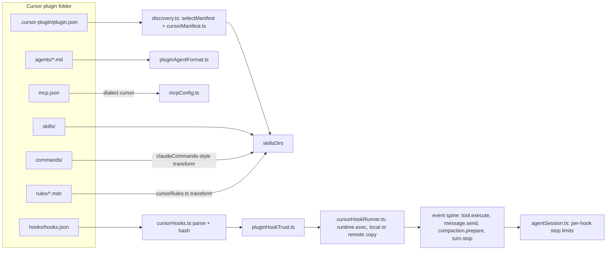

# Cursor Plugin Support in Xum

*   **Status:** Proposed

--------------------------------------------------------------------------------

## Overview

Xum loads plugins in three formats today: Agent Plugins (root `plugin.json`),
Codex (`.codex-plugin/plugin.json`) and Claude Code (`.claude-plugin/plugin.json`).
This design adds Cursor (`.cursor-plugin/plugin.json`) as a fourth format, plus
Cursor's marketplace file (`.cursor-plugin/marketplace.json`).

Xum does not run Cursor plugins as a separate system. It translates each Cursor
part into a part Xum already has: skills, agents, MCP servers and hooks. Rules
become skills. The user adds and installs Cursor plugins only from Xum's Plugins
tab, under the same install review and consent as other plugins.

One part is new. Cursor hooks are shell commands, and Xum has never run a shell
command from a plugin. This design adds a host command runner for Cursor hooks on
Xum's existing hook points. It also turns Xum's fixed stop-hook continuation
limit into a per-hook limit with a per-turn ceiling.

## The Problem

A user who finds a plugin for Cursor cannot use it in Xum.

*   The official Cursor marketplace (github.com/cursor/plugins, checked
    2026-10-30) lists 128 plugins: 17 from Cursor and 111 from third parties.
    Xum can read 2 of the 128 (`pstack` and `origin-apps`), because only those
    two also ship a manifest that Xum knows.
*   Xum skips a folder whose only manifest is `.cursor-plugin/plugin.json`, and
    it shows no message (`src/node/services/agentPlugins/discovery.ts`). The
    user sees nothing installed and no reason why.
*   The plugins the user named need more than skills. `cursor-team-kit` ships
    19 skills, 2 agents (`thermo-nuclear-code-quality-review`, `ci-watcher`) and
    2 always-apply rules. `ralph-loop` and `advisor` need hooks that run and can
    continue a turn. 104 of the 111 third-party plugins declare MCP servers.
    All 104 point `mcpServers` to a `./mcp.json` file, and 102 of those servers
    are remote HTTP servers (for example `https://mcp.attio.com/mcp`). Most of
    them ask the user to sign in.

The workaround today is to ask each plugin author to add a second manifest. That
does not scale to 128 plugins, and it does nothing for rules, agent frontmatter
or hooks, which only the Cursor format describes.

The proposed solution: a Cursor reader that maps every Cursor part onto a Xum
part, a marketplace reader for the Plugins tab, and a hook runner that keeps
Xum's consent and safety rules. Parts with no Xum counterpart stay visible in
the install review as "not applied" and go into tracking issues.

## Goals

1.  **Marketplace install.** The user adds `https://github.com/cursor/plugins`
    in the Plugins tab, sees the plugins listed in its `marketplace.json`, and
    installs one of them.
2.  **Skills, commands and rules.** Cursor skills and commands load as Xum
    skills. Every `.mdc` rule, always-apply rules included, loads as a skill
    under the skill consent that ships today. The install review labels a rule
    skill as "loaded on request in Xum", because Xum does not add it to every
    prompt.
3.  **Agents.** Cursor agents run as Xum sub-agents through the shipped mapping
    in `pluginAgentFormat.ts`. An agent with `model: fast` uses the model the
    user configured for Explore. With no Explore model configured, it uses the
    parent model, as today.
4.  **MCP servers.** Servers from the `mcp.json` file that the manifest's
    `mcpServers` names connect. Remote HTTP servers are the main case: 102 of
    the 104 marketplace servers. Xum also expands `${CURSOR_PLUGIN_ROOT}` and
    `${CLAUDE_PLUGIN_ROOT}` to the plugin's install folder in `command`, `args`,
    `env` and `cwd`, because the Cursor spec defines them. No marketplace
    `mcp.json` uses them today, so only a test fixture checks them.
5.  **Hooks.** After the user trusts a hook, Xum runs Cursor `command` hooks on
    the events that map to Xum's hook points (`tool.execute`, `message.send`,
    `compaction.prepare`, `turn.stop`). Xum gives each hook the input fields and
    environment variables that Cursor documents, where Xum has the data.
6.  **Stop-loop limits.** Each stop hook has its own loop limit. A hook with no
    `loop_limit` uses Xum's one shared default of 3, whatever format it comes
    from. A number sets that hook's limit. `null` means no per-hook limit, but
    no hook can go past one Xum ceiling per user turn. Xum never continues a
    turn after a user Stop, an abort or an error.
7.  **Nothing is dropped without a trace.** The install review and the plugin
    detail list every part, field and hook event that Xum does not apply.

Success means these checks pass on the real marketplace:

1.  Install `cursor-team-kit`. Its 19 skills and its 2 rule skills load.
2.  `thermo-nuclear-code-quality-review` runs as a sub-agent.
3.  With an Explore model configured, `ci-watcher` runs on that model.
4.  A fixture copy of `ralph-loop` with `loop_limit: null` continues the turn
    until the reply contains its `<promise>` tag, then stops. A user Stop in
    the middle ends the current turn, and Xum adds no continuation. The loop
    stays active in the plugin's own state (`.cursor/ralph/`), so the next turn
    can resume it, and running the plugin's `cancel-ralph` skill ends it. The
    test checks the Stop and the cancel. The fixture changes only `hooks.json`, to
    `bash "${CURSOR_PLUGIN_ROOT}/hooks/<script>.sh"` (the change in the
    unmerged cursor/plugins PR #524). Published ralph-loop runs its commands as
    written, which fails in Xum as in Cursor (D17).
5.  A remote HTTP MCP server from the marketplace with no `${...}`
    placeholders connects after the user signs in. The candidate is `attio`.
6.  A test fixture plugin with a stdio MCP server launched through
    `${CURSOR_PLUGIN_ROOT}` connects.
7.  The install review for `advisor` lists `subagentStop` as not applied.

## Non-Goals

1.  **Rules in the system prompt.** Always-apply rule injection and glob-based
    auto-attach are out of scope. Tracking issue T2.
2.  **Hook events with no Xum hook point.** `sessionStart`, `sessionEnd`,
    `subagentStart`, `subagentStop`, `afterAgentThought`, the Tab hooks,
    `workspaceOpen` and prompt-type hooks stay inert and listed. Tracking
    issue T1.
3.  **A small-model table per provider** for `model: fast` when no Explore
    model is configured. Tracking issue T3.
4.  **`readonly` deny-at-execution** (all tools in the request, writes denied
    when they run). Tracking issue T4.
5.  **A Cursor-only default loop limit.** Raising the shared default from 3 to
    5 for every hook source is a separate discussion. Tracking issue T5.
6.  **Plugins that Cursor installed on disk** (for example under `~/.cursor`).
    Xum loads only plugins added from its own Plugins tab.
7.  **Cursor `variables`** (user-supplied values for MCP servers). Listed as
    not applied.

## Open Questions

None. The owner decided D1, D2 (value), D4, D5 and D7–D20 while the Technical
Plan was drafted, and each decision is recorded at the step it changes. D3, D6
and the rest of the brainstorm decisions were settled before drafting.

## Critical User Journeys (CUJs)

### CUJ 1: Install a Cursor plugin from the Cursor marketplace

*   **Given**: Agent Plugins are enabled in Xum, and the user has not added any
    Cursor marketplace.
*   **When**: The user opens the Plugins tab, adds
    `https://github.com/cursor/plugins`, picks `cursor-team-kit` and confirms
    the install review.
*   **Then**: The install review lists 19 skills, 2 rule skills labeled "loaded
    on request in Xum", 2 agents, and no hooks or MCP servers. After install, a
    new chat can load the skills and spawn both agents.

### CUJ 2: Run a Cursor agent on a small model

*   **Given**: `cursor-team-kit` is installed, and the user set a model for the
    Explore agent in Settings.
*   **When**: The parent agent spawns `ci-watcher`, which declares
    `model: fast`.
*   **Then**: `ci-watcher` runs on the Explore model. The sub-agent header shows
    the model and where it came from. If the user clears the Explore model, the
    next spawn uses the parent model.

### CUJ 3: Loop a turn with a stop hook

*   **Given**: The fixture copy of `ralph-loop` (hook commands in the
    `${CURSOR_PLUGIN_ROOT}` form) is installed, its two hooks are trusted, and
    the user starts a loop with a completion promise.
*   **When**: Each turn ends.
*   **Then**: Xum runs `afterAgentResponse`, then `stop`. While the reply has no
    `<promise>` tag, the stop hook continues the turn, and the chat shows
    "plugin continued turn n of 50". When the tag appears, the loop ends. If the
    user presses Stop, the current turn ends and Xum adds no continuation. The
    loop stays active in the plugin's state (`.cursor/ralph/`), so the end of
    the next turn can resume it, because ralph's stop hook does not read
    `status`. The user ends the loop with the plugin's `cancel-ralph` skill,
    which deletes that state.

### CUJ 4: Connect a remote MCP server from a Cursor plugin

*   **Given**: The user installs a third-party plugin from the Cursor
    marketplace whose `mcp.json` names a remote HTTP server with no `${...}`
    placeholders (for example `attio`).
*   **When**: The user enables the server, signs in when Xum asks, and a chat
    calls one of its tools.
*   **Then**: The tool call returns a result. A plugin whose `mcp.json` needs
    user values (`${CLIENT_ID}`, `${BREVO_MCP_TOKEN}`) shows those servers as
    "needs values not supported in Xum" instead of failing to connect.

### CUJ 4b: Launch a local MCP server through `${CURSOR_PLUGIN_ROOT}`

*   **Given**: A test fixture plugin ships a stdio server whose `command` or
    `args` use `${CURSOR_PLUGIN_ROOT}`.
*   **When**: The user installs the fixture and enables the server.
*   **Then**: Xum starts the server from the plugin's install folder, and a tool
    call returns a result.

### CUJ 5: See what Xum does not apply

*   **Given**: The user previews `advisor` in the Plugins tab.
*   **When**: The install review opens.
*   **Then**: It lists `subagentStop` as "not applied in Xum", next to the hooks
    that will run. The user can install the plugin knowing which part will not
    work.

## Technical Plan (Architecture)

This plan was written against Xum `3d3a4cf2d8`. Line numbers are from that
commit. Each owner decision is marked "decided Dn" at the step it changes.

### Shape of the change

Xum treats a Cursor plugin as one more source format. Every part is translated
into a part Xum already has, at the points where the Claude format is
translated today. Only the hook runner adds new behavior.

### 1. Manifest reader

*   `selectManifest` (`discovery.ts:1178-1203`) gains
    `.cursor-plugin/plugin.json` as the **last** candidate, after root
    `plugin.json`, Codex and Claude. A folder that loads today keeps its
    manifest. `pstack` and `origin-apps` keep loading through their root
    `plugin.json`, which declares `$schema`. This order is mechanical: any
    other order changes plugins that work today.
*   A new `cursorFallback` gate sits beside `codexFallback` and
    `claudeFallback` (`discovery.ts:1248-1249`). A Cursor package counts as
    `foreign` in `xumComponentGate` (`discovery.ts:1113-1123`), so Xum-only
    parts (`hooks.js`, `workflows/`) in a Cursor folder never run.
*   A new `cursorManifest.ts` normalizes the manifest, modeled on
    `normalizeClaudeManifest` (`claudeManifest.ts:298`):

| Cursor field | Xum field | Rule |
| --- | --- | --- |
| `name`, `displayName`, `version`, `description`, `author`, `homepage`, `repository`, `license`, `keywords`, `logo` | plugin metadata | Same handling as Claude. `logo` uses the existing logo path checks. |
| `skills` (string or list) | `skillsDirs` | Added to the default `skills/` scan, as for Claude. |
| `commands` (string or list) | `skillsDirs` with `{command: true}` | Same transform as Claude commands (`claudeCommands.ts`). |
| `rules` (string or list) | `skillsDirs` with `{rule: true}` | See section 2. |
| `agents` (string or list) | `agentsDir` | One folder, as for Claude. A list with more than one folder loads the first and lists the rest as not applied. |
| `mcpServers` (string) | `mcpConfigPath`, dialect `cursor` | See section 4. An inline object or list is not applied and listed, as for Claude (`claudeManifest.ts:166-181`). No marketplace plugin uses that form. |
| `hooks` (string or inline object) | `cursor.hooks` | See section 5. |
| `variables`, `category`, `tags`, `publisher`, `clientVersionRequirement`, `minClientVersions` | none | Listed as not applied (Goal 7). |

### 2. Rules as skills

*   A new `cursorRules.ts` turns each `.mdc` file into SKILL.md text when Xum
    reads it, the way `claudeCommands.ts` turns a command into a skill. Nothing
    new is written to disk.
*   The skill name is the file name without `.mdc`. If a real skill in the same
    plugin has that name, the skill wins and the rule is listed as not applied.
*   Rule types map as follows:

| Rule frontmatter | Skill | Install review label |
| --- | --- | --- |
| `alwaysApply: true` | model-invocable, description from `description` | "always-apply rule, loaded on request in Xum" |
| `description` only | model-invocable | "rule" |
| `globs` set | model-invocable, globs added to the description | "glob rule, not attached by file in Xum" |
| none of the three | user-invocable only (`disable-model-invocation`) | "manual rule" |

*   Rule consent (**decided D14, owner, 2026-10-30**): the shipped skill
    consent. It fingerprints the converted frontmatter (name, description, the
    rule-type label, the user-only flag for manual rules) and any directive
    lines in the body (#6617, PR #6763). Prose edits load after an update
    without a new review, as for skills. The consent site must fingerprint the
    fields the conversion produces, so a change to `alwaysApply` or `globs`
    that changes the label asks for review.

### 3. Marketplace and install

*   A Cursor marketplace path constant sits beside
    `CLAUDE_MARKETPLACE_RELATIVE_PATH` (`claudeMarketplace.ts:33`). The Claude
    parser, its 8 MiB cap and its 500-entry cap (`claudeMarketplace.ts:38-40`)
    are reused. The Cursor file has 128 entries, so the cap holds.
*   `previewSource` (`installService.ts:3552-3557`) reads both marketplace
    files when both exist, and shows one merged list (**decided D20, owner,
    2026-10-30**). `cursor/plugins` ships both: the Claude file lists 2 entries
    (`origin-apps`, and `pstack` at `./harness/pstack/claude-code`), the Cursor
    file lists 128 (`pstack` at `./pstack`).
    *   A name in only one file shows once, with that file's install method.
    *   A name in both files shows once, with two install methods: "Claude
        build" and "Cursor build". The user picks one in the install review.
        This reuses the multiple-methods-per-entry rule
        (`entryInstallMethods`, `installMethods.ts:496-530`).
    *   Same-name guard: install folders are named after the plugin
        (`targetPathFor(entry.name)`), so only one build of a name can be
        installed. A second install of the same name is refused until the user
        uninstalls the first. Not yet verified: the exact refusal message today.
    *   Updates stay on the source file. The `generatedFrom` marker records
        which file an install came from, and the update path reads the entry
        again from that file (`installService.ts:6378-6383`). An install made
        through the Claude file keeps updating from the Claude file after this
        change.
    *   Merged-list caps: each file keeps its own 8 MiB and 500-entry cap. The
        merged list has at most 1000 entries.
*   A new install-method kind (`cursor-marketplace`) joins
    `detectInstallMethods` (`installMethods.ts:299-316`). The generated
    manifest marker follows the `claude-marketplace` pattern
    (`installMethods.ts:654-709`), including the downgrade-safe
    `INERT_COMPONENT_PATH` (`manifest.ts:276`) for parts an older Xum build
    must not load.
*   The install review shows every not-applied part, field and hook event. The
    preview schema gains one list for them (`common/orpc/schemas/agentPlugins.ts`).

### 4. MCP servers

*   A new MCP dialect `cursor` joins `claude` (`discovery.ts:988-1005`,
    `:1354`).
*   The ternary in `pluginPlaceholderValues` (`mcpConfig.ts:365-375`) becomes a
    per-dialect table. The `cursor` dialect expands `CURSOR_PLUGIN_ROOT` and
    `CLAUDE_PLUGIN_ROOT` to the install folder. The `${CLAUDE_PLUGIN_ROOT}/<path>`
    rewrite to `./<path>` (`mcpConfig.ts:346-363`) applies to both names.
*   Any other `${NAME}` placeholder (user values such as `${CLIENT_ID}`) marks
    that server "needs values not supported in Xum". Xum does not start it and
    does not read the value from the environment. Cursor `variables` are a
    non-goal.
*   Remote HTTP servers go through the existing plugin MCP path, with its
    https rule for auth URLs.
*   The Cursor `auth` block (**decided D19, owner, 2026-10-30**): the `cursor`
    dialect translates it with the rules of the Codex `oauth` translation
    (`translateCodexMcpEntry`, `openaiMcpAuth.ts:397-440`):
    *   a fixed `CLIENT_ID` becomes a provided client
        (`{mode: "provided", clientId}`);
    *   `scopes` become default scopes;
    *   a placeholder `CLIENT_ID` or `CLIENT_SECRET` keeps the server in "needs
        values not supported in Xum" (10 of the 14 marketplace servers with
        `auth`);
    *   a fixed `CLIENT_SECRET` follows the existing secret-source rule (no
        marketplace server has one);
    *   authorization and token endpoints still come from discovery.
    *   This affects 4 marketplace servers today: `x`, `x-ads`, `meta-ads`,
        `gopuff`. Known risk: a provider that binds the client ID to Cursor's
        redirect URLs rejects Xum's random loopback redirect. None of the 4 is
        tested yet.

### 5. Hooks

#### 5.1 Parse, list and trust

*   A new `cursorHooks.ts` parses Cursor `hooks.json`:
    `{version: 1, hooks: {<event>: [{command, type?, matcher?, timeout?,
    loop_limit?, failClosed?}]}}`, from `hooks/hooks.json` or the manifest's
    `hooks` value. Invalid entries drop with a warning, as in `codexHooks.ts`.
*   Each hook gets a status from the existing enum
    (`common/orpc/schemas/agentPlugins.ts:79-84`): `runnable` for a mapped
    event with a `command` handler, `ignored-event` for an unmapped event,
    `unsupported-handler` for `type: "prompt"`.
*   Trust reuses `pluginHookTrust.ts` (`{hash, state}` per hook) and today's
    hash, `hashHookDefinition` (`codexHooks.ts:696-699`): the event, the
    matcher and the handler entry exactly as declared (**decided D1, owner,
    2026-10-30**). The scripts are covered when the user reviews an install or
    an update, not before each run.
    *   Accepted risk: a script changed on disk after install (`stop-hook.sh`,
        the `lib.sh` it sources, a `bun` import) runs on the host with no new
        review. The round-2 Goldfish review rated this a blocker (B1).
    *   Reason for accepting it: anything that can write a plugin folder under
        the Xum home can also change Xum's config and the hook trust file, so a
        check before each run adds little protection. The check also costs a
        folder walk on every hook run.
    *   Rejected: hashing the whole plugin folder before each run, and hashing
        each script a command names. See Alternatives Considered.
*   Kill switches: the runner refuses to start any hook process when
    `XUM_DISABLE_AGENT_TOOLS` (`utils/agentToolsDisabled.ts:16-18`),
    `XUM_DISABLE_TERMINALS` (`terminalService.ts:75-76`) or
    `XUM_DISABLE_PROJECT_AUTOMATION` (`utils/projectAutomation.ts:18-23`) is
    set. This has one defensible answer: AGENTS.md requires that model-driven
    bug-bash runs never reach a host shell.
*   Remote workspaces (**decided D7, owner, 2026-10-30**): Cursor command hooks
    also run in SSH, Docker and devcontainer workspaces, inside the workspace,
    through the workspace runtime. This goes past the rule that ships today,
    where remote workspaces load only skills and agents from plugins
    (`remoteProjectPlugins.ts:1-16`, #7218). See 5.6 for the copy step this
    needs.

#### 5.2 Event mapping

| Cursor event | Xum point | Phase | Can block or change |
| --- | --- | --- | --- |
| `preToolUse` | `tool.execute` | before | deny, `updated_input` |
| `beforeShellExecution` | `tool.execute` (bash only) | before | deny |
| `beforeMCPExecution` | `tool.execute` (MCP tools only) | before | deny |
| `postToolUse` | `tool.execute` | after | `additional_context`, `updated_mcp_tool_output` |
| `afterShellExecution` | `tool.execute` (bash only) | after | none |
| `afterMCPExecution` | `tool.execute` (MCP tools only) | after | none |
| `afterFileEdit` | `tool.execute` (file edit tools only) | after | none |
| `beforeSubmitPrompt` | `message.send` | before | block (`continue: false`) |
| `preCompact` | `compaction.prepare` | before | none (observe only) |
| `afterAgentResponse` | `turn.stop` | first | none |
| `stop` | `turn.stop` | after `afterAgentResponse` | `followup_message` |
| `beforeReadFile`, `postToolUseFailure` | none (**decided D10, owner, 2026-10-30**) | | listed as not applied (T1) |
| all other events | none | | listed as not applied (T1) |

Cursor fires a generic hook and a specific hook for the same tool call
(`preToolUse` and `beforeShellExecution`). Xum does the same, generic first.

#### 5.3 Tool names for matchers

| Cursor matcher value | Xum tools |
| --- | --- |
| `Shell` | `bash` |
| `Read` | `file_read` |
| `Write` | the file edit tools (`file_edit_replace_string`, `file_edit_replace_lines`, `file_edit_insert`) |
| `Task` | `task` |
| `MCP:<tool>` | the MCP tool with that name |
| `Grep`, `Delete` | none (**decided D9, owner, 2026-10-30**). A matcher such as `Shell\|Delete` still fires for `bash`. The install review lists "`Delete` never matches in Xum" for each such hook. This matches Cursor's reach: shell `rm` and `grep` never hit these matchers there either. |

The table lives in a new `cursorToolNames.ts`, beside `codexToolNames.ts`.

#### 5.4 The runner

*   A new `cursorHookRunner.ts` registers on the spine beside the Codex runner
    (`codexHookService.ts:124-125`). It rechecks trust before every call, as the
    Codex runner does (`codexHookService.ts:217-218`).
*   It starts one process per hook call through the workspace runtime's
    `exec`, with the hook input as JSON on stdin and JSON read from stdout. One
    code path serves every runtime: for local and worktree workspaces `exec`
    starts a host process, and for remote workspaces it runs inside the
    workspace. No plugin code starts a process today except one `git` call
    (`installService.ts:1031`). This runner is the first.
*   `CURSOR_PLUGIN_ROOT` is the install folder for local workspaces and the
    copied folder (5.6) for remote ones. `CURSOR_CODE_REMOTE=true` is set only
    for remote workspaces, as Cursor documents.
*   Exit code 127 (command not found) is logged and shown once per workspace
    as "`<command>` not found in this workspace". A remote machine without
    `jq` or `bun` gives this result.
*   Shell (**decided D15, owner, 2026-10-30**): `runtime.exec` on every
    platform. On Windows, local `exec` runs through Git Bash (`getBashPath`,
    `LocalBaseRuntime.ts:250`, `:631`), so there is no Windows-only path. A
    hook written in PowerShell syntax fails, which is logged with the exit
    code. No marketplace hook uses PowerShell.
*   Timeout (**decided D16, owner, 2026-10-30**): the shared rule,
    `effectiveHookTimeoutSeconds` (`src/constants/pluginHooks.ts:2-7`): a
    declared `timeout` in seconds, else 10 s, capped at 30 s, the same as Codex
    hooks. A timeout counts as a crash under the failure rules (5.5). A user
    Stop kills the process group.
*   Working folder: the plugin folder, except `stop` (and, later,
    `subagentStop`), which run from the workspace root, as Cursor documents.
*   `command` runs as written (**decided D17, owner, 2026-10-30**). Xum does not
    rewrite a leading `./`. A `./hooks/x.sh` in a `stop` hook therefore looks
    in the workspace root, is not found (exit 127), counts as a crash under the
    failure rules (5.5), and shows "`./hooks/x.sh` not found in this
    workspace" once. This matches Cursor's real behavior (cursor/plugins
    PR #315). Published ralph-loop is affected: its hooks never run in Xum,
    as in Cursor.
*   Environment: a minimal set, not Xum's full environment.
    `CURSOR_PROJECT_DIR` and `CLAUDE_PROJECT_DIR` are the workspace root.
    `CURSOR_PLUGIN_ROOT` is the plugin folder. `PATH` and `HOME` pass through.
    `CURSOR_USER_EMAIL` is never set.
*   `CURSOR_VERSION` and the transcript (**decided D18, owner, 2026-10-30**):
    *   `CURSOR_VERSION` is `xum-<version>`. A hook that parses it as a Cursor
        version fails visibly instead of trusting a fake one. No marketplace
        hook reads it today.
    *   For local and worktree workspaces, `transcript_path` (input) and
        `CURSOR_TRANSCRIPT_PATH` (environment) point to the workspace's
        `~/.xum/sessions/<workspace>/chat.jsonl`. For remote workspaces both are
        `null`, because the hook runs inside the workspace and cannot see the
        host file.
    *   Reason: continual-learning triggers only when `transcript_path` is set
        and its modification time advanced
        (`continual-learning-stop.ts:210-219`). Advisor forwards it to its
        consult agent (`lib.sh:55-58`).
    *   Known gap: `chat.jsonl` is JSON Lines, not Cursor's transcript format.
        A plugin agent that parses the transcript reads a format it was not
        written for.
*   Input fields: the common fields Xum can fill (`conversation_id` = workspace
    ID, `generation_id` = turn ID, `model`, `hook_event_name`,
    `workspace_roots`) plus each event's own fields. `user_email` is `null`.
    `transcript_path` follows D18. The turn text for
    `afterAgentResponse` is the full text of the final reply, every text part
    of the last assistant message, cut to its **last** 16 KiB. Today
    `lastAssistantText` keeps the trailing text run only, returns `null` when
    the turn ends on a tool call, and keeps the **first** 16 KiB
    (`promptHooks.ts:128`, `:173-181`). A completion promise sits at the end
    of a reply, so the first 16 KiB can miss it.
*   Exit codes and bad output: see 5.5.

#### 5.5 Failure rules for all plugin hooks (decided D8, owner, 2026-10-30)

One failure rule covers Cursor and Codex hooks: Cursor's documented rule. The
owner chose the option that blocks more often, and asked that Codex hooks follow
it too, so Xum has one rule instead of two.

Permission hooks are Cursor's `preToolUse`, `beforeShellExecution`,
`beforeMCPExecution`, and Codex's
`PreToolUse`.

| Result | Permission hook | Any other hook |
| --- | --- | --- |
| Exit 0 with valid output | apply the output | apply the output |
| Exit 2, or `permission: "deny"` | block, send `agent_message` to the model | (Cursor) block where the event can block |
| `permission: "ask"` | block. Xum has no prompt that asks the user to approve one tool call. | not applicable |
| Exit 0 with invalid JSON, or output that fails the event's schema | **block** | ignore the output, warn |
| `updated_input` / `updatedInput` that fails the tool's input schema | **block** | not applicable |
| Crash, timeout, other non-zero exit, command not found | allow, warn. Block if `failClosed: true`. | allow, warn |
| Codex MCP server missing or unavailable | allow, warn (Codex hooks have no `failClosed`) | allow, warn |
| Input too large for the hook to check | allow, warn. Block if `failClosed: true`. | allow, warn |
| Xum cannot read its own trust store | allow, warn. This is Xum's failure, not the hook's. | allow, warn |

*   Change to shipped Codex behavior: today every Codex failure lets the call
    through (`codexHookRunner.ts:10-16`), including malformed output
    (`:568-569`) and an `updatedInput` that fails the schema (`:386`, `:400`).
    After this change those two cases block a `PreToolUse` call. This departs
    from Codex's documentation, which says such failures do not block.
*   Every block caused by a failure (not by an explicit deny) shows one line in
    the chat that names the plugin, the hook and the reason, and says how to
    turn the hook off in the Plugins tab. Without that line a broken hook looks
    like a stalled agent.

#### 5.6 Plugin copy for remote workspaces (new)

Remote workspaces cannot see the host install folder, so Xum copies a plugin
into the workspace before its first hook call there.

*   Source: the host install folder, the files the user reviewed at install or
    update. Never the upstream repository.
*   Target: a folder named after the plugin and the hash of its install folder
    (`hashPluginTree`, `treeHash.ts:13`), under the remote user's Xum home. A
    copy whose name holds the current hash is current. Xum writes no other
    state about it.
*   Transport: `ensureDir` plus streaming `writeFile` (`Runtime.ts:529`,
    `:546`), then `exec` to restore executable modes. Symlinks follow the same rule the
    installer applies to the install folder (not yet checked in detail). The copy is bounded by the install quota (100 MiB, 10,000 files,
    `installService.ts:1192-1193`).
*   When: on the first hook call for that plugin in that workspace, and again
    after an update changes the hash. Xum holds the hook call until the copy
    finishes. The copy has its own limit, one constant (proposed: 120 s),
    separate from the hook timeout: with the 10 s hook default, a large plugin
    copy over SSH would never finish. The hook's own timeout starts after the
    copy.
*   Failure: a failed or timed-out copy skips the hook call, as any hook
    failure does (D8), logs the reason and tries again on the next call.
*   Cleanup: copies with an old hash are deleted after a successful new copy.
*   Trust: D1 covers the entry only. A remote copy edited inside the workspace
    is not detected. This is the D1 accepted risk, and the agent's own bash
    tool has the same access there.

### 6. Stop-loop limits

*   Today one counter (`agentSession.ts:1646`) and one cap
    (`MAX_STOP_HOOK_CONTINUATIONS = 3`, `:706`, checked at `:10810`) cover every
    stop-hook continuation in a user turn.
*   New rule, one code path for every hook source:
    1.  Each continuation reason carries the hook that produced it.
    2.  A hook with no `loop_limit` uses the shared default (3). A number sets
        that hook's limit. `null` sets no per-hook limit.
    3.  A per-user-turn ceiling of 50 stops all continuations, whatever the
        hooks say (**decided D2 and its value, owner, 2026-10-30**). It is one
        constant beside `MAX_STOP_HOOK_CONTINUATIONS`. Reaching it pauses the
        loop: the next user message starts a new user turn, and the hooks can
        continue again.
    4.  The chat shows "plugin continued turn n of 50" for each continuation.
*   Counting scope (**decided D4, owner, 2026-10-30**): per user turn, for
    every hook source, as today. Each hook's count and the 50 ceiling reset
    when a user turn starts, and stay in memory. `loop_count` in the hook input
    is that hook's own count in the current user turn.
    *   Reason: Cursor's own plugins expect this, although Cursor's docs say
        "for this conversation". Continual-learning counts a stop as a user
        turn only when `loop_count === 0` (`continual-learning-stop.ts:137-139`),
        and advisor expects to nudge again after the user answers
        (`stop-hook.sh:32-37`). Both break if the count never resets.
    *   Codex hooks keep their shipped behavior: 3 continuations per user
        turn.
    *   Xum's own nudges keep their check: they run only when no hook
        continued the current user turn.
*   A user Stop or abort already skips `turn.stop` (`handleTurnAbort`,
    `agentSession.ts:1590`), so no continuation follows a Stop today.
*   Observe-only stop calls (**decided D5, owner, 2026-10-30**): after a turn
    ends by a user Stop or an error, Xum runs each trusted Cursor `stop` hook
    once with `status: "aborted"` or `"error"` and `loop_count` as it stands.
    Xum ignores any `followup_message` from these calls, so the turn never
    continues. The call follows the usual timeout (5.4), failure rules (5.5),
    kill switches and remote copy (5.6). It does not count toward any limit.
    *   This adds a new call site in the abort and error paths, beside
        `handleTurnAbort`. `afterAgentResponse` does not run there.
    *   Known effect: ralph's stop hook ignores `status`, so its own iteration
        count rises by one on each Stop. Advisor and continual-learning exit
        early on a status other than `completed`.
*   Xum's own TODO and status nudges keep their rule: they run only when no
    hook has continued the turn (`agentSession.ts:10874-10881`).

### 7. Agents

*   The shipped mapping in `pluginAgentFormat.ts` stays: no `readonly` maps to
    Exec, `readonly: true` maps to Explore (`:347`).
*   `model: fast` (**decided D11, owner, 2026-10-30**): a `fast` agent
    resolves its AI settings, model and thinking level, as if its base were
    Explore. Its tools stay those of its real base (Exec, or Explore when
    `readonly: true`).
    *   Today `mapModel` (`pluginAgentFormat.ts:297-303`) finds no `fast` alias,
        and the agent takes the Exec model from Settings, then the parent model.
        The parent chat's Exec choice is skipped for Exec-derived agents on
        purpose (`resolveAgentAiSettings.ts:99-111`).
    *   Mechanism: the Cursor mapping writes a new optional Xum frontmatter
        field, `ai.settingsBase: "explore"`, for `model: fast`. When it is set,
        `loadDefinitionLayers` (`resolveNodeAgentAiSettings.ts`) builds the
        ancestor chain from that ID instead of `base`, for AI settings only.
        Tool policy still follows `base`.
    *   New lookup order for a `fast` agent: its own saved choice, its own
        Settings entry, its own frontmatter defaults, then Explore's Settings
        (Delegated override, then base entry) and Explore's definition, then
        the parent model, then fallbacks.
    *   The built-in Explore agent sets no model (`src/node/builtinAgents/explore.md`).
        With no Explore model in Settings, a `fast` agent falls through to the
        parent model, as today.
    *   Consent: the mapped frontmatter is fingerprinted
        (`pluginAgentFormat.ts:361-362`), so each installed `fast` agent asks
        for consent once after the update that ships this field.
    *   Downgrade: an older Xum build ignores `ai.settingsBase` and resolves as
        today. A schema fixture covers this.
    *   The sub-agent header names the source: "model from Explore settings".
    *   `model: inherit` and every other `model` value keep today's behavior.
*   `is_background: true` (**decided D12, owner, 2026-10-30**): the agent
    runs in the background unless the parent says otherwise.
    *   `task.run_in_background` stops defaulting to `false` at parse time
        (`toolDefinitions.ts:423`, today `z.boolean().nullish().default(false)`).
        The handler resolves a missing value from the target agent: `true` for
        an agent with the default set, `false` for all others. An explicit
        `true` or `false` from the parent always wins.
    *   The Cursor mapping writes a new optional Xum field,
        `subagent.defaultBackground: true`. It is fingerprinted like the rest of
        the mapped frontmatter, and an older Xum build ignores it.
    *   The `task` tool description says that some agents default to the
        background, and the agent list marks them. A parent that needs the
        report in the same step must pass `run_in_background: false` or call
        `task_await`.
    *   This changes the `task` tool's default for these agents only. Every
        other agent keeps `false`.
*   `readonly` agent prompt (**decided D13, owner, 2026-10-30**): for
    `readonly: true` agents only, the mapping sets `prompt.append: true`
    instead of `false` (`pluginAgentFormat.ts:340-372`). The model sees the
    body of `src/node/builtinAgents/explore.md` (leave the checkout unchanged,
    no writes through redirects or `tee`, no `rm`/`mv`/installs, check
    `git status` after verification) before the plugin's own body.
    *   Agents without `readonly` keep `append: false`. Their body is the whole
        prompt, as in Cursor and Claude Code.
    *   The mapped frontmatter changes, so each installed `readonly` agent asks
        for consent once after this update.
    *   Known conflict: a plugin body that asks a `readonly` agent to write a
        file gets two conflicting orders. Checked 2026-10-30: none of the 6
        marketplace `readonly` agents asks to write, save or create a file.
    *   A later edit of `explore.md` reaches every `readonly` plugin agent.

### 8. Changes to shipped behavior

These change what Xum does today for users who never install a Cursor plugin.
Each one needs a line in the release notes.

| Change | Who sees it | Decision |
| --- | --- | --- |
| A Codex `PreToolUse` hook with malformed output, or an `updatedInput` that fails the schema, now blocks the tool call instead of being ignored. | Users of Codex plugins with `PreToolUse` hooks | D8 |
| Adding a repository with both marketplace files shows one merged list. `cursor/plugins` goes from 2 entries to 128. | Users of the Plugins tab | D20 |
| `task.run_in_background` no longer defaults to `false` at parse time. A missing value comes from the agent. Every agent without the new field still gets `false`. | Every parent agent that spawns sub-agents | D12 |
| Plugin hooks can run in SSH, Docker and devcontainer workspaces. Today remote workspaces load only plugin skills and agents. | Users of remote workspaces | D7 |
| The `afterAgentResponse` and turn-stop text passed to hooks is the last 16 KiB of the full final reply. Codex `Stop` hooks receive the same text. | Users of Codex `Stop` hooks | Mechanical (5.4) |
| Stop-hook continuations are counted per hook with a ceiling of 50 per user turn. Hooks without `loop_limit`, all Codex hooks included, keep 3 per user turn. | No visible change for existing hooks | D2, D3, D4 |

## Alternatives Considered

Sources: the brainstorm brief (`concepts_brief.md`, "Alternatives Weighed") and
the options the owner rejected while the Technical Plan was drafted. Each entry
names the decision that rejected it.

### Scope

#### Alternative A: Ask plugin authors to add a root `plugin.json`

*   **Pros**: Xum loads Agent Plugins today, and Cursor loads them too, so no
    Xum code is needed.
*   **Cons**: 126 of the 128 marketplace plugins would each need a change from
    their author. The root format has no rules, agent frontmatter or hooks.
*   **Reason for Rejection**: It does not scale, and it drops the parts the
    owner asked for (The Problem).

#### Alternative B: Keep Cursor command hooks inert, as Claude hooks are

*   **Pros**: No new code that runs plugin commands. Same rule as Claude and
    Codex `command` hooks today.
*   **Cons**: ralph-loop, advisor and continual-learning do nothing.
*   **Reason for Rejection**: The owner wants those plugins to work (round 1).

#### Alternative C: Rules in the system prompt now

*   **Pros**: Always-apply rules would behave as in Cursor.
*   **Cons**: Needs a new rules component, consent on the exact text, an order
    against `AGENTS.md`, a token budget, and cache churn on every rule change.
*   **Reason for Rejection**: Deferred to tracking issue T2. Rules load as
    skills instead (round 2).

#### Alternative D: Drop rules from the first version

*   **Pros**: Less code.
*   **Cons**: `cursor-team-kit`'s two rules would not load at all.
*   **Reason for Rejection**: Loading them as skills costs one read-time
    transform and keeps them usable (round 2).

### Marketplace

#### Alternative E: The Cursor marketplace file wins over the Claude file

*   **Pros**: One file per repository, simple to explain. `cursor/plugins` lists
    128 entries.
*   **Cons**: A plugin listed only in the Claude file disappears.
*   **Reason for Rejection**: D20 merges both lists, so nothing disappears.

#### Alternative F: The Claude marketplace file wins, as today

*   **Pros**: No change for existing users.
*   **Cons**: `cursor/plugins` keeps listing 2 plugins. Success test 1 fails.
*   **Reason for Rejection**: D20.

#### Alternative G: An `origin` discriminant instead of a fourth boolean gate

*   **Pros**: Replaces `codexFallback`, `claudeFallback` and a new
    `cursorFallback` with one field. Fewer gate combinations to test.
*   **Cons**: A refactor of `discovery.ts` (1985 lines) before any Cursor code
    lands, with no user-visible change.
*   **Reason for Rejection**: Not needed for this feature. The plan adds
    `cursorFallback` beside the existing gates. The refactor is listed under
    Future Improvements.

### Hooks

#### Alternative H: Run Cursor hooks in the QuickJS sandbox

*   **Pros**: No shell, no host process. Xum's own `hooks.js` runs there.
*   **Cons**: The sandbox has no shell. Every Cursor hook is a bash or `bun`
    command.
*   **Reason for Rejection**: It cannot run the hooks (brainstorm).

#### Alternative I: Translate Cursor hooks into Codex `mcp_tool` hooks

*   **Pros**: Reuses the Codex runner as it ships.
*   **Cons**: Each hook needs an MCP server to wrap its command.
*   **Reason for Rejection**: More moving parts than a runner (brainstorm).

#### Alternative J: Run hooks through `TerminalService` or project lifecycle hooks

*   **Pros**: Existing code that already starts processes.
*   **Cons**: Both use a PTY. Hooks would show in the terminal UI, and lifecycle
    hooks inject project secrets.
*   **Reason for Rejection**: Wrong process model (brainstorm).

#### Alternative K: Hash the whole plugin folder before each hook run

*   **Pros**: Catches a changed script, a sourced `lib.sh` or a `bun` import.
*   **Cons**: A folder walk on every hook run, and advisor runs on every edit.
    Misses tools outside the folder.
*   **Reason for Rejection**: D1. Anything that can write the plugin folder can
    also change Xum's config and trust file, so the check adds little. This is
    an accepted risk.

#### Alternative L: Hash each script a hook command names

*   **Pros**: One file read per run.
*   **Cons**: Misses sourced files and imports. Xum has to guess the script path
    from a shell command.
*   **Reason for Rejection**: D1.

#### Alternative M: Hooks only in local workspaces

*   **Pros**: Matches the rule that ships today for remote plugins. No copy
    step.
*   **Cons**: ralph-loop and advisor do nothing in SSH, Docker and devcontainer
    workspaces.
*   **Reason for Rejection**: D7.

#### Alternative N: Always run hooks on the host, even for remote workspaces

*   **Pros**: No copy step, host tools available.
*   **Cons**: The workspace path does not exist on the host. All three hook
    plugins read and write workspace state.
*   **Reason for Rejection**: D7.

#### Alternative O: Every hook failure lets the call through (today's Codex rule)

*   **Pros**: A broken hook never stalls the agent. One rule that already ships.
*   **Cons**: A crashed or misconfigured guard lets every call through, and
    `failClosed` is ignored.
*   **Reason for Rejection**: D8. The owner chose the option that blocks more
    often, for Codex hooks too.

#### Alternative P: Map `Grep` and `Delete` matchers to `bash` commands

*   **Pros**: A deletion guard fires on the way Xum agents delete files.
*   **Cons**: Command-text guessing misses `find -delete` and scripts, and fires
    on harmless text. The hook gets `Shell` input it does not expect.
*   **Reason for Rejection**: D9. Cursor does not match shell `rm` either.

#### Alternative Q: Support `beforeReadFile` and `postToolUseFailure` now

*   **Pros**: Secret-scanning read guards and failure hints work.
*   **Cons**: Every guarded read reads the file twice, which costs time over
    SSH. `attachments` stays empty.
*   **Reason for Rejection**: D10. Tracked in T1.

#### Alternative R: PowerShell on Windows, as Cursor does

*   **Pros**: Same shell as Cursor on Windows.
*   **Cons**: Every marketplace hook uses POSIX syntax and fails. A second spawn
    path for one platform.
*   **Reason for Rejection**: D15.

#### Alternative S: Separate or raised timeouts for Cursor hooks

*   **Pros**: More room for slow hooks and remote workspaces.
*   **Cons**: A second rule beside the Codex one, or a change for every hook
    source. No marketplace hook needs more than a few seconds.
*   **Reason for Rejection**: D16.

#### Alternative T: Resolve a leading `./` against the plugin folder

*   **Pros**: Published ralph-loop would loop in Xum. Same rule as `mcp.json`.
*   **Cons**: Xum would run plugins that fail in Cursor, and a workspace-relative
    `./script` would break.
*   **Reason for Rejection**: D17. The loop test uses a fixture copy of
    ralph-loop instead.

#### Alternative U: No transcript path, or no `CURSOR_VERSION`

*   **Pros**: No Xum data handed to plugin hooks beyond the event input.
*   **Cons**: Continual-learning never triggers without `transcript_path`.
*   **Reason for Rejection**: D18.

#### Alternative V: No stop-hook call after a user Stop or an error

*   **Pros**: No process after Stop. Ralph's iteration count stays exact.
*   **Cons**: Hooks never see `aborted` or `error`, unlike in Cursor.
*   **Reason for Rejection**: D5.

### Stop-loop limits

#### Alternative W: One cap of 3 for every stop hook, as today

*   **Pros**: No change to `agentSession.ts`.
*   **Cons**: `loop_limit`, including `null`, is ignored. ralph-loop stops after
    3 continuations.
*   **Reason for Rejection**: The owner wants per-hook limits (round 2).

#### Alternative X: `null` with no outer limit

*   **Pros**: Exactly what Cursor's `null` means.
*   **Cons**: A missed promise runs paid turns until the user presses Stop.
*   **Reason for Rejection**: D2. A ceiling of 50 per user turn.

#### Alternative Y: A default of 5 for Cursor hooks

*   **Pros**: Cursor's documented default, so authors' tests match.
*   **Cons**: Two defaults and two code paths.
*   **Reason for Rejection**: D3. Raising the shared default for all hooks is
    tracking issue T5.

#### Alternative Z: Count continuations per conversation

*   **Pros**: The scope Cursor's docs describe.
*   **Cons**: Stored per-hook state. Continual-learning would trigger once per
    chat and advisor would go quiet after 3 nudges, because both expect the
    count to reset with each user message.
*   **Reason for Rejection**: D4.

#### Alternative AA: Xum mutes a plugin's follow-ups after a user Stop

*   **Pros**: A Stop would end a ralph loop for good.
*   **Cons**: New stored state per plugin and chat, and Xum overriding
    plugin-owned state.
*   **Reason for Rejection**: CUJ 3 decision. Ralph's own `cancel-ralph` skill
    ends the loop.

### Agents

#### Alternative AB: `model: fast` as a hint in the agent's prompt

*   **Pros**: No change to the model lookup.
*   **Cons**: A prompt hint selects no model.
*   **Reason for Rejection**: Round 1.

#### Alternative AC: Map `fast` to a fixed alias such as `haiku`

*   **Pros**: Always a small model.
*   **Cons**: Provider-specific, and wrong for users without that provider.
*   **Reason for Rejection**: Brainstorm. A per-provider table is tracking
    issue T3.

#### Alternative AD: Place the Explore model before or after the Exec ancestor, model only

*   **Pros**: Smaller change than an AI settings base. Thinking resolves as
    today.
*   **Cons**: Before Exec: `fast` silently overrides an Exec setting. After
    Exec: `fast` has no effect for users with an Exec model.
*   **Reason for Rejection**: D11. `fast` agents use Explore as their AI
    settings base.

#### Alternative AE: Ignore `is_background`, or only hint it

*   **Pros**: No change to the `task` tool.
*   **Cons**: The parent can wait on `ci-watcher` in the foreground.
*   **Reason for Rejection**: D12.

#### Alternative AF: `readonly` keeps the plugin body only, or gets a separate notice

*   **Pros**: The agent runs as the author wrote it, or with a short notice
    independent of `explore.md`.
*   **Cons**: Nothing tells the agent not to write through `bash`, or a second
    copy of the read-only rules to keep in step.
*   **Reason for Rejection**: D13. Explore's body comes first.

#### Alternative AG: `readonly` deny-at-execution

*   **Pros**: All tools stay in the request, so the prompt cache stays valid.
*   **Cons**: A second enforcement point beside tool policy, and `bash` commands
    cannot be classified by name.
*   **Reason for Rejection**: Deferred to tracking issue T4 (round 2).

### MCP and consent

#### Alternative AH: Ignore the Cursor `auth` block

*   **Pros**: No plugin-supplied client IDs.
*   **Cons**: Providers without dynamic client registration reject sign-in.
*   **Reason for Rejection**: D19.

#### Alternative AI: A full body hash for rule skills

*   **Pros**: Every rule edit gets a review.
*   **Cons**: A second consent rule beside #6617, and more re-reviews on update.
*   **Reason for Rejection**: D14.

--------------------------------------------------------------------------------

## Non-Functional Requirements

*   **Security.** This design adds the first plugin code that starts processes
    (section 5.4).
    *   A hook runs only after the user trusts its exact `hooks.json` entry.
    *   All three `XUM_DISABLE_*` switches stop every hook process.
    *   The environment is minimal (`hostEnv: "minimal"`), and
        `CURSOR_USER_EMAIL` is never set.
    *   Accepted risk (D1): a script changed on disk after install runs with no
        new review.
    *   The PR that adds the runner gets its own security review.
*   **Cost.**
    *   Each hook call is one process start. Over SSH it is also one round trip.
    *   Each stop-hook continuation is one paid model turn, capped at 50 per
        user turn.
    *   Hooks keep the shared 10 s default and 30 s cap. The first remote copy
        of a plugin has its own 120 s limit.
*   **Rollout and rollback.**
    *   Every new frontmatter field (`ai.settingsBase`,
        `subagent.defaultBackground`), schema value (`cursor-marketplace`,
        dialect `cursor`) and marker is optional. Older builds ignore it or read
        it as opaque.
    *   A downgrade fixture covers each one.
    *   Generated manifests use `INERT_COMPONENT_PATH` (`manifest.ts:276`) for
        parts an older build must not load.
    *   The changes to shipped behavior are listed in section 8.

### Additional Resources

*   Brainstorm brief: `concepts_brief.md` version 4 (two Goldfish rounds,
    research R1–R3).
*   Cursor docs, read 2026-10-30: `cursor.com/docs/hooks.md`,
    `cursor.com/docs/reference/plugins.md`, `cursor.com/docs/plugins.md`,
    `cursor.com/docs/reference/third-party-hooks.md`.
*   `github.com/cursor/plugins` at its commit of 2026-10-29: PR #315 (advisor
    hook paths), PR #524 (ralph-loop fix, closed unmerged), issues #50 and
    #282.
*   Xum precedents: the Claude plugin reader (`claudeManifest.ts`,
    `claudeMarketplace.ts`, `claudeCommands.ts`), the Codex hook runner
    (`codexHookRunner.ts`), #6617 and PR #6763 (skill body consent), #7218
    (remote plugins).

### Future Improvements

*   **T1, unmapped hook events.** `sessionStart`, `sessionEnd`,
    `subagentStart`, `subagentStop`, `afterAgentThought`, the Tab hooks,
    `workspaceOpen`, prompt-type hooks, `beforeReadFile` and
    `postToolUseFailure`. Trigger: a plugin the owner uses needs one. Advisor's
    `subagentStop` is the first known consumer.
*   **T2, rules in the system prompt.** Always-apply injection (consent on the
    exact text, order against `AGENTS.md`, a size budget, cache churn) and glob
    auto-attach. Trigger: a rule skill that models fail to load when it
    matters.
*   **T3, a small model per provider for `model: fast`** when Explore has no
    model in Settings. Trigger: users who run `fast` agents without an Explore
    model.
*   **T4, `readonly` deny-at-execution.** All tools stay in the request, and
    writes are denied when they run. Trigger: a measured prompt-cache loss from
    the Explore tool list.
*   **T5, the shared default stop-loop limit.** Raising it from 3 to 5 for
    every hook source. Trigger: a plugin without `loop_limit` that needs more
    than 3 continuations.
*   **An `origin` discriminant for plugin formats** in `discovery.ts`, in place
    of the `codexFallback`, `claudeFallback` and `cursorFallback` booleans
    (Alternative G).
*   **Cursor `variables`** for MCP servers that need `${CLIENT_ID}`-style user
    values (20 of the 104 marketplace servers).

--------------------------------------------------------------------------------

## Detailed Implementation Plan

Paths are repo-relative. "Create" means a new file. Each PR below is a
reviewable unit. Its files are listed with it, and every PR ships its own tests.

### PR 1: Cursor manifest reader, rules as skills, agent prompt

#### 1.1 `src/node/services/agentPlugins/discovery.ts` (Modify)

*   **Type / Scope**: TypeScript module, plugin discovery.
*   **Proposed Changes**:
    *   Add `CURSOR_PLUGIN_MANIFEST_RELATIVE_PATH` (`.cursor-plugin/plugin.json`)
        beside the constants at lines 79-86.
    *   Add it as the last candidate in `selectManifest` (lines 1178-1203).
    *   Add the `cursorFallback` gate beside lines 1248-1249.
    *   Treat a Cursor package as `foreign` in `xumComponentGate` (lines
        1113-1123).
    *   Pass rule roots (`{rule: true}`) and command roots into `skillsDirs`.
    *   Set `mcpConfigDialect: "cursor"`.
    *   Record not-applied fields on `AgentPluginInfo`.

#### 1.2 `src/node/services/agentPlugins/cursorManifest.ts` (Create)

*   **Type / Scope**: TypeScript module.
*   **Proposed Changes**: `normalizeCursorManifest(raw, root)`, modeled on
    `normalizeClaudeManifest`. It returns metadata, skill, command and rule
    roots, the agents folder (the first one if a list), the `mcp.json` path,
    the hooks source (path or inline object) and the list of not-applied
    fields, following the table in Technical Plan section 1. It is fail-soft:
    an invalid field warns and is dropped.

#### 1.3 `src/node/services/agentPlugins/cursorRules.ts` (Create)

*   **Type / Scope**: TypeScript module.
*   **Proposed Changes**: `cursorRuleAsSkill(mdcText, fileName)` returns
    SKILL.md text and a rule-type label, using the mapping table in section 2.
    Every read site that today calls the Claude command transform also calls
    this for `{rule: true}` roots, including the separate folder scanner in
    `agent_skill_list`. Per the memory note from PR #7399, a naming change must
    reach that scanner too. A name clash with a real skill keeps the skill and
    lists the rule as not applied.

#### 1.4 `src/node/services/agentPlugins/componentConsent.ts` (Modify)

*   **Type / Scope**: Consent fingerprints.
*   **Proposed Changes**: Rule skills fingerprint the converted frontmatter and
    the rule-type label, plus directive lines, the same as skills (D14). Every
    consent site that fingerprints a skill must receive the converted fields.

#### 1.5 `src/node/services/agentDefinitions/pluginAgentFormat.ts` (Modify)

*   **Type / Scope**: Agent frontmatter mapping.
*   **Proposed Changes**: For `readonly: true`, set `prompt.append: true`
    (D13). Agents without `readonly` keep `false`.

#### 1.6 Tests for PR 1

*   `src/node/services/agentPlugins/discovery.test.ts` (Modify):
    *   a Cursor-only folder loads;
    *   a folder with both a root `plugin.json` that declares `$schema` and a
        Cursor manifest keeps the root manifest;
    *   `hooks.js` and `workflows/` in a Cursor folder do not load;
    *   not-applied fields are listed.
*   `src/node/services/agentPlugins/cursorManifest.test.ts` (Create): each row
    of the section 1 table, including a string or a list for `skills`,
    `agents` and `rules`, and an inline `mcpServers` that is not applied.
*   `src/node/services/agentPlugins/cursorRules.test.ts` (Create):
    *   the four rule types and their labels;
    *   a manual rule is user-invocable only;
    *   a name clash with a skill.
*   `src/node/services/agentPlugins/componentConsent.test.ts` (Modify): a
    change to `alwaysApply` that changes the label asks for review, and a
    prose-only change does not.
*   `src/node/services/agentDefinitions/pluginAgentFormat.test.ts` (Create):
    *   `readonly` maps to base Explore with `append: true`;
    *   other agents keep `append: false`;
    *   the mapped fingerprint changes for `readonly` agents.
*   `tests/bugbash/pluginInstallFixtures.ts` (Modify): add a `cursor-team-kit`
    style fixture (skills, two agents, two rules).

### PR 2: Cursor marketplace, merged list, install method

#### 2.1 `src/node/services/agentPlugins/claudeMarketplace.ts` (Modify)

*   **Type / Scope**: Marketplace parser.
*   **Proposed Changes**:
    *   Add `CURSOR_MARKETPLACE_RELATIVE_PATH` beside line 33.
    *   Export a merge of two parsed lists by entry name. Each file keeps its
        own caps (8 MiB, 500 entries). An entry in both files carries both
        sources.

#### 2.2 `src/node/services/agentPlugins/installService.ts` (Modify)

*   **Type / Scope**: Preview, install and update.
*   **Proposed Changes**:
    *   `previewSource` (lines 3552-3557) reads both marketplace files and
        returns the merged list (D20).
    *   The marketplace read at a sha (lines 2447-2476) takes the file path as
        a parameter.
    *   The update path (lines 6378-6383) passes the entry for a
        `cursor-marketplace` marker as it does for `claude-marketplace`.
    *   A second install under a name that is already installed is refused,
        with a message that names the installed build.

#### 2.3 `src/node/services/agentPlugins/installMethods.ts` (Modify)

*   **Type / Scope**: Install methods.
*   **Proposed Changes**:
    *   Add a `cursor-plugin` detection beside `claude-plugin` (line 311).
    *   Add a `cursor-marketplace` entry method.
    *   `entryInstallMethods` (lines 496-530) offers both builds for a name
        listed in both files.
    *   `marketplaceManifest` (lines 654-700) writes the `cursor-marketplace`
        marker, with `INERT_COMPONENT_PATH` for parts an older build must not
        load.

#### 2.4 `src/node/services/agentPlugins/manifest.ts` (Modify)

*   **Type / Scope**: Generated manifest types.
*   **Proposed Changes**: Add the `cursor-marketplace` variant to
    `GeneratedFrom` (line 301).

#### 2.5 `src/common/orpc/schemas/agentPlugins.ts` (Modify)

*   **Type / Scope**: oRPC schemas.
*   **Proposed Changes**:
    *   Add `cursor-plugin` and `cursor-marketplace` (with `entry`) to
        `AgentPluginInstallMethodSchema` (line 168).
    *   Add a `notApplied` list (part, name, reason) to
        `AgentPluginInstallPreviewSchema` (line 184).

#### 2.6 `src/browser/features/Settings/Sections/PluginInstallMethods.tsx` (Modify)

*   **Type / Scope**: Renderer.
*   **Proposed Changes**: Label the new methods "Cursor build" and "Claude
    build" in `installMethodLabel` (line 28) and `InstallMethodPicker`
    (line 77).

#### 2.7 `src/browser/features/Settings/Sections/PluginsSettingsSection.tsx` (Modify)

*   **Type / Scope**: Renderer.
*   **Proposed Changes**:
    *   `PreviewDisclosures` (line 1036) and `UpdateReviewPanel` (line 1335)
        show the `notApplied` list and the rule-type labels.
    *   The same view shows the read-only label "edit tools removed, shell
        still available" for `readonly` agents.

#### 2.8 `src/browser/features/Settings/Sections/PluginMarketplaceListing.tsx` (Modify)

*   **Type / Scope**: Renderer.
*   **Proposed Changes**: Show one row per name. A name with two builds shows
    both methods.

#### 2.9 Tests and stories for PR 2

*   `claudeMarketplace.test.ts`, `installMethods.test.ts`,
    `installService.marketplace.test.ts` and
    `installService.installMethods.test.ts` (Modify):
    *   the merge (a name in one file, a name in both);
    *   per-file caps;
    *   the `cursor-marketplace` marker round trip;
    *   an update reads the source file;
    *   the same-name refusal.
*   `src/node/services/agentPlugins/manifest.test.ts` (Modify): downgrade
    fixture. A manifest with the `cursor-marketplace` marker, read by the
    existing parser, loads no part that must stay inert.
*   `PluginsSettingsSection.stories.tsx` (Modify): a story with two builds and
    a `notApplied` list, at desktop and phone widths (AGENTS.md mobile rule).
*   `tests/bugbash/repros/cursorMarketplaceMerge.e2e.ts` (Create): add a
    fixture repository with both files, see the merged list, and install the
    Cursor build.

### PR 3: MCP dialect `cursor`

#### 3.1 `src/node/services/agentPlugins/mcpConfig.ts` (Modify)

*   **Type / Scope**: Plugin MCP config.
*   **Proposed Changes**:
    *   Replace the ternary in `pluginPlaceholderValues` (lines 365-375) with a
        per-dialect table. `cursor` expands `CURSOR_PLUGIN_ROOT` and
        `CLAUDE_PLUGIN_ROOT`.
    *   Apply the `${...}/<path>` to `./<path>` rewrite (lines 346-363) to both
        names.
    *   Any other `${NAME}` marks the server "needs values not supported in
        Xum" and skips it.

#### 3.2 `src/node/services/agentPlugins/openaiMcpAuth.ts` (Modify)

*   **Type / Scope**: Plugin MCP OAuth.
*   **Proposed Changes**: Add a translation for the Cursor `auth` block that
    shares its rules with `translateCodexMcpEntry` (lines 397-440). A fixed
    `CLIENT_ID` becomes a provided client, `scopes` become default scopes, a
    placeholder keeps the server in "needs values", and a fixed
    `CLIENT_SECRET` follows the secret-source rule (D19).

#### 3.3 Tests for PR 3

*   `mcpConfig.test.ts` (Modify):
    *   both root names in `command`, `args`, `env` and `cwd`;
    *   a user placeholder skips the server;
    *   the `claude` dialect is unchanged.
*   `openaiMcpAuth.test.ts` (Modify): the `auth` block with a fixed ID, with a
    placeholder ID, and with scopes.
*   `tests/bugbash/pluginInstallFixtures.ts` (Modify): a stdio fixture
    launched through `${CURSOR_PLUGIN_ROOT}` (success test 6).

### PR 4: `model: fast` and `is_background`

#### 4.1 `src/common/orpc/schemas/agentDefinition.ts` (Modify)

*   **Type / Scope**: Agent frontmatter schema.
*   **Proposed Changes**: Add optional `ai.settingsBase` (an agent ID) under
    `ai` (line 84). Add optional `subagent.defaultBackground` (boolean) under
    `subagent` (line 82).

#### 4.2 `src/node/services/agentDefinitions/pluginAgentFormat.ts` (Modify)

*   **Type / Scope**: Agent frontmatter mapping.
*   **Proposed Changes**: `model: fast` writes `ai.settingsBase: "explore"`
    (D11). `is_background: true` writes `subagent.defaultBackground: true`
    (D12). Remove the comment that says `is_background` is ignored (lines
    366-367).

#### 4.3 `src/node/services/agentDefinitions/resolveNodeAgentAiSettings.ts` (Modify)

*   **Type / Scope**: AI settings resolution.
*   **Proposed Changes**: `loadDefinitionLayers` builds the ancestor chain from
    `ai.settingsBase` when it is set, for AI settings only. Tool policy keeps
    following `base`.

#### 4.4 `src/common/utils/tools/toolDefinitions.ts` (Modify)

*   **Type / Scope**: Tool schema.
*   **Proposed Changes**:
    *   Change `run_in_background` (line 423) from `.nullish().default(false)`
        to `.nullish()`.
    *   Update the `task` description: some agents default to the background,
        and an explicit value wins.

#### 4.5 `src/node/services/tools/task.ts` (Modify)

*   **Type / Scope**: Task tool handler.
*   **Proposed Changes**: Where `run_in_background` is read (line 534), resolve
    a missing value from the target agent's `subagent.defaultBackground`, else
    `false`. Mark such agents in the agent list that the tool shows.

#### 4.6 `src/browser/features/Tools/TaskToolCall.tsx` (Modify)

*   **Type / Scope**: Renderer.
*   **Proposed Changes**: Next to the model display (lines 536-561), show the
    model source when it came from another agent's settings ("model from
    Explore settings"). This needs the source in the task metadata. If the
    metadata lacks it, PR 4 adds it.

#### 4.7 Tests for PR 4

*   `resolveNodeAgentAiSettings.test.ts` (Modify):
    *   a `fast` agent takes Explore's Settings model and thinking level;
    *   with no Explore model it takes the parent model;
    *   the agent's own Settings entry still wins;
    *   tool policy is unchanged.
*   `pluginAgentFormat.test.ts` (Modify): `fast` and `is_background` mapping
    and fingerprints.
*   `src/node/services/tools/task.test.ts` (Modify):
    *   a missing value with a default agent runs in the background;
    *   an explicit `false` wins;
    *   other agents stay in the foreground.
*   Schema downgrade fixture: an older frontmatter parse ignores both new
    fields.

### PR 5: One failure rule and the turn-stop text (shipped changes)

#### 5.1 `src/node/services/agentPlugins/codexHookRunner.ts` (Modify)

*   **Type / Scope**: Codex hook runner.
*   **Proposed Changes**: For `PreToolUse`, block on malformed output
    (`applyOutput`, lines 560-569) and on an `updatedInput` that fails the
    schema (lines 386, 400), per the table in section 5.5 (D8). Rewrite the
    header comment (lines 10-16). Every block caused by a failure emits a
    `plugin.hook.notice` that names the plugin, the hook and the reason.

#### 5.2 `src/node/services/agentPlugins/promptHooks.ts` (Modify)

*   **Type / Scope**: Turn-stop text.
*   **Proposed Changes**: `lastAssistantText` (lines 173-181) returns all text
    parts of the final assistant message, cut to the last 16 KiB, and returns
    text even when the turn ended on a tool call.

#### 5.3 Tests for PR 5

*   `codexHookRunner.test.ts` (Modify): malformed `PreToolUse` output blocks,
    an invalid `updatedInput` blocks, a timeout or a missing server still lets
    the call through, and `UserPromptSubmit` and `Stop` failures still let the
    call through.
*   `promptHooks.test.ts` (Modify): a reply over 16 KiB keeps its end, and a
    reply that ends on a tool call keeps its text.
*   `tests/bugbash/repros/hookReviewWarnings.e2e.ts` (check): it still passes,
    or it is updated if its notice text changes.

### PR 6: Per-hook stop limits

#### 6.1 `src/constants/pluginHooks.ts` (Modify)

*   **Type / Scope**: Shared constants.
*   **Proposed Changes**: Move `MAX_STOP_HOOK_CONTINUATIONS` (3) here from
    `agentSession.ts:706` as the shared default. Add
    `MAX_PLUGIN_CONTINUATIONS_PER_USER_TURN` (50) and
    `REMOTE_PLUGIN_COPY_TIMEOUT_SECONDS` (120).

#### 6.2 `src/node/services/events/eventSpine.ts` (Modify)

*   **Type / Scope**: Spine types.
*   **Proposed Changes**: Each continuation reason in `TurnStopContext` carries
    the hook key and that hook's `loop_limit` (a number, `null` or absent).

#### 6.3 `src/node/services/agentSession.ts` (Modify)

*   **Type / Scope**: Turn lifecycle.
*   **Proposed Changes**:
    *   Replace the one counter (line 1646) with a per-hook count map that
        resets when a user turn starts (D4).
    *   `runTurnStopHooks` (line 10742) keeps a reason only while its hook is
        under its limit (default 3, `null` = none) and the turn is under 50
        (D2).
    *   Each continuation emits the notice "plugin continued turn n of 50".
    *   Xum's own nudges keep their check: no hook continued this user turn
        (lines 10874-10881).

#### 6.4 Tests for PR 6

*   `src/node/services/agentSession.turnStopHooks.test.ts` (Modify):
    *   a hook without `loop_limit` stops after 3;
    *   a numeric limit;
    *   `null` stops at 50;
    *   two hooks count separately;
    *   counts reset on a user message;
    *   a Stop adds no continuation;
    *   Codex hooks behave as before.

### PR 7: Cursor hooks, parse, trust and runner on `turn.stop` (security review)

#### 7.1 `src/node/services/agentPlugins/cursorHooks.ts` (Create)

*   **Type / Scope**: TypeScript module.
*   **Proposed Changes**:
    *   Parse Cursor `hooks.json` (file or inline) into
        `AgentPluginHookSchema` entries.
    *   Set the status per section 5.1 and the hash with `hashHookDefinition`
        (D1).
    *   List unmapped events and `prompt` hooks as not applied.

#### 7.2 `src/node/services/agentPlugins/cursorHookRunner.ts` (Create)

*   **Type / Scope**: TypeScript module.
*   **Proposed Changes**:
    *   Register on `turn.stop`: `afterAgentResponse` first, then `stop`.
    *   For each call:
        1.  Recheck trust and the three kill switches.
        2.  Get the runtime with `createRuntimeForWorkspace`
            (`runtimeHelpers.ts:157`).
        3.  Run the command as written (D17) through `Runtime.exec`
            (`Runtime.ts:506`), with `cwd` per section 5.4,
            `hostEnv: "minimal"`, the environment from section 5.4 and D18,
            and the timeout from `effectiveHookTimeoutSeconds` (D16).
        4.  Write the JSON input to `ExecStream.stdin`, and read JSON from
            stdout.
        5.  Apply the failure table (5.5), and map `followup_message` to a
            continuation reason with the hook's `loop_limit`.
        6.  Exit 127 emits a one-time "not found in this workspace" notice.
    *   Remote workspaces are inert until PR 9.

#### 7.3 `src/node/services/agentPlugins/codexHookService.ts` (Modify)

*   **Type / Scope**: Hook registration.
*   **Proposed Changes**: Register the Cursor runner beside the Codex runner in
    the per-workspace step (lines 94-125). The trust gate is shared.

#### 7.4 `src/node/services/agentSession.ts` (Modify)

*   **Type / Scope**: Turn lifecycle.
*   **Proposed Changes**: In the abort and error paths (`handleTurnAbort`,
    line 10288), run trusted Cursor `stop` hooks once with `aborted` or `error`
    and ignore their output (D5).

#### 7.5 `src/browser/features/Settings/Sections/PluginHooksPanel.tsx` (Modify)

*   **Type / Scope**: Renderer.
*   **Proposed Changes**: Show Cursor hooks with their status notes
    (`PLUGIN_HOOK_STATUS_NOTE`, line 87), and add "runs a command in your
    workspace" to the trust prompt.

#### 7.6 Tests for PR 7

*   `cursorHooks.test.ts` (Create): parsing, status values, the hash stays
    stable when the file is reformatted, and unmapped events.
*   `cursorHookRunner.test.ts` (Create), with a fake runtime
    (`fakeRuntime.testHarness.ts`):
    *   input and environment fields;
    *   working folder per event;
    *   exit 0, 2, 127 and other codes;
    *   timeout and process kill;
    *   kill switches;
    *   trust revoked mid-turn;
    *   `afterAgentResponse` runs before `stop`;
    *   observe-only calls after abort.
*   `tests/bugbash/pluginHookFixtures.ts` (Modify): the ralph-loop fixture copy
    with `${CURSOR_PLUGIN_ROOT}` commands.
*   `tests/bugbash/repros/cursorStopHookLoop.e2e.ts` (Create, `tools-on` if it
    needs the scripted model): the loop continues until the promise, Stop adds
    no continuation, and `cancel-ralph` ends the loop.

### PR 8: Tool, message and compaction events

#### 8.1 `src/node/services/agentPlugins/cursorToolNames.ts` (Create)

*   **Type / Scope**: TypeScript module.
*   **Proposed Changes**: The matcher table from section 5.3 (`Shell`, `Read`,
    `Write`, `Task`, `MCP:<tool>`). `Grep` and `Delete` match nothing (D9). It
    also maps tool input and output into Cursor's field names for each event.

#### 8.2 `src/node/services/agentPlugins/cursorHookRunner.ts` (Modify)

*   **Type / Scope**: Hook runner.
*   **Proposed Changes**: Register `tool.execute` (the generic hook, then the
    specific one), `message.send` (`beforeSubmitPrompt`, user sends only) and
    `compaction.prepare` (`preCompact`, observe-only), per the table in section
    5.2. Apply `updated_input` through the tool's `parseInput`, as Codex
    rewrites do.

#### 8.3 Tests for PR 8

*   `cursorToolNames.test.ts` (Create): each matcher value, and that `Grep` and
    `Delete` match nothing.
*   `cursorHookRunner.test.ts` (Modify):
    *   deny from `preToolUse` and `beforeShellExecution`;
    *   an invalid `updated_input` blocks;
    *   `failClosed`;
    *   `afterFileEdit` fires only for edit tools;
    *   `beforeSubmitPrompt` blocks a send.

### PR 9: Remote workspaces

#### 9.1 `src/node/services/agentPlugins/remotePluginCopy.ts` (Create)

*   **Type / Scope**: TypeScript module.
*   **Proposed Changes**:
    *   `ensureRemotePluginCopy(runtime, plugin)` copies the install folder to
        `<remote Xum home>/plugin-copies/<name>-<treeHash>/` with `ensureDir`
        and `writeFile` (`Runtime.ts:529`, `:546`).
    *   It restores executable modes through `exec`, follows the installer's
        symlink rule, and respects the install quota and the 120 s limit.
    *   It deletes copies with an old hash after a successful new copy.

#### 9.2 `src/node/services/agentPlugins/cursorHookRunner.ts` (Modify)

*   **Type / Scope**: Hook runner.
*   **Proposed Changes**: For remote runtimes, call `ensureRemotePluginCopy`
    before the hook, then set `CURSOR_PLUGIN_ROOT` to the copy and
    `CURSOR_CODE_REMOTE=true`. `transcript_path` stays `null` (D18).

#### 9.3 Tests for PR 9

*   `remotePluginCopy.test.ts` (Create), with a fake runtime:
    *   a first copy;
    *   a current copy is reused;
    *   a new hash copies again and deletes the old copy;
    *   the quota and the timeout;
    *   modes are restored.
*   A manual SSH dogfood run (Verification Plan, step 6).

### PR 10: Docs

#### 10.1 `docs/hooks/plugins.mdx` (Modify)

*   **Type / Scope**: User docs.
*   **Proposed Changes**: A "Cursor plugins" section:
    *   what loads, and the "not applied" list;
    *   rules as skills;
    *   hook events and the failure rules;
    *   stop-loop limits and the ceiling of 50;
    *   remote workspaces;
    *   the Codex failure-rule change.

#### 10.2 `docs/config/mcp-servers.mdx` (Modify)

*   **Type / Scope**: User docs.
*   **Proposed Changes**: The `cursor` MCP dialect, the plugin-root variables,
    "needs values", and the `auth` block.

#### 10.3 `docs/agents/agent-skills.mdx` (Modify)

*   **Type / Scope**: User docs.
*   **Proposed Changes**: Cursor agents: `model: fast` uses Explore's settings,
    `is_background` sets the background default, and `readonly` gets Explore's
    rules.

`docs/docs.json` needs no change: all three pages are already in the
navigation.

### Verification Plan

*   **Build**: `make typecheck` and `make build` for every PR.
*   **Unit tests**: `bun test` on each PR's test files listed above, then
    `make test` before each push.
*   **Static analysis**: `make static-check` before each push, `make
    lint-eslint` for type-aware rules, and `make crap-check`, `make dry-check`
    and `make mutate-check` on the changed functions.
*   **Repros**: `make test-bugbash-repros` with `BUGBASH_AI=mock`, and
    `make test-bugbash-repros-sandbox` for `tools-on` repros (PR 7).
*   **Dogfood** (dev-server sandbox, `dev-server-sandbox` skill, API at
    `/api/agentPlugins/preview` and `/install`):
    1.  Add `https://github.com/cursor/plugins`. Expect 128 entries, `pstack`
        with two builds, and `origin-apps` once (success test 1).
    2.  Install `cursor-team-kit`. Expect 19 skills, 2 rule skills with labels,
        and 2 agents. Spawn `thermo-nuclear-code-quality-review` (tests 1, 2).
    3.  Set an Explore model, then spawn `ci-watcher`. Expect it on that model,
        in the background, with the source label in the header (test 3, CUJ 2).
    4.  Install the ralph-loop fixture, trust both hooks, and run a loop to its
        promise. Press Stop mid-loop, then run `cancel-ralph` (test 4, CUJ 3).
    5.  Install `attio` and sign in. Install the stdio fixture. Call a tool
        on each (tests 5, 6, CUJ 4, 4b).
    6.  Repeat step 4 in an SSH workspace. Expect the remote copy and the loop.
    7.  Preview `advisor`. Expect `subagentStop` as not applied (test 7,
        CUJ 5).
    8.  Check the Plugins tab at 390 px.
*   **Evidence**: screenshots of steps 1, 2, 4 and 7 and a short recording of
    step 4, attached to each PR with `gh pr ... --attach`.

--------------------------------------------------------------------------------

<!-- Provenance: Indicates initial structural drafting via EGM. -->

*Drafted with EGM*
