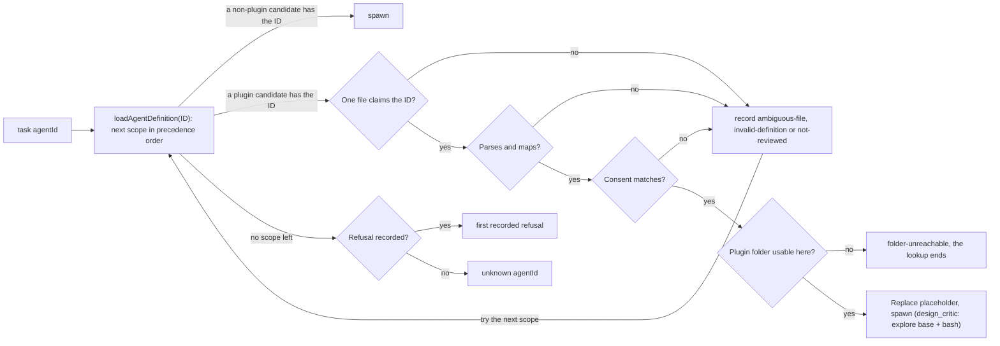

# Foreign plugin agents

- **Status:** Implemented

---

## Overview

Xum runs agent files that plugins of other harnesses ship. A foreign plugin agent is an agent file written in Claude Code or Cursor format (the term `src/node/services/agentDefinitions/pluginAgentFormat.ts` already uses). This design closes two gaps that stop such agents from doing their job: Xum leaves `${CLAUDE_PLUGIN_ROOT}` unreplaced in agent files, and read-only Claude agents cannot search code. It also makes plugin agent spawn errors name their cause.

Two related designs have their own RFCs:

1. Install method choice, which lets a plugin repository that ships several manifests install through its Claude or Cursor manifest: [`rfc/20261106_plugin-install-method-choice.md`](https://github.com/coder/xum/blob/4a1cf82e1da83bfabc04c340c8f080e2fc3eb7e4/rfc/20261106_plugin-install-method-choice.md) at commit `4a1cf82e1d` of branch `plugin-install-method-choice-parked`.
2. Spawning a foreign agent by its frontmatter `name` (`egm-design`) or by `<plugin>:<name>`: [`20261105_foreign-plugin-agent-aliases.md`](./20261105_foreign-plugin-agent-aliases.md). Its design did not converge in review.

The motivating plugin is egm ([google/elephant-goldfish-model](https://github.com/google/elephant-goldfish-model)), a design-review plugin whose skills spawn persona reviewer agents. The work shipped as two PRs: [#7938](https://github.com/coder/xum/pull/7938) (A2, A4) and [#7939](https://github.com/coder/xum/pull/7939) (A3).

### Terms

- **Managed git install**: a plugin that the user installed from a git repository in Settings → Plugins. Xum keeps one **registry row** per managed install in `~/.xum/plugins.json`, with its source, commit, imported components and consent records.
- **Plugin sources**, in agent precedence order (earlier wins): project agents, project plugins (a repository's own `.xum/plugins`), remote project plugins (the project plugins of a trusted remote checkout, read from the remote workspace, [#6426](https://github.com/coder/xum/issues/6426)), global agents, global plugins (managed installs and `~/.agents/plugins`), built-in agents.
- **Agent ID**: the lowercased file stem of an agent file (`pluginAgentIdOf` in `src/node/services/agentPlugins/agentFiles.ts`). `task` takes it as `agentId`.
- **Consent review**: the step where the user approves a managed plugin's components. Xum records a **consent fingerprint** per component. For an agent, the fingerprint covers its ID, file name and mapped frontmatter, not its body (`agentConsentSubject` in `src/node/services/agentPlugins/componentConsent.ts`). A component whose fingerprint changed shows "Changed since you reviewed it" and does not load until the user reviews it again.
- **Agent base**: the built-in agent (`exec` or `explore`) whose prompt, tool policy and model settings a mapped foreign agent inherits.
- **Plugin folder**: the installed tree of a plugin, which `${CLAUDE_PLUGIN_ROOT}` names.
- **"Decided by: author (delegated)"**: the author asked the drafting agent to make this choice during design and accepted the result.

## The Problem

**egm's Claude agents cannot do their job in Xum.** egm's Claude manifest declares 9 agents: 7 reviewers, a synthesizer and a bootstrap orchestrator. Two gaps in how Xum runs foreign plugin agents stop them, whatever the install path:

1. **Plugin root placeholder.** Each egm Claude adapter tells the agent to read its persona from `${CLAUDE_PLUGIN_ROOT}/agents/<persona>.md` and to resolve bundled standards against the same placeholder. Xum replaces that placeholder in plugin skills (`substituteSkillDirectoryPlaceholders` in `src/node/services/agentSkills/skillDirectory.ts`) and in plugin MCP config (`expandPluginPlaceholders` in `src/node/services/agentPlugins/expansion.ts`), but not in agent files. The agent gets a path that does not exist and, as its adapter instructs, reports an incomplete review.
2. **Code search.** egm's Claude reviewers declare `tools: [Read, Grep, Glob]`. Xum has no grep or glob tool, so `Grep` and `Glob` grant nothing. The mapped allowlist then removes every tool the list does not grant (`CLAUDE_TOOLS` and `mapToolLists` in `src/node/services/agentDefinitions/pluginAgentFormat.ts`). The reviewers can read a file by path but cannot list folders or search.

**The `egm-in-xum` skill works around it.** That skill, from the Coder team's `coder/fux-plugins` plugin, tells the agent to spawn a generic `explore` child for each reviewer, with a brief that starts "read this persona file". Every review spawn carries that extra brief text, and every egm update needs the mapping checked again.

**A subfolder install reaches egm's Claude manifest.** egm commits a Claude-only package at `distributions/claude/`, and Xum can install a repository subfolder. Once the two gaps are closed, that install gives egm its agents. A plugin that ships all of its manifests in one folder needs install method choice ([`rfc/20261106_plugin-install-method-choice.md`](https://github.com/coder/xum/blob/4a1cf82e1da83bfabc04c340c8f080e2fc3eb7e4/rfc/20261106_plugin-install-method-choice.md) at commit `4a1cf82e1d` of branch `plugin-install-method-choice-parked`).

## Goals

1. **Plugin agents find their plugin's files.** Xum replaces `${CLAUDE_PLUGIN_ROOT}` in foreign plugin agent bodies. A foreign plugin agent whose body contains `${CLAUDE_PLUGIN_ROOT}`, on a workspace that cannot read its plugin folder, is left out of that workspace's `task` list. The spawn error and the composition inspector give the reason.
2. **Read-only Claude agents can search code.** A Claude-format plugin agent whose tool list holds only `Read`, `Grep`, `Glob` or `LS`, and names at least one of the last three, gets the `explore` base, Explore's prompt and the bash tools. `disallowedTools: Bash` still removes bash.
3. **Spawn errors name the cause.** When `task` refuses a plugin agent by its ID, the error names one reason: `not-reviewed`, `ambiguous-file`, `folder-unreachable` or `invalid-definition`. It does not say "unknown agentId" for an agent file of a plugin that Xum loads. A plugin that Xum does not load, such as an untrusted project plugin, has no agent to refuse.
4. **The egm success test passes.** On a local workspace, egm installed from its `distributions/claude` subfolder and reviewed lists its agents in `task`. `task` with `agentId: design_critic` starts the design reviewer, and the reviewer reads its persona file and searches code with bash.

## Non-Goals

1. **Changing egm.** This design changes only Xum.
2. **`${CURSOR_PLUGIN_ROOT}` in agent bodies.** egm's Cursor agents take their root from the task text, so egm does not need it.
3. **Honoring `omitClaudeMd`.** Xum does not honor `omitClaudeMd` and still sends project instructions to these agents.
4. **Native read-only search tools.** Goal 2 uses bash. Adding grep and glob tools to Xum is a separate design.
5. **Xum-host plugin agents that use `${CLAUDE_PLUGIN_ROOT}` on SSH, Docker and devcontainer workspaces.** These agents are hidden there (A2). A remote project plugin's agent stays available on the remote host that holds its folder.
6. **Spawning a foreign agent by its frontmatter `name` or by `<plugin>:<name>`.** This moved to [`20261105_foreign-plugin-agent-aliases.md`](./20261105_foreign-plugin-agent-aliases.md). Until it ships, the `egm-in-xum` skill tells the parent to list the plugin's `agents/` folder to map each persona name to its file name, and the success test uses the ID `design_critic`.

## Open Questions

None.

## Critical User Journeys (CUJs)

### CUJ 1: Run egm's design reviewer

- **Given**: egm is installed from `google/elephant-goldfish-model/distributions/claude`, and its components are reviewed. The user is on a local workspace.
- **When**: A parent agent spawns `design_critic` on a design document.
- **Then**: The reviewer reads `agents/design_critic.md` from the plugin folder and searches the repository with bash. On an SSH workspace, the `task` list leaves `design_critic` out, and a direct spawn returns `folder-unreachable`.

## Technical Plan (Architecture)

The plan changes how Xum runs foreign plugin agents, from every plugin source. Part B, which changes which manifest a managed git install loads, is in [`rfc/20261106_plugin-install-method-choice.md`](https://github.com/coder/xum/blob/4a1cf82e1da83bfabc04c340c8f080e2fc3eb7e4/rfc/20261106_plugin-install-method-choice.md) at commit `4a1cf82e1d` of branch `plugin-install-method-choice-parked`.

### Part A: foreign plugin agents

#### A1. Agent aliases (moved)

Aliases moved to [`20261105_foreign-plugin-agent-aliases.md`](./20261105_foreign-plugin-agent-aliases.md). The label A1 stays unused here so that A2 to A4 keep their names. Nothing in A2 to A4 depends on aliases.

#### A2. Plugin root placeholder in agent bodies

- **Replacement.** When Xum reads the body of a foreign plugin agent, it replaces `${CLAUDE_PLUGIN_ROOT}` with the plugin folder's path. It uses `expandPluginPlaceholders` in `src/node/services/agentPlugins/expansion.ts`, the replacer for plugin MCP config. Its parameter is `Partial<PluginPlaceholderValues>`, so that agent bodies set only `CLAUDE_PLUGIN_ROOT`. `PLUGIN_ROOT` and `PLUGIN_DATA` stay required in `PluginPlaceholderValues`, so MCP callers keep passing them. `${CLAUDE_SKILL_DIR}`, `${CLAUDE_PLUGIN_DATA}`, `${CURSOR_PLUGIN_ROOT}`, `${PLUGIN_ROOT}` and `${PLUGIN_DATA}` stay literal. Xum-format agent bodies are unchanged.
- **Path form.** For a plugin on the Xum host, Xum inserts the native absolute path with forward slashes (`C:/Users/...` on Windows hosts). A remote project plugin's path stays as the remote reports it. `file_read` resolves it with `path.resolve`, and Git Bash accepts it. The POSIX form that skill directories use (`/c/Users/...`, built by `resolveSkillDirectory` in `skillDirectory.ts`) breaks `file_read`, because `path.resolve` turns it into `C:\c\Users\...` (`LocalBaseRuntime.normalizePath` in `src/node/runtime/LocalBaseRuntime.ts`). I did not verify the Git Bash behavior on a Windows host. PR 1 adds a test with a win32 path.
- **Consent.** Replacement happens after the consent check, on the text sent to the model. The fingerprint does not change, because it never covered the body (Terms). Any later fingerprint of the agent body must hash the bytes before replacement.
- **Availability.** A foreign plugin agent whose body contains `${CLAUDE_PLUGIN_ROOT}` is available on a workspace only when its plugin folder is usable there. "Usable" is the skill rule, moved from `getSkillDirectoryUnavailableReason` in `skillDirectory.ts` into one shared function: the plugin and the workspace are on the same remote runtime, or both run on the Xum host. Host plugins on a local or worktree workspace pass. Remote project plugins on the remote host that holds their folder pass. Host plugins on SSH, Docker and devcontainer workspaces fail.
- **Unavailable agents.** An unavailable agent stays in the discovered agent list with an `unavailableReason`. The `task` tool list leaves it out, so the model does not try it. This filter runs before the `resolveAgentFrontmatter` call in `discoverAvailableSubagentsForToolContext` (`src/node/services/turnContextAssembler.ts`), because that call's `catch` keeps descriptors. A direct spawn returns `folder-unreachable`: "plugin agent design_critic of egm needs its plugin folder, which this workspace cannot read (runtime: ssh). Run it from a local or worktree workspace." Skills differ: an unreachable skill stays listed with a note, because its text still loads. A foreign agent whose body points at its plugin folder cannot do its job without that folder.

#### A3. Code search for read-only Claude agents

- **New rule.** A Claude-format `tools` list is a **read-only search list** when every entry is exactly `Read`, `Grep`, `Glob` or `LS` (with no specifier such as `Grep(*.ts)` and no `mcp__` entry), and at least one entry is `Grep`, `Glob` or `LS`. Names match with case, as `mapAllowedEntry` in `pluginAgentFormat.ts` matches today, so `[read, grep]` is not a search list. One four-name constant defines the set.
- **Mapping.** In a read-only search list, `Grep`, `Glob` and `LS` grant the bash tools (`BASH_TOOLS` in `pluginAgentFormat.ts`). In any other list they grant nothing, as today. `LS` gets a row in the tool table (`CLAUDE_TOOLS` in `pluginAgentFormat.ts`), which also stops an `LS` in `disallowedTools` from making Xum skip the agent.
- **Denylist order.** The mapping keeps Claude's order: `disallowedTools` first, then the `tools` entries that remain (`mapToolLists` and `isReadOnlySearchList` in `pluginAgentFormat.ts`). So `disallowedTools: [Grep]` removes `Grep` from the list before the rule runs, and a list left with no search tool grants no bash. This removal matches names without case and ignores specifiers, as `mapDeniedEntry` in `pluginAgentFormat.ts` does, so `disallowedTools: [grep]` and `[Grep(*.ts)]` also remove `Grep`. `disallowedTools: Bash` removes the bash tools in every case (`mapToolLists` in `pluginAgentFormat.ts`).
- **Base and prompt.** `isReadonlyForeignPluginAgent` in `pluginAgentFormat.ts` also returns true for a read-only search list. Such an agent gets the treatment of a Cursor `readonly: true` agent: the `explore` base, and Explore's prompt before its own body (`mapForeignPluginAgentFrontmatter` in `pluginAgentFormat.ts`). Explore removes file edits and `task`. The mapped allowlist removes every other tool that the list does not grant.
- **Documented exception.** The tool table's rule is that its allow list grants Xum tools "only for the core tools, where the Xum tools do the same job and no more" (the doc comment above `CLAUDE_TOOLS` in `pluginAgentFormat.ts`). The table records this rule as its one named exception, with the reason: Xum has no read-only search tool.
- **For egm.** The rule applies to egm's 7 reviewers. The synthesizer (`Agent, Read, Grep, Glob, Write`) and the bootstrap orchestrator (which also lists `Bash` and `Edit`) keep today's mapping.
- **Side effects.** All three follow from the mapped frontmatter changing:
  1. Affected agents of managed installs show "Changed since you reviewed it" and need one review. The release note says why.
  2. A downgrade changes the fingerprint back, and the agents need review again there.
  3. Agents with `model: inherit` move from the user's Exec model settings to their Explore model settings, and inherit Explore's 5-minute prompt cache.

#### A4. Spawn errors

`TaskService` passes four plugin agent refusals to the model instead of "unknown agentId" (`checkTaskAgentRunnable` and `readReservationAgentDefinition` in `src/node/services/taskService.ts`):

- `not-reviewed`: the agent's consent fingerprint does not match its record.
- `ambiguous-file`: two files of one plugin claim the ID ([#6629](https://github.com/coder/xum/issues/6629), `ambiguousPluginAgentIds` in `agentFiles.ts`).
- `folder-unreachable`: A2.
- `invalid-definition`: the file does not parse or map, for example a `ForeignPluginAgentToolsError` (`pluginAgentFormat.ts`), or it is a link that leads out of the plugin folder (`resolvePluginAgentFile` in `agentDefinitionsService.ts`).

Today `loadAgentDefinition` catches parse and consent errors and moves on to the next scope (`src/node/services/agentDefinitions/agentDefinitionsService.ts`). Discovery skips the same candidates (`readAgentDescriptorFromFile` in `agentDefinitionsService.ts`), so a lower-precedence agent with the same ID wins in both. A spawn by ID starts the agent that discovery lists under that ID, so the four refusals take two paths:

- `not-reviewed`, `ambiguous-file` and `invalid-definition` keep today's skip. `loadAgentDefinition` records the refusal and moves on to the next scope. It throws the first recorded refusal as a `PluginAgentRefusalError` only when no later scope has the ID.
- `folder-unreachable` ends the lookup. An unavailable agent keeps its place in discovery (A2), so it hides a lower-precedence agent with the same ID from the `task` list. A spawn of that ID returns `folder-unreachable` and never starts the lower agent. So on an SSH workspace, a foreign plugin agent named `exec` whose body uses `${CLAUDE_PLUGIN_ROOT}` returns `folder-unreachable` and does not fall back to the built-in Exec agent.

The `folder-unreachable` result is an opt-in of `loadAgentDefinition`. Only the two `task` spawn paths pass it: `checkTaskAgentRunnable` and `readReservationAgentDefinition` (the `createMany` definition read), both in `taskService.ts`. Every other caller (agent resolution for the main chat, base chains, AI settings resolution, workspace turns, turn context assembly and the other `TaskService` reads) does not pass it and resolves the ID as it does today. An unreachable foreign agent never breaks a main chat or a base chain. `checkTaskAgentRunnable` already runs after the parent runtime is loaded, so it maps the refusal there with no new lookup.

The diagram shows how one spawn by ID resolves.

### Delivery

Two PRs, each with its own tests and downgrade note:

1. A2 and A4: placeholder replacement, the shared availability rule and the spawn errors ([#7938](https://github.com/coder/xum/pull/7938)).
2. A3: code search for read-only Claude agents, with the release note about the new review ([#7939](https://github.com/coder/xum/pull/7939)).

## Alternatives Considered

### Scope

#### Alternative J: Keep the `egm-in-xum` fallback

- **Mechanism**: No change. Parents spawn generic `explore` children with a brief that says "read the persona file".
- **Pros**: It works today on local and worktree workspaces, and the reviewers have bash.
- **Cons**: Each spawn carries a hand-written brief. The mapping has to be checked by hand on every egm update. It does nothing for other plugins.
- **Reason for Rejection**: Decided by: author. The plugin's own agents do the same job once Part A ships, without a brief per spawn.

### Part A

#### Alternative G: Run read-only Claude agents on the `explore` base to get bash

- **Mechanism**: Change only the base of agents with read-only tool lists from `exec` to `explore`.
- **Pros**: A one-line mapping change.
- **Cons**: It grants no search tool. The mapped `tools` list removes every tool it does not name, on any base (`mapToolLists` in `pluginAgentFormat.ts`), so the agent still has only `file_read` and `attach_file`.
- **Reason for Rejection**: Decided by: author (delegated). A3 grants the bash tools explicitly.

#### Alternative H: Native read-only search tools

- **Mechanism**: Add grep and glob tools to Xum, and map Claude `Grep` and `Glob` to them.
- **Pros**: It keeps egm's "no shell" rule for reviewers and the mapping rule "the same job and no more". A prompt injection in a reviewed document could not run shell commands.
- **Cons**: Two new tools for every agent, each with its own limits, output caps, remote-runtime support and tests.
- **Reason for Rejection**: Decided by: author. The new tools are a larger change than this design. Accepted instead: a prompt injection in a reviewed document can run shell commands (Risks & Mitigations). It stays a possible follow-up (Non-Goal 4).

#### Alternative O: Show the shell grant as its own consent item

- **Mechanism**: A3 applies only after the user approves a separate consent item that says "This agent gets a shell for search".
- **Pros**: The user sees the shell grant in plain words, instead of as a changed fingerprint.
- **Cons**: Unmanaged and project plugins have no consent records, so they still need a rule without consent. It adds a consent kind for one mapping rule.
- **Reason for Rejection**: Decided by: author (delegated). The release note and the read-only agent text in the review ("edit tools removed, shell still available") name the grant. A new consent kind is a separate change.

## Risks & Mitigations

| Risk                                                            | Failure mode                                                                                                                                                                                                                                                                                   | Mitigation or acceptance                                                                                                                                                                                                                                                                   |
| --------------------------------------------------------------- | ---------------------------------------------------------------------------------------------------------------------------------------------------------------------------------------------------------------------------------------------------------------------------------------------- | ------------------------------------------------------------------------------------------------------------------------------------------------------------------------------------------------------------------------------------------------------------------------------------------ |
| Bash for read-only search agents (A3)                           | A prompt injection in a document that a reviewer reads runs shell commands. Bash on the `explore` base is read-only by instruction only. egm's own rule says "Reviewers cannot edit files or run shell commands" (egm `docs/claude.md`, section "Reviewer isolation", at commit `113a3afc44`). | Accepted by the author, who chose bash over native search tools (Alternative H). The trigger set excludes `WebFetch` and `WebSearch`, so agents that read web pages do not gain bash. `disallowedTools: Bash` removes it.                                                                  |
| No review for unmanaged and project plugin agents               | Agents of those plugins that match A3 gain bash with no consent review, because those plugins have no consent records (`isPluginAgentConsented` in `src/node/services/agentPlugins/componentConsent.ts`).                                                                                      | Accepted by the author. The release note names the change.                                                                                                                                                                                                                                 |
| Agent bodies and the files they read are not covered by consent | An upstream change to an agent body loads with no review. A2 makes persona files reachable, and consent does not cover them either.                                                                                                                                                            | Accepted: plugin skills already expose the same plugin folder today. A2 does not change the fingerprint. [#6617](https://github.com/coder/xum/issues/6617) (closed) settled body consent for skills by fingerprinting only their directive lines. The agent fingerprint has no body field. |
| One review after the upgrade, one after a downgrade             | A3 changes the mapped frontmatter, so affected managed agents show "Changed since you reviewed it" until reviewed, and again after a downgrade.                                                                                                                                                | Release note. The existing review row explains it.                                                                                                                                                                                                                                         |
| Remote runtimes                                                 | Foreign agents of Xum-host plugins that use `${CLAUDE_PLUGIN_ROOT}` cannot run on SSH, Docker or devcontainer workspaces.                                                                                                                                                                      | They are hidden from the `task` list there (Non-Goal 5).                                                                                                                                                                                                                                   |

---

## Non-Functional Requirements

- **Security.** See Risks & Mitigations.
- **Performance.** Spawns by ID read no extra files.
- **Rollout and rollback.** No feature flag and no new stored state. A3 changes agent fingerprints, so affected managed agents need one review after the upgrade and one more after a downgrade.

---

## Detailed Implementation Plan

The plan has three parts. The acceptance criteria and the Verification Plan are binding: a PR merges only when its criteria pass and its verification steps ran. The target file list is advisory. After implementation, record file-level drift once in an "As built" list at the end of this document. Do not update the target file list in each review round.

### Acceptance criteria (binding)

Each criterion is a behavior and names the PR that must pass it.

1. (PR 1) A foreign plugin agent whose body contains `${CLAUDE_PLUGIN_ROOT}` receives the plugin folder's path in its system prompt on a local workspace. `${CLAUDE_SKILL_DIR}`, `${CLAUDE_PLUGIN_DATA}`, `${CURSOR_PLUGIN_ROOT}`, `${PLUGIN_ROOT}` and `${PLUGIN_DATA}` stay literal. A Xum-format plugin agent's body is unchanged. On a win32 host path, the inserted path has the form `C:/...`.
2. (PR 1) On an SSH, Docker or devcontainer workspace, a foreign Xum-host plugin agent whose body uses `${CLAUDE_PLUGIN_ROOT}` is left out of the `task` tool description, and a direct spawn returns `folder-unreachable`, also when a lower-precedence scope has an agent with the same ID. That lower-precedence agent is left out of the `task` tool description too. Only the `task` spawn paths return `folder-unreachable`: main-chat agent resolution and a base chain through the same ID (for example an unreachable foreign `exec`) resolve as before this change. The same holds on a devcontainer runtime double. A Xum-format plugin agent whose body contains `${CLAUDE_PLUGIN_ROOT}` keeps its body unchanged and stays listed. The composition inspector shows the agent as a diagnostic with the `folder-unreachable` reason. A remote project plugin agent on the remote host that holds its folder is listed and spawns.
3. (PR 1) Replacing `${CLAUDE_PLUGIN_ROOT}` leaves the agent's consent fingerprint unchanged.
4. (PR 1) When no other scope has the ID, a spawn by ID of a plugin agent that is not reviewed, ambiguous, unreachable or invalid returns `not-reviewed`, `ambiguous-file`, `folder-unreachable` or `invalid-definition`. None of these spawns returns "unknown agentId". When a lower-precedence scope has the same ID, a not-reviewed, ambiguous or invalid plugin agent is skipped, and the spawn starts the agent that the `task` list shows for that ID.
5. (PR 2) A Claude agent with `tools: [Read, Grep, Glob]` resolves to the `explore` base with `file_read`, `attach_file` and the bash tools, and without file edits or `task`. With `disallowedTools: [Bash]` added, it has no bash tools. With `disallowedTools: [Grep, Glob]`, `[grep, glob]` or `[Grep(*.ts), Glob]` added, it has no bash tools.
6. (PR 2) Claude agents with `tools: [Read, Edit, Grep]`, `tools: [WebFetch, Grep]` or `tools: [read, grep]` keep the mapping they have before A3.
7. (PR 2) `LS` in `disallowedTools` does not make Xum skip the agent.
8. (PR 2) After the upgrade, a managed Claude agent whose mapping A3 changes shows "Changed since you reviewed it".

**egm success test**

9. (after PR 2) On a local workspace, egm at commit `113a3afc44e8f4f54722d7150d5701f65cc8ef7f`, installed from its `distributions/claude` subfolder and reviewed: a parent that spawns `design_critic` on a test document gets a review in which the child read `agents/design_critic.md` from the plugin folder and ran at least one `rg` or `grep` command with bash. This is a dogfood check, not an automated test (Verification Plan).

### Target files to create or modify (advisory)

Grouped by delivery PR. Paths are relative to the repository root.

#### PR 1: placeholder replacement and spawn errors (A2, A4)

1. `src/node/services/agentPlugins/expansion.ts` (Modify): make the values of `PluginPlaceholderValues` optional, so that a caller can set only `CLAUDE_PLUGIN_ROOT`. Unset names stay literal. MCP callers keep passing every value.
2. `src/node/services/agentPlugins/expansion.test.ts` (Modify): only the set names are replaced. MCP results are unchanged.
3. `src/node/services/agentPlugins/pluginPathAvailability.ts` (Create): `isPluginPathUsableFrom(sourceRuntime: Runtime, workspaceRuntime: Runtime): boolean`, the `sameRemote || bothOnHost` test moved out of `getSkillDirectoryUnavailableReason`. Also `toAgentBodyPath(path, sourceRuntime): string`, which returns the forward-slash native form for a Xum-host path and leaves a remote path unchanged.
4. `src/node/services/agentSkills/skillDirectory.ts` (Modify): `getSkillDirectoryUnavailableReason` calls `isPluginPathUsableFrom`. Skill behavior does not change.
5. `src/node/services/agentSkills/skillDirectory.test.ts` (Modify): skill results are unchanged for each runtime kind.
6. `src/node/services/agentDefinitions/pluginAgentFormat.ts` (Modify): export `isForeignPluginAgentFormat(raw)` (the private `isXumFormat`, negated).
7. `src/node/services/agentDefinitions/parseAgentDefinitionMarkdown.ts` (Modify): return whether a plugin file is foreign, so callers need no second parse.
8. `src/node/services/agentDefinitions/parseAgentDefinitionMarkdown.test.ts` (Modify): the foreign flag for Claude, Cursor and Xum-format files.
9. `src/common/orpc/schemas/agentDefinition.ts` (Modify): `AgentDefinitionDescriptorSchema` gains `unavailableReason?: string`.
10. `src/node/services/agentDefinitions/pluginAgentRefusal.ts` (Create): `PluginAgentRefusalError` with `reason: "not-reviewed" | "ambiguous-file" | "folder-unreachable" | "invalid-definition"`, `agentId`, `pluginName` and `detail`. Its message gives the reason and the next step, for example "plugin agent design_critic of egm has not been reviewed on this install. Open Settings → Plugins and select Review on the plugin."
11. `src/node/services/agentDefinitions/agentDefinitionsService.ts` (Modify)
    - Discovery sets `unavailableReason` for foreign plugin agents whose body contains the placeholder and whose candidate runtime fails `isPluginPathUsableFrom` against the workspace runtime.
    - The package read replaces the placeholder in the body after `parseAgentFile` checks consent, with `toAgentBodyPath`.
    - `loadAgentDefinition` takes an opt-in for the `task` spawn paths. With it, it throws a `folder-unreachable` `PluginAgentRefusalError` at once. Without it, availability does not change the result. For a consent, ambiguity, parse or mapping failure it records the refusal, tries the next scope, and throws the first recorded refusal when no later scope has the ID (A4).
12. `src/node/services/turnContextAssembler.ts` (Modify): `discoverAvailableSubagentsForToolContext` leaves out descriptors with `unavailableReason` before it calls `resolveAgentFrontmatter`.
13. `src/node/services/turnContextAssembler.test.ts` (Modify): the `task` list leaves out an unavailable agent and the lower-precedence agent with the same ID that it hides (criterion 2).
14. `src/node/services/taskService.ts` (Modify): `checkTaskAgentRunnable` and the `createMany` definition read (`readReservationAgentDefinition`) pass the opt-in and return a `PluginAgentRefusalError`'s message instead of "unknown agentId". No other caller passes the opt-in.
15. `src/node/services/agentDefinitions/agentDefinitionsService.test.ts` (Modify): criteria 1 and 3, and the discovery half of criterion 2 with a host plugin on a local runtime and on `HostKeyShellRemoteRuntime` (`src/node/runtime/testRemoteRuntime.ts`). The remote project plugin case reuses the `CountingRemoteRuntime` harness of `src/node/services/agentPlugins/remoteProjectPlugins.test.ts`.
16. `src/node/services/taskService.pluginAgents.test.ts` (Create): criterion 4 and the spawn half of criterion 2 through `TaskService.create` and `createMany`.
17. `src/node/services/agentPlugins/composition.ts` (Modify): unavailable agents appear as diagnostics whose `path` is the agent file.
18. `docs/agents/agent-skills.mdx` and `docs/agents/index.mdx` (Modify): Xum replaces `${CLAUDE_PLUGIN_ROOT}` in foreign plugin agent bodies on workspaces where the plugin folder is reachable, and the four spawn refusals. Then run `./scripts/generate-builtin-skills.sh` to regenerate `src/node/services/agentSkills/builtInSkillContent.generated.ts`. Never edit the generated file by hand.

#### PR 2: code search for read-only Claude agents (A3)

1. `src/node/services/agentDefinitions/pluginAgentFormat.ts` (Modify)
   - Add `LS` to `CLAUDE_TOOLS` with no grant and no deny.
   - Add the constant `READ_ONLY_SEARCH_TOOLS = ["Read", "Grep", "Glob", "LS"]` and `isReadOnlySearchList(entries)`: a `tools` list, after the `disallowedTools` entries are removed, whose entries all equal a name in the constant, with no specifier and no `mcp__` entry, and that names `Grep`, `Glob` or `LS`.
   - `mapAllowedEntry` grants `BASH_TOOLS` for `Grep`, `Glob` and `LS` only inside such a list.
   - `isReadonlyForeignPluginAgent` also returns true for such a list.
   - The header comment names this rule as the one exception to "the same job and no more".
2. `src/node/services/agentDefinitions/pluginAgentFormat.test.ts` (Modify): criteria 6 and 7, with egm's reviewer, synthesizer and bootstrap orchestrator frontmatter as fixtures.
3. `src/node/services/agentDefinitions/agentDefinitionsService.test.ts` (Modify): criterion 5 through `resolveToolPolicyForAgent`, which gives the effective tool set.
4. `src/node/services/agentPlugins/installService.test.ts` (Modify): criterion 8, with a consent record built from the frontmatter that the mapping before A3 produces. The test stores that mapped frontmatter as a literal fixture.
5. `src/browser/features/Settings/Sections/PluginsSettingsSection.tsx` (Modify): read-only search agents use the existing read-only agent text "(edit tools removed, shell still available)" (`ReadonlyAgentNote`). Keep the sentence "Unless that list removes Bash, it can run shell commands" (`PreviewDisclosures`). Add after it: "A list of only Read, Grep, Glob and LS that names Grep, Glob or LS also gets the shell, for search."
6. `docs/agents/index.mdx` (Modify): the tool table rows for `Grep`, `Glob` and `LS`, and the read-only search rule. Then regenerate the built-in skill content.

### Verification Plan (binding)

- **Build and types:** `make typecheck`.
- **Static checks:** `make static-check` before every push, and `make lint-eslint` for the type-aware rules on changed files.
- **Unit tests:** `make test-unit` for every PR. It runs the isolated files one per process (the `test-unit` target in `Makefile`). During development, run the listed test files directly with `bun test <file>`.
- **Quality gates:** `make crap-check`, `make dry-check` and `make mutate-check` on the changed functions. Fix findings per the `crap-gate` and `gauntlet` skills.
- **Dogfood (criterion 9):**
  1. Start an isolated dev server with the `dev-server-sandbox` skill.
  2. In Settings → Plugins, install `google/elephant-goldfish-model/distributions/claude` at commit `113a3afc44e8f4f54722d7150d5701f65cc8ef7f`, and review the components.
  3. In a local workspace, ask the agent to spawn `design_critic` on a small test document.
  4. Pass: the transcript shows that the child read `agents/design_critic.md` from the plugin folder and ran an `rg` or `grep` command with bash.

## As built

- **PR 1** ([#7938](https://github.com/coder/xum/pull/7938), merged as `5c69acd192`):
  - `Task.createWorkspaceTurn` (`workspaceTurnManager.ts`) also names the plugin agent refusals instead of "unknown agentId", at three sites.
  - The SSH, Docker and devcontainer runtimes have a `Runtime.mode` getter, which the `folder-unreachable` message names (`runtimeMode.test.ts`).
  - `isPluginPathUsableFrom` is the shared availability rule for plugin skills and agents.
  - `agentResolution.test.ts` also changed.
  - `PluginPlaceholderValues` keeps `PLUGIN_ROOT` and `PLUGIN_DATA` required, and `expandPluginPlaceholders` takes `Partial<PluginPlaceholderValues>` (PR 1 target item 1 plans optional values).
  - `AgentDefinitionDescriptorSchema` gains `unavailablePath`, the agent file, next to `unavailableReason`. The composition inspector uses it as the diagnostic `path`.
- **PR 2** ([#7939](https://github.com/coder/xum/pull/7939), merged as `05f5bf7c2f`):
  - The install review labels an agent "(edit tools removed, shell removed)" when its mapped tools leave no bash tool, and the preview gains the field `shellRemovedAgents`. The label appears only on read-only agents.
  - The bash grant sits in `mapToolLists`, not in `mapAllowedEntry` (PR 2 target item 1).
  - `isReadOnlySearchList` takes `(entries, denylist)`, because it removes the denylist entries before it tests the list (PR 2 target item 1 plans `isReadOnlySearchList(entries)`).
- **All-local multi-project workspaces** ([#7955](https://github.com/coder/xum/pull/7955), merged as `ae09165b64`): a multi-project workspace counts as local for plugin folders when every one of its projects is a local or worktree workspace. `isPluginPathUsableFrom` passes there, and `docs/agents/index.mdx` says so.
- **Criterion 9** passed in a real-model run of the Dogfood steps on a local merge of the PR 1 head `e3d7c59203` and the PR 2 head `a8eda2a7be`, with egm's `distributions/claude` at `113a3afc44` ([evidence](https://github.com/coder/xum/pull/7939#issuecomment-6671744536)). The child read `agents/design_critic.md` from the plugin folder and searched the code with `grep` through bash. Both PRs gained commits after the run and before they merged. The evidence comment calls this criterion "criterion 23", its number before the split.

---

_Drafted with EGM_
