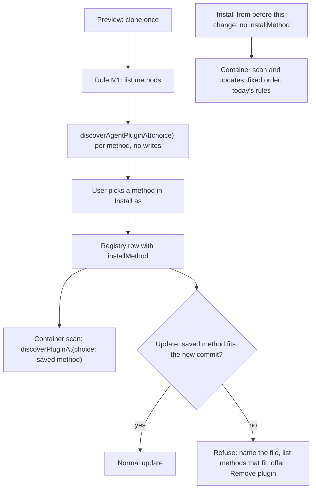

# Plugin install method choice

- **Status:** Draft. Split out of [`20261104_plugin-install-methods.md`](./20261104_plugin-install-methods.md), which keeps Part A (foreign plugin agents). The plan labels start at B1 and the acceptance criteria at 9, so that the prototype branches' references to them stay valid.

---

## Overview

Xum installs agent plugins from git repositories (Settings → Plugins). Some plugin repositories, egm among them, ship one manifest per harness: a root `plugin.json`, `.codex-plugin/plugin.json`, `.claude-plugin/plugin.json` and `.cursor-plugin/plugin.json`. Each manifest declares a different set of components. Xum reads only one of them, picked by a fixed order, and never tells the user that the others exist.

This design makes each manifest that Xum can load an install method. The install preview lists the methods with the components each one gives. Xum saves the method the user picks, and discovery, consent reviews and updates load that manifest.

The motivating plugin is egm ([google/elephant-goldfish-model](https://github.com/google/elephant-goldfish-model)), a design-review plugin whose skills spawn persona reviewer agents. Its Claude agents also need the foreign plugin agent fixes of [`20261104_plugin-install-methods.md`](./20261104_plugin-install-methods.md) (Part A), which have shipped. This design is not built. Two closed prototype PRs hold code for it (Delivery).

### Terms

- **Managed git install**: a plugin that the user installed from a git repository in Settings → Plugins. Xum keeps one **registry row** per managed install in `~/.xum/plugins.json`, with its source, commit, imported components and consent records. Method choice applies only to managed git installs.
- **Plugin sources**, in agent precedence order (earlier wins): project agents, project plugins (a repository's own `.xum/plugins`), remote project plugins (the project plugins of a trusted remote checkout, read from the remote workspace, [#6426](https://github.com/coder/xum/issues/6426)), global agents, global plugins (managed installs and `~/.agents/plugins`), built-in agents.
- **Consent review**: the step where the user approves a managed plugin's components. Xum records a **consent fingerprint** per component. For an agent, the fingerprint covers its ID, file name and mapped frontmatter, not its body (`src/node/services/agentPlugins/componentConsent.ts:301-324`). A component whose fingerprint changed shows "Changed since you reviewed it" and does not load until the user reviews it again.
- **Update review**: the screen that shows what an update changes before the user applies it.
- **Manifest method**: an install method that reads one of the repository's manifests (B1). **Generated method**: `skills` or `claude-marketplace`, which write a `plugin.json` into the installed tree and record themselves in its `generatedFrom` marker.
- **Fixed order**: today's manifest order: root `plugin.json` with `$schema`, then `.codex-plugin/plugin.json`, `.claude-plugin/plugin.json`, `.cursor-plugin/plugin.json`, and last a root `plugin.json` without `$schema` when nothing else exists (`src/node/services/agentPlugins/discovery.ts:1500-1526`).
- **Fits**: a saved method fits a commit when rule M1 offers it for that commit and its manifest validates (B5).
- **Staged tree**: the temporary clone that the install preview and install read before Xum moves it into place.
- **"Decided by: author (delegated)"**: the author asked the drafting agent to make this choice during design and accepted the result.

## The Problem

**Users get fewer components than the plugin offers, and nothing tells them.** Every egm manifest resolves the same 7 skills. Its Claude manifest also declares 9 agents (7 reviewers, a synthesizer and a bootstrap orchestrator), and its Cursor manifest declares 7 reviewers. Xum loads egm through the Codex manifest, because Xum skips a root `plugin.json` without `$schema` and the Codex manifest comes next in the fixed order. A Codex package gets no agents (`src/node/services/agentPlugins/discovery.ts:1438-1446`). The result is 7 skills and 0 agents. The preview offers no other choice: `detectInstallMethods` returns only "Agent Plugin" when a Codex manifest exists (`src/node/services/agentPlugins/installMethods.ts:312-317`).

**Picking the Claude manifest also needs the agent fixes.** egm's Claude agents need `${CLAUDE_PLUGIN_ROOT}` replaced in their bodies and need code search. Part A of [`20261104_plugin-install-methods.md`](./20261104_plugin-install-methods.md) ships both.

**A subfolder install helps plugins that publish one folder per harness.** egm commits a Claude-only package at `distributions/claude/`, and Xum can install a repository subfolder today. With Part A, that gives egm its agents. It does not help a plugin that ships all of its manifests in one folder. An egm draft design (`docs/designs/claude_release_branch_distribution.md`) proposes moving that package to a generated `release/claude` branch.

## Goals

1. **Each loadable manifest is a choice.** For a repository that ships more than one manifest Xum can load, the install preview offers each one as its own method. One exception: when the root `plugin.json` has `$schema` (a Xum-native package), Xum offers only that manifest (rule M1). Each method shows its component counts: skills, agents, hooks that can run, hooks that are listed and never run, and MCP servers. A manifest that fails validation is not offered, and the preview shows its validation error as a warning.
2. **The choice holds.** After the user installs with a manifest method, every part of Xum that discovers, reviews or loads that plugin uses the chosen manifest. Restarts and updates keep the method.
3. **Changing the method is a new install.** The user picks another method by uninstalling and installing again. Xum runs a full consent review for it.
4. **A method that does not fit the new commit refuses the update.** When the commit an update would install does not fit the saved method, Xum refuses the update. The message names the missing or invalid file, lists the methods that fit the new commit, and says how to switch: uninstall and install again. The update review also offers "Remove plugin". Not updating keeps the plugin on its current commit, still tracking its branch.
5. **Users and maintainers can see the method.** The Settings plugin row, the composition inspector, `bun run debug plugins` and the install and update log lines show the method and the manifest path that loaded. The Settings row also lists the other manifest methods that the installed copy offers, with their agent counts.
6. **The egm success test passes.** On a local workspace, egm installed with the `claude-plugin` method loads 7 skills and 9 agents, each with an accepted consent review. `task` with `agentId: design_critic` starts the design reviewer, and the reviewer reads its persona file and searches code with bash (Part A of the parent RFC).

## Non-Goals

1. **Running Claude-format hooks.** Xum lists them and runs none today. The preview says so. Running them needs a mapping from Claude tool names to Xum tools, which is a separate design.
2. **Method choice outside managed git installs.** Marketplace entries install through their entry folder, as today. A `claude-marketplace` install, which writes a generated `plugin.json` for an entry folder without a manifest, writes no `installMethod` and keeps the fixed order. An entry folder with its own manifest, which includes every Cursor marketplace entry (`installMethods.ts:11-13`), installs like a subfolder install and saves that manifest's method. Unmanaged plugins in `~/.agents/plugins` and project plugins keep the fixed order.
3. **Changing the method in place.** There is no "change method" action on an installed plugin, and updates never change the method (Alternative K).
4. **Migrating existing installs.** An install without a saved method keeps today's behavior. Xum does not guess a method for it.

## Open Questions

None.

## Critical User Journeys (CUJs)

### CUJ 1: Install egm with its agents

- **Given**: egm is not installed. The user is on a local workspace.
- **When**: The user adds `google/elephant-goldfish-model` in Settings → Plugins, picks "Claude Code plugin" in the "Install as" toggle, reviews the components and installs.
- **Then**: Before the pick, the toggle showed "Agent Plugin (.codex-plugin/plugin.json)" with 7 skills and 0 agents, "Claude Code plugin (.claude-plugin/plugin.json)" with 7 skills and 9 agents, and "Cursor plugin (.cursor-plugin/plugin.json)" with 7 skills and 7 agents. After install, the Settings row says "Installed as Claude Code plugin". A parent agent spawns `design_critic`, and the reviewer reads `agents/design_critic.md` from the plugin folder and searches the repository with bash.

### CUJ 2: The saved manifest disappears upstream

- **Given**: egm is installed with the `claude-plugin` method and tracks `main`.
- **When**: A new egm commit deletes `.claude-plugin/`, and the user opens the update.
- **Then**: Xum refuses the update with ".claude-plugin/plugin.json is gone in this commit. Methods that fit this commit: Agent Plugin, Cursor plugin. To switch, uninstall the plugin and install it again." The update review offers "Remove plugin". If the user closes it, egm stays on its current commit and keeps tracking `main`.

### CUJ 3: An existing install after the upgrade

- **Given**: egm was installed before this change, through the Codex manifest, so its registry row has no saved method.
- **When**: The user upgrades Xum and opens Settings → Plugins.
- **Then**: egm still loads 7 skills and 0 agents, and its updates keep using the Codex manifest. Its row says "Installed as Agent Plugin" and "also installable as Claude Code plugin (9 agents), Cursor plugin (7 agents)". Getting the agents takes an uninstall and a new install.

## Technical Plan (Architecture)

The plan changes which manifest a managed git install loads. It needs none of the parent RFC's code, but egm's agents work only with Part A of the parent RFC.

### Part B: install methods

#### B1. Method kinds and rule M1

The manifest methods, each with a short label for the Settings row and a long label (short label plus the loaded file) for the "Install as" toggle:

| Kind            | Manifest it loads                                                                                     | Short label        |
| --------------- | ----------------------------------------------------------------------------------------------------- | ------------------ |
| `agent-plugin`  | `plugin.json` with `$schema`, or else `.codex-plugin/plugin.json` under a schema-less root (as today) | Agent Plugin       |
| `claude-plugin` | `.claude-plugin/plugin.json`                                                                          | Claude Code plugin |
| `cursor-plugin` | `.cursor-plugin/plugin.json`                                                                          | Cursor plugin      |

The short labels already exist (`src/common/constants/agentPluginInstallMethods.ts`). `skills` and `claude-marketplace` stay generated methods. `cursor-marketplace` stays as it is: its entry installs through its own manifest.

One table in `discovery.ts` lists the four manifest files in the fixed order. `selectManifest` and `detectInstallMethods` both read it, so they list the same files in the same order. A test pins the order. A new manifest file can only be added at the end, because a new position changes which manifest an install without a saved method loads.

**Rule M1: which manifest methods are offered.**

1. When the root `plugin.json` has `$schema`, Xum offers only `agent-plugin`, as today. A Xum-native package can load `hooks.js` and `workflows/` (`discovery.ts:1438-1446`), and consent has no `hooks` kind (`src/common/config/schemas/agentPluginInstalls.ts:68-79`). If the user picked another method there, an older build would load the root manifest and run a `hooks.js` that the user never saw. Offering only the root manifest removes that case. It also covers the case where the Codex file is the root manifest's `com.openai` overlay, the extra OpenAI metadata a root manifest reads from `.codex-plugin/plugin.json` (`discovery.ts:1172-1210`).
2. Otherwise Xum offers `agent-plugin` when a Codex manifest exists, `claude-plugin` when a Claude manifest exists and `cursor-plugin` when a Cursor manifest exists. Today Xum offers Claude or Cursor, never both (`installMethods.ts:319-321`).
3. A root `plugin.json` without `$schema` is never offered. Validation rejects it (`src/node/services/agentPlugins/manifest.ts:422-427`). A root `plugin.json` that cannot be read or parsed counts as the package's own manifest, as today (`discovery.ts:1485-1488`), and its error is shown. When a schema-less root `plugin.json` is the only manifest, the preview shows its `$schema` validation error, as today, and not the "No plugin.json ... found" error of `noInstallMethodMessage` (`installMethods.ts:405-412`).
4. A manifest that fails validation is not offered. Xum validates each offered method with one `discoverAgentPluginAt` call on the staged tree (B4). The preview shows the validation error as a warning, and install refuses that method.

For egm, M1 offers `agent-plugin` (.codex-plugin/plugin.json), `claude-plugin` and `cursor-plugin`. Xum does not read egm's `.plugin/plugin.json`, and this design does not change that.

#### B2. Selecting a named manifest

`selectManifest` (`discovery.ts:1500`) and `discoverPluginAt` gain a `choice` argument:

- `{ kind: "fixed-order" }` keeps today's behavior. It covers the generated methods and every plugin without a saved method.
- `{ kind: "method", method }` reads only that method's manifest. For `agent-plugin` that is the root `plugin.json` with `$schema`, or else the Codex manifest. It never reads the Claude or Cursor manifest. If the manifest is missing or invalid, discovery returns no plugin and an error diagnostic that names the method and the file. It never falls back to another manifest.

`discoverAgentPluginAt` (`discovery.ts:1834`), the exported wrapper of `discoverPluginAt`, takes `choice` as a required argument, so the compiler lists every caller. Each caller passes the choice of the tree it reads: the staged method during preview and install, and the saved method for an installed plugin. That includes crash recovery and the hook gate, which re-reads plugins on every hook call (`src/node/services/agentPlugins/codexHookService.ts:371`).

The container scan already reads the registry before it discovers each plugin (`discovery.ts:2255`, then `:2283`). It passes each managed plugin's saved method into `discoverPluginAt`. Plugins without a registry row get `fixed-order`.

#### B3. The saved method

- **Field.** The registry row gains an optional `installMethod`: `agent-plugin`, `claude-plugin` or `cursor-plugin`. Xum writes it when the user installs a repository or a subfolder with a manifest method. An entry folder with its own manifest, which includes every Cursor marketplace entry (`installMethods.ts:11-13`), installs like a subfolder install and saves that manifest's method. A `claude-marketplace` install, which writes a generated `plugin.json` for an entry folder without a manifest, writes no `installMethod` and keeps the fixed order (Non-Goal 2). Generated methods keep `generatedFrom`: their method is fixed by the file Xum wrote, and older builds already read that marker.
- **Tolerant parse.** Xum reads the field from the raw row with its own parser, `readStoredInstallMethod`, not with the row schema. The row schema strips unknown keys (`agentPluginInstalls.ts:81-122`). Discovery reads the raw row in `readPluginComponentImports` (`src/node/services/agentPlugins/registry.ts:95-151`). InstallService reads it from the raw rows that it already keeps to preserve unknown fields (`src/node/services/agentPlugins/installService.ts:2167-2175`). An unknown value (from a newer build) means `fixed-order` and logs one warning per process. It never makes the row invalid. Today an invalid row turns off all of the plugin's components (`registry.ts:120-128`). A row that fails the full row schema but still has a valid `name` and `lockedSha`, for example one with a source kind from a newer build, keeps its saved method: its components stay off, and discovery still reads only the saved manifest. Otherwise the fixed-order manifest would load, and a Codex hook of that manifest that the user trusted in an older build could run. Only two rows with the same name drop the method, because the choice is then ambiguous. A row that this build cannot parse also makes `checkUpdates`, `getComponents` and `previewComponentReview` refuse (`installService.ts:2134-2148`). Install, update, uninstall and review skip that row and keep it on disk (`installService.ts:2072-2112`).
- **Why `fixed-order` is safe for an unknown value.** It loads what a build from before this change loads for the same row. Rule M1's first clause binds every build that writes the field: no build saves a method other than `agent-plugin` for a tree whose root `plugin.json` has `$schema`. So a saved method never hides a Xum-native root from a build that falls back to the fixed order, and each component that the fallback loads still needs a matching consent record. Failing closed would instead turn the plugin off whenever a newer build saved a method kind that this build does not know.
- **Missing field.** Every install from before this change has no field. It loads by the fixed order and updates by today's `chooseUpdateMethod` (`installMethods.ts:388-403`), which keeps a Codex install on Codex. Xum does not write a field for it.
- **Older builds.** Older builds keep fields they do not know when they rewrite a row (`installService.ts:7184-7190`). They ignore the field when they load and update, so egm installed as Claude loads as Codex there. Their updates install the whole tree, so the saved manifest is still on disk after the user upgrades again, and the new build loads it. Components of that manifest whose fingerprint changed then need review. An agent body is not part of the fingerprint (Risks & Mitigations). Cursor hook trust and OAuth sign-ins are outside component consent, and the older build's update handled them for its own manifest only: it moved every Cursor hook trust record bound to the old commit to the new one (`installService.ts:7212-7222`, `pluginHookTrust.ts:242-262`), and it checked OAuth identity changes only for the manifest it loaded (`installService.ts:3240-3278`). The next bullets cover that gap. If the older build's update reached a commit without the saved manifest, the plugin loads nothing and shows B2's error diagnostic. The next update in the new build refuses (B5) and says how to switch.
- **Updates by an older build.** The row also gains `installMethodSha`: the `lockedSha` at which this build last installed or updated the plugin with its saved method. Install and every update in this build write it in the same registry write as `lockedSha` (`installService.ts:7184-7190`), and only for a row with a saved method (Missing field). Older builds keep the field and never change it. Crash recovery (`reconcilePromotedUpdateProvenance`, `installService.ts:4669-4729`) rewrites `lockedSha` from the update journal and leaves `installMethodSha` unchanged, because it cannot tell which build promoted the tree. A value that differs from `lockedSha` therefore means that an older build moved the commit, or that an update in this build crashed. A missing or malformed value on a row with a saved method counts as a mismatch. A mismatch matters only when the saved method's manifest is not the manifest that the fixed order loads from the installed tree. When both are the same manifest, the older build reviewed that manifest itself. This is always the case for `agent-plugin`, which resolves like the fixed order (B1).
- **Fail closed.** When a mismatch matters, Xum loads none of the plugin's components: no skill, agent or hook, and no MCP server starts. The Settings row says that an older build updated the plugin and that uninstalling and installing it again reviews it. An update of the plugin refuses with the same message, because it would move the older build's hook trust to the next commit (`pluginHookTrust.ts:242-262`). Xum writes no hook trust, OAuth state or registry field to repair the plugin. A reinstall starts with no hook trust, because trust is bound to `installedAt` (`pluginHookTrust.ts:8-11`). A crash during an update in this build ends the same way, so such a plugin then needs a reinstall.
- **Sign-out on uninstall.** An uninstall signs out the OAuth credentials of the plugin's remote MCP servers ([#7941](https://github.com/coder/xum/pull/7941)). The recovery for an unreadable pending sign-out record (`signOutPluginServers`) signs out the remote MCP servers of every managed plugin tree. For a plugin with a saved method, both take the remote MCP servers of the saved manifest and of the fixed-order manifest, because an older build loads the fixed-order manifest and can sign in to a server that only that manifest declares. They sign out only a server whose fingerprint matches its consent record in the row, once per credential key. When the two differ, this build never reviewed the fixed-order manifest, and after an older build's update it did not review the saved manifest at that commit either. An unreviewed manifest can name the URL of an unrelated server, and a sign-out deletes the user's stored credential for that URL (`McpOauthService.logout`).
- **Source of truth.** The registry header says discovery is the source of truth for what loads (`agentPluginInstalls.ts:26-30`). That stays true: discovery still reads only the folder. The saved method decides which manifest in the folder discovery reads. This change updates the header comment to say so.

#### B4. The install preview

One preview, one clone:

1. Clone and stage as today (`installService.ts:3714-3740`).
2. List the methods with rule M1.
3. For each manifest method, run `discoverAgentPluginAt` with that choice on the staged tree, which writes nothing. Count its components with the code that builds the selected method's component lists today.
4. If the `skills` method fits, evaluate it last, because it writes a generated `plugin.json` into the staged tree (`installService.ts:2947-2950`).
5. Return the full component review of the selected method.

The preview keeps its `methods` field unchanged and gains a new optional field, `methodSummaries`: one entry per manifest method with `method`, `manifestPath` and `counts`. `counts` has `skills`, `agents`, `hooksCanRun`, `hooksListed` and `mcpServers`. "Hooks that can run" counts the hooks that Xum can run for that manifest's format: a Xum-native root's `hooks.js` as one hook, Codex `mcp_tool` hooks on the mapped events, and Cursor command hooks. Codex and Cursor hooks count whether or not the user has trusted them yet, and each one runs only after the user trusts it. A `hooks.js` loads once the user approves the install review that discloses it (`installService.ts:3025-3044`). Claude-format hooks always count as listed. Claude commands are not counted separately, because they load as skills.

Only the selected method carries warnings and not-applied items, such as Cursor rules. When the selected method fails validation, the preview keeps today's fallback: it selects the next valid method and shows the error as a warning (`installService.ts:2956-2978`). Picking another method in the toggle re-previews, as it does today, so the full component review is always the one for the method being installed. Install checks that the staged tree's digest for the chosen method matches the preview (`installService.ts:4088-4092`).

The "Install as" toggle is always visible when two or more methods fit (`src/browser/features/Settings/Sections/PluginInstallMethods.tsx:94-131`). It shows each manifest method's long label and counts. A generated method (`skills`, `claude-marketplace`) keeps its short label and shows no counts, because `methodSummaries` covers manifest methods only. The preview preselects the first offered method in the fixed order (for egm, `agent-plugin`), so one click installs what Xum installs today (Alternative N).

#### B5. Updates

`chooseUpdateMethod` gains the saved method as an input:

1. **Saved method fits:** use it. Consent and the update review work as today. A saved `agent-plugin` still fits when the new commit's root `plugin.json` gains `$schema`, or loses it while a Codex manifest exists, because B1 defines that method as the `$schema` root or else the Codex manifest, the same resolution as the fixed order. When the root loses `$schema` and no Codex manifest exists, the method does not fit, and item 2 refuses the update. The update review shows the capability changes of such an update, and they need consent before it applies (`installService.ts:6978-6995`). When the root gains `$schema`, rule M1 offers only `agent-plugin`, so a refusal would force a reinstall into the same method.
2. **Saved method does not fit:** Xum refuses the update, through the existing refusal at `installMethods.ts:626-633` with a new message. The message names the missing or invalid file, or says that the new commit's Xum-native root takes precedence. It lists the methods that fit the new commit, and says "To switch, uninstall the plugin and install it again." When no method fits the new commit, the message says "No install method fits this commit." in place of the list and the switch sentence. This refusal takes precedence over the generic `noInstallMethodMessage` error (`installMethods.ts:634`). The update review shows this error with a "Remove plugin" button that opens the existing uninstall confirmation (`src/browser/features/Settings/Sections/PluginsSettingsSection.tsx:1215-1246`). Nothing is applied, so the plugin stays on its commit and keeps tracking its branch.
3. **No saved method:** today's rules.

The update journal does not change, because an update never changes the method. `checkUpdates` still compares only commits (`installService.ts:6552-6601`), so a refused plugin shows "update available" on every check while the remote commit differs from the installed one (Risks & Mitigations).

#### B6. Visibility

- `AgentPluginInfo` gains `manifestPath` (the relative path of the manifest that discovery loaded) and `installMethod` (the saved kind, or none).
- The Settings plugin row shows "Installed as `<short label>`" for every managed install. Manifest installs take the label from `manifestPath`. Generated installs take it from their `generatedFrom` kind ("Skills", "Claude Code marketplace entry").
- The row also lists the other manifest methods that the installed copy offers, with each one's agent count. Xum lists the methods with the file checks of `detectInstallMethods`, and counts agents with one read-only `discoverAgentPluginAt` call per other manifest method when the Settings list loads. That count follows the manifest's own rules, for example a Claude `agents` list. Xum never runs the `skills` method on an installed copy, because that method writes into the tree.
- `WorkspaceCompositionPluginSchema` (`src/common/orpc/schemas/agentPlugins.ts`) gains `installMethod` and `manifestPath`. The composition inspector and `bun run debug plugins` (`src/cli/debug/plugins.ts:116-123`) print them. Unavailable plugin agents (parent RFC, A2) appear as composition diagnostics whose `path` is the agent file.
- Install, update and recovery log lines include the method.

The diagram shows how a method is chosen, saved and used.

### Delivery

Before this design is built, it must cover what every other Xum build does to a plugin whose saved manifest that build does not load: hook trust, OAuth sign-ins, the registry row and updates. No build repairs state that another build changed: the plugin fails closed, and a reinstall reviews it.

The work splits into two stacked PRs, each with its own tests and downgrade note. The criteria and the file plan name them PR 3 and PR 4:

- PR 3: B1, B2, B3 and B5: rule M1, named-manifest selection, the saved method and the update rule. These ship together so that a method choice holds from the first PR that offers it.
- PR 4, stacked on PR 3: B4 and B6: per-method counts in the preview, and visibility.

Two prototype PRs, closed without merging, hold code for these PRs. Their latest work is on branches:

- PR 3: [#7940](https://github.com/coder/xum/pull/7940), branch `plugin-install-method-choice-parked`.
- PR 4: [#7948](https://github.com/coder/xum/pull/7948), branch `plugin-install-method-visibility-parked`.

## Alternatives Considered

### Scope

#### Alternative A: Change egm instead of Xum

- **Mechanism**: egm adds `$schema` and an `agents` entry to its root `plugin.json`. Xum then loads it as an Agent Plugin, with agents.
- **Pros**: No Xum code. It fixes egm on every Xum version that reads root manifests.
- **Cons**: It fixes one plugin. egm leaves `$schema` out on purpose, because omp (another harness egm supports) sends manifests with `$schema` to a strict validator that rejects egm's keys. The agent gaps that Part A of the parent RFC closes stay.
- **Reason for Rejection**: Decided by: author. Xum already reads each harness's manifest format, so the fix belongs in Xum, where every multi-manifest plugin installed from git benefits.

#### Alternative B: Install egm from `distributions/claude` and ship only Part A

- **Mechanism**: The user installs `google/elephant-goldfish-model/distributions/claude` as a subfolder. That folder has a Claude manifest and no Codex manifest, so Xum loads it as a Claude plugin today. Part A makes its agents work.
- **Pros**: It meets the egm success test with PRs 1 and 2 of the 4. No registry, discovery or update changes.
- **Cons**: It works only for plugins that publish a separate folder per harness. egm's draft design moves that folder to a generated branch, so the install path changes. Users must know that the subfolder exists.
- **Reason for Rejection**: Decided by: author. The install-method choice is for plugins that ship all manifests in one folder. egm can use the subfolder install until Part B ships, and the delivery order allows that.

### Part B

#### Alternative C: Delete the unchosen manifests from the installed folder

- **Mechanism**: At install and update, Xum deletes every manifest that the fixed order would load before the chosen one. The unchanged fixed order then loads the chosen manifest. Nothing is added to the registry.
- **Pros**: Older builds load the same manifest. Discovery keeps reading only the folder.
- **Cons**:
  1. The preview must count every method from one clone, which needs named-manifest selection anyway. Once that exists, the deletion adds nothing.
  2. Xum cannot tell "the user chose Claude" from "the repository had only Claude", so a later upstream Codex manifest gets deleted without asking.
  3. An older build's update clones a fresh tree and goes back to Codex. Nothing records the earlier choice.
  4. The fixed order becomes a stored format. Reading a new manifest file would change installed plugins.
  5. A link such as `.codex-plugin` → `.claude-plugin` makes the deletion remove the chosen manifest.
- **Reason for Rejection**: Decided by: author (delegated). The five problems above. The registry field (B3) records the choice and survives older builds' rewrites.

#### Alternative D: No saved method, prefer Claude over Codex

- **Mechanism**: One rule in discovery: a schema-less root with both Codex and Claude manifests loads Claude. Consent fails closed, so the new agents wait for a review.
- **Pros**: The smallest change. No registry field and no preview change.
- **Cons**: The user gets no choice. It changes every plugin that ships both manifests, including unmanaged ones. The number of such plugins is unknown.
- **Reason for Rejection**: Decided by: author (delegated). It changes the loaded manifest of plugins whose users never chose it.

#### Alternative F: "Stay on the current commit" as a commit pin

- **Mechanism**: When the saved method does not fit the new commit, "stay" changes the install's `refType` to `commit`, which `checkUpdates` reports as pinned.
- **Pros**: It reuses an existing state, and the update badge goes away.
- **Cons**: The pin is one-way. Updates then refuse with "uninstall and reinstall". The tracked branch name is lost. The user never learns that the manifest came back upstream.
- **Reason for Rejection**: Decided by: author (delegated). Updates are manual, so not applying one keeps the commit (B5).

#### Alternative I: Offer every manifest, even over a Xum-native root

- **Mechanism**: Rule M1 without its first limit. A repository with a `$schema` root `plugin.json` also offers its Claude and Cursor manifests.
- **Pros**: Goal 1 holds with no exception.
- **Cons**: If the user picks Claude over a Xum-native root, an older build loads the root and can run its `hooks.js`, which the Claude review never showed. Consent has no `hooks` kind. The Codex file can also be the root's `com.openai` overlay, which is not a separate package.
- **Reason for Rejection**: Decided by: author (delegated). The downgrade path runs code that nobody reviewed.

#### Alternative K: Change the method of an installed plugin in place

- **Mechanism**: An action on the installed plugin, or a choice in the update review, switches it to another method of the same commit.
- **Pros**: Existing installs (CUJ 3) get the agents without an uninstall.
- **Cons**: It re-implements install inside update: a new `installedAt`, a full consent review, new journal fields and crash recovery that must restore the new `installedAt` and method. A crash between the folder swap and the registry write must not leave old hook trust bound to the new tree.
- **Reason for Rejection**: Decided by: author (delegated). Uninstall and install run a full consent review with a new `installedAt` (Goal 3).

#### Alternative L: Offer the schema-less root `plugin.json` as a method

- **Mechanism**: Load egm's root `plugin.json` with the foreign component rules. Its `agents/` folder holds the full personas.
- **Pros**: For egm, the parent RFC's A2 becomes unnecessary.
- **Cons**: The root personas declare no `tools`, so they map to the `exec` base with every tool, file edits included. Validation also rejects a root without `$schema` today (`manifest.ts:422-427`).
- **Reason for Rejection**: Decided by: author (delegated). It gives reviewers more tools than the parent RFC's A3, and it needs a validation path that Xum refuses today.

#### Alternative M: A separate `codex-plugin` method kind

- **Mechanism**: Split `agent-plugin` into a root kind and a Codex kind.
- **Pros**: The saved kind names one file.
- **Cons**: `chooseUpdateMethod` looks for `agent-plugin` (`installMethods.ts:392-393`). Without a matching change, every existing Codex install switches to Claude on update, or stops updating when it has only a Codex manifest.
- **Reason for Rejection**: Decided by: author (delegated). A saved `agent-plugin` already never reads the Claude or Cursor manifest (B2), and rows without the field keep today's update rules.

#### Alternative N: Preselect the method with the most components

- **Mechanism**: The preview preselects the method with the most agents, so one click installs egm as Claude.
- **Pros**: A user who does not look at the toggle still gets egm's agents.
- **Cons**: It changes what one click installs for every repository that ships more than one manifest. Ties need a rule. The toggle already shows each method's counts.
- **Reason for Rejection**: Decided by: author (delegated). The counts in the toggle show the difference, and one click keeps installing what it installs today.

## Risks & Mitigations

| Risk                                                                                | Failure mode                                                                                                                                                                                                                                                                                                                                                                                                                                          | Mitigation or acceptance                                                                                                                                                                                                                                                                                                                                                                                                                                                                                                                                                                                                                                                                                                                                                                                               |
| ----------------------------------------------------------------------------------- | ----------------------------------------------------------------------------------------------------------------------------------------------------------------------------------------------------------------------------------------------------------------------------------------------------------------------------------------------------------------------------------------------------------------------------------------------------- | ---------------------------------------------------------------------------------------------------------------------------------------------------------------------------------------------------------------------------------------------------------------------------------------------------------------------------------------------------------------------------------------------------------------------------------------------------------------------------------------------------------------------------------------------------------------------------------------------------------------------------------------------------------------------------------------------------------------------------------------------------------------------------------------------------------------------- |
| Consent across manifests                                                            | Consent for an agent of one manifest also covers an agent of another manifest with the same ID, file name and mapped frontmatter, which an older build can load (B3).                                                                                                                                                                                                                                                                                 | Accepted: an older build cannot compute a fingerprint with a manifest field, and a Codex package loads no agents, so the case needs two manifests that ship the same agent file and frontmatter.                                                                                                                                                                                                                                                                                                                                                                                                                                                                                                                                                                                                                       |
| Downgrade with a saved method                                                       | An older build ignores `installMethod` and loads by the fixed order. Its update records consent for that manifest's components, moves every Cursor hook trust record bound to the old commit to the new one without reviewing the saved manifest's hook files, and checks OAuth identity changes only for that manifest. It can sign in to a server that only that manifest declares. An unreviewed manifest can name the URL of an unrelated server. | After the upgrade, changed components of the saved manifest need review. When `installMethodSha` shows that an older build moved the commit and the saved manifest is not the one that the fixed order loads, the plugin loads nothing and its updates refuse until the user installs it again (B3). The uninstall and the sign-out recovery sign out the servers of both manifests whose fingerprint matches their consent record, once per credential key (B3). A reviewed server that an unreviewed commit changed (its URL, for example) keeps its old credential, because its fingerprint no longer matches. The next sign-in to a server at that URL, or the Settings sign-out of such a server, clears it. A plugin whose saved manifest is gone shows B2's error diagnostic, and its next update refuses (B5). |
| A new build applies an update that adds a Xum-native root, then the user downgrades | The new build loads the saved `claude-plugin` manifest, and the older build later loads the new root and runs its `hooks.js`.                                                                                                                                                                                                                                                                                                                         | Rule M1 does not offer `claude-plugin` for a commit with a `$schema` root, so the new build refuses that update (B5) and never installs the commit.                                                                                                                                                                                                                                                                                                                                                                                                                                                                                                                                                                                                                                                                    |
| A refused update keeps the badge                                                    | `checkUpdates` compares only commits, so the plugin shows "update available" on every check while the remote commit differs from the installed one, and opening the update refuses again. The plugin stays on an older commit, which can miss upstream fixes.                                                                                                                                                                                         | Accepted: updates are manual, and the refusal says how to switch. Uninstall and install reset hook trust and approved copies, because both are bound to `installedAt` (`src/node/services/agentPlugins/pluginHookTrust.ts:8-11`).                                                                                                                                                                                                                                                                                                                                                                                                                                                                                                                                                                                      |

---

## Non-Functional Requirements

- **Security.** See Risks & Mitigations. Rule M1 stops a method choice from hiding a Xum-native `hooks.js`.
- **Performance.** The preview runs one discovery per offered manifest method on one clone: at most three, plus the `skills` evaluation, and no extra clone. The Settings list runs one read-only discovery per other manifest method of each managed plugin, when the list loads.
- **Rollout and rollback.** No feature flag. Stored state gains two optional registry fields, `installMethod` and `installMethodSha`. Older builds keep them and ignore them (B3).

---

## Detailed Implementation Plan

The plan has three parts. The acceptance criteria and the Verification Plan are binding: a PR merges only when its criteria pass and its verification steps ran. The target file list is advisory. After implementation, record file-level drift once in an "As built" list at the end of this document. Do not update the target file list in each review round.

### Acceptance criteria (binding)

Each criterion is a behavior and names the PR that must pass it.

**Part B**

9. (PR 3) For a staged tree with egm's layout (schema-less root `plugin.json`, Codex, Claude and Cursor manifests), the preview offers `agent-plugin` (.codex-plugin/plugin.json), `claude-plugin` and `cursor-plugin`. It preselects `agent-plugin`, the first offered method in the fixed order.
10. (PR 3) For a staged tree with a `$schema` root `plugin.json` and any other manifests, the preview offers only `agent-plugin`.
11. (PR 3) A manifest that fails validation is not offered. The preview shows its validation error as a warning, and install refuses it. For a tree whose only manifest is a schema-less root `plugin.json`, the preview shows that root's `$schema` validation error, not the "No plugin.json ... found" error.
12. (PR 3) Installing egm with `claude-plugin` writes `installMethod: "claude-plugin"` to the registry row. After a restart, discovery loads `.claude-plugin/plugin.json` and its 9 agents (once reviewed). A `claude-marketplace` install, which writes a generated `plugin.json` for an entry folder without a manifest, writes no `installMethod` and keeps the fixed order. An entry folder with its own manifest, which includes every Cursor marketplace entry (`installMethods.ts:11-13`), installs like a subfolder install and saves that manifest's method.
13. (PR 3) A saved `agent-plugin` on a tree that has only a Claude manifest loads no plugin. It does not load the Claude manifest.
14. (PR 3) A registry row whose `installMethod` is an unknown string loads its plugin by the fixed order, with its imported components and consent records unchanged. A row that fails the full row schema but has a valid `name` and `lockedSha` keeps its saved method: discovery reads only the saved manifest, and no hook of the fixed-order manifest runs.
15. (PR 3) A registry row without `installMethod` loads and updates as before this change. An egm install without the field keeps updating with the Codex manifest. A plugin with only a Codex manifest updates.
16. (PR 3) For one install with a saved method, the component review, the update capability diff (the component changes an update review shows), the runtime load and the hook gate produce the same consent fingerprints.
17. (PR 3) A saved method whose manifest is missing from the installed folder loads no plugin and reports an error diagnostic that names the method and the file.
18. (PR 3) An update whose new commit fits the saved method keeps it. A saved `agent-plugin` fits a commit whose root `plugin.json` gains `$schema`, and that update goes through the normal update review. It also fits a commit whose root loses `$schema` while a Codex manifest exists.
19. (PR 3) An update is refused when its new commit lacks the saved manifest, has it in an invalid form, or adds a `$schema` root over a `claude-plugin` or `cursor-plugin` install. It is also refused when the root of a saved `agent-plugin` loses `$schema` and the commit has no Codex manifest. The message names the file and lists the methods that fit the new commit. When no method fits the new commit, the message names the file and says "No install method fits this commit." instead of the method list and the switch sentence. The update review offers "Remove plugin". Nothing is applied: the commit, the branch tracking and the registry row are unchanged.
20. (PR 4) For the egm staged tree, the preview's `methodSummaries` give 7 skills for each method, 0, 9 and 7 agents, and 0 hooks and 0 MCP servers. A fixture with a Codex `mcp_tool` hook, a Claude hook and one MCP server counts them as `hooksCanRun: 1`, `hooksListed: 1` and `mcpServers: 1` under the matching methods. A `$schema` root with `hooks.js` counts `hooksCanRun: 1` under `agent-plugin`. Counting leaves the staged tree's bytes unchanged.
21. (PR 4) The Settings row shows "Installed as `<short label>`" for manifest installs with and without a saved method, and for generated installs. The row lists the other manifest methods of the installed copy with their agent counts (for egm installed as Codex: Claude Code plugin with 9, Cursor plugin with 7). The composition entry and `bun run debug plugins` show the method and the manifest path. The install and update log lines include the method.
22. (PR 4) Listing the other methods of an installed plugin writes nothing into its folder.

**egm success test**

23. (after PR 4, with Part A of the parent RFC) On a local workspace, egm at commit `113a3afc44e8f4f54722d7150d5701f65cc8ef7f` (the commit whose layout the counts in this design describe), installed with `claude-plugin` and reviewed, has 7 skills and 9 agents. A parent that spawns `design_critic` on a test document gets a review in which the child read `agents/design_critic.md` from the plugin folder and ran at least one `rg` or `grep` command with bash. This is a dogfood check, not an automated test (Verification Plan).

**Updates applied by an older build**

24. (PR 3) A row with a saved method fails closed when its `installMethodSha` differs from `lockedSha`, or is missing or malformed, and its saved manifest is not the manifest that the fixed order loads from the installed tree. Such a plugin loads no skill, agent or hook and starts no MCP server. Its Settings row says that an older build updated it and that a reinstall reviews it, and an update of it refuses with that message. Xum writes no hook trust, OAuth state or registry field for it. A saved `agent-plugin`, or a saved method whose manifest the fixed order also loads, loads as usual after a mismatch. Install and every update in this build write `installMethodSha` in the same registry write as `lockedSha`. Crash recovery leaves `installMethodSha` unchanged. An uninstall of a plugin with a saved method, and the sign-out recovery, sign out each remote MCP server of the saved manifest and of the fixed-order manifest whose fingerprint matches its consent record in the row, each credential key once. A server without a matching record is not signed out, also when its URL is the URL of a server that the user signed in to.

### Target files to create or modify (advisory)

Grouped by delivery PR. Paths are relative to the repository root.

#### PR 3: method choice that holds (B1, B2, B3, B5)

1. `src/common/orpc/schemas/agentPlugins.ts` (Modify): add `SavedInstallMethodSchema` (`"agent-plugin" | "claude-plugin" | "cursor-plugin"`) next to `AgentPluginInstallMethodSchema`. Remove the comment "No install record stores a method" (`:212`). Change the comments at `:195` and `:261` to describe rule M1.
2. `src/common/constants/agentPluginInstallMethods.ts` (Modify): a long-label helper that appends the manifest path to the existing short label.
3. `src/node/services/agentPlugins/discovery.ts` (Modify)
   - The manifest table (file, normalizer) in the fixed order. `selectManifest`'s candidate list comes from it.
   - `ManifestChoice = { kind: "fixed-order" } | { kind: "method"; method: SavedInstallMethod }` for `selectManifest` and `discoverPluginAt`, and as a required argument of `discoverAgentPluginAt`.
   - A named method whose manifest is missing or invalid returns null with a diagnostic that names the method and the file.
   - The container scan passes `methodByName.get(entryName)` into `discoverPluginAt`.
   - `AgentPluginInfo` gains `installMethod` in this PR, because the hook gate (item 8) reaches the saved method through it. `manifestPath` lands in PR 4.
   - The container scan loads no component of a plugin that fails closed (B3): a saved method whose manifest is not the fixed-order manifest of the installed tree, with an `installMethodSha` that differs from `lockedSha`.
4. `src/node/services/agentPlugins/registry.ts` (Modify): `readStoredInstallMethod(raw: unknown): SavedInstallMethod | undefined`, which logs one warning per process for an unknown value, and a reader for `installMethodSha` that returns undefined for a malformed value. `readPluginComponentImports` returns `methodByName`.
5. `src/common/config/schemas/agentPluginInstalls.ts` (Modify): document `installMethod` as an optional raw field outside the row schema. Update the header comment on the source of truth (B3).
6. `src/node/services/agentPlugins/installMethods.ts` (Modify)
   - `detectInstallMethods` applies rule M1 from the manifest table, offers Claude and Cursor as separate methods, and keeps offering `skills` only when the tree has neither a root `plugin.json` nor a Codex manifest.
   - `chooseUpdateMethod(methods, generatedFrom, saved)` returns the saved method when it fits, a refusal with the methods that fit (or "No install method fits this commit.") when it does not, and the result of today's rules when nothing is saved. `chooseInstallMethod`, `chooseStagedMethod` and the `update` request mode carry the saved method.
   - The refusal at `:626-633` gets the B5 message. Its `detected.methods.length > 0` guard (`:627`) changes, so that an update with a saved method and no fitting method gets that refusal, not `noInstallMethodMessage`.
   - The module comment describes rule M1 and the saved method.
7. `src/node/services/agentPlugins/installService.ts` (Modify)
   - A helper `savedInstallMethod(name)` reads the method from the raw registry row.
   - Install writes `installMethod` for manifest methods, also for an entry folder with its own manifest, which installs like a subfolder install. A `claude-marketplace` install with a generated `plugin.json` writes none.
   - The uninstall's server list (`installedServerUrls`) and the sign-out recovery's list (`installedPluginServerUrls`) take the remote MCP servers of the saved manifest and of the fixed-order manifest for a plugin with a saved method, keep only those whose fingerprint matches a consent record in the row, and deduplicate them by credential key.
   - Install and every update write `installMethodSha` in the same registry write as `lockedSha`, only for a row with a saved method. `reconcilePromotedUpdateProvenance` leaves it unchanged. An update of a plugin that fails closed (B3) refuses with the B3 message, and the list API reports that state for the Settings row.
   - `validateStagedClone` validates each offered manifest method with one `discoverAgentPluginAt` call and removes invalid ones from the offered list, keeping their errors as warnings. The fallback at `:2956-2978` stays.
   - Every `discoverAgentPluginAt` call passes a choice: the staged method in preview and install, the saved method for installed plugins (lines 2951, 3176, 4685, 4884, 5053, 5553, 6785 and 6850).
   - Install, update and recovery log lines include the method.
8. `src/node/services/agentPlugins/codexHookService.ts` (Modify): the hook gate's re-read (`:371`) passes the saved method, read from `AgentPluginInfo.installMethod`.
9. `src/node/services/agentPlugins/testFixtures.ts` (Modify): `reviewedComponentConsent` passes a choice and accepts a saved method. Add `createRawPluginInstallRow(entry, extra)`, which returns a raw row with extra fields such as `installMethod`.
10. `src/node/services/agentPlugins/cursorHooks.test.ts`, `codexHooks.test.ts`, `codexHookService.test.ts`, `installService.marketplace.test.ts`, `discovery.test.ts`, `installMethods.test.ts` and `installService.installMethods.test.ts`, all in `src/node/services/agentPlugins/` (Modify): pass `{ kind: "fixed-order" }` at their existing `discoverAgentPluginAt` calls.
11. `src/node/services/agentPlugins/discovery.test.ts` (Modify): the table order is pinned. Each named method loads only its manifest (criteria 13 and 17). The container scan uses the saved method.
12. `src/node/services/agentPlugins/registry.test.ts` (Modify): criterion 14.
13. `src/node/services/agentPlugins/installService.test.ts` (Modify): `writeRegistry` keeps unknown row fields, including `installMethod`.
14. `src/node/services/agentPlugins/installMethods.test.ts` (Modify): rule M1 cases (criteria 9, 10, 11) and `chooseUpdateMethod` for criteria 15, 18 and 19.
15. `src/node/services/agentPlugins/installService.installMethods.test.ts` (Modify)
    - A helper that writes egm's manifest layout into a test repository: a schema-less root `plugin.json`, the three manifests, `skills/` with 7 skills, the 9 Claude adapters in `.claude-plugin/agents/` and 7 Cursor agents.
    - Criteria 12, 15, 16 (component review, update capability diff, runtime load and hook gate), 18, 19 and 24 through the service.
16. `src/browser/features/Settings/Sections/PluginsSettingsSection.tsx` (Modify): a refused update review shows its message and a "Remove plugin" button that opens the existing uninstall confirmation (`:1215-1246`). The button has a keyboard path, and its shortcut hint is hidden at phone width.
17. `src/browser/features/Settings/Sections/PluginsSettingsSection.updateRefused.test.tsx` (Create): the refused update review shows the message and opens the uninstall confirmation (criterion 19).
18. `tests/ipc/agentPlugins.test.ts` (Modify): install with `claude-plugin` through IPC and read the registry row.
19. `docs/agents/agent-skills.mdx` (Modify): the "Install as" methods, rule M1, where the choice is saved, updates that refuse, and older builds. Then regenerate the built-in skill content.

#### PR 4: preview counts and visibility (B4, B6)

1. `src/common/orpc/schemas/agentPlugins.ts` (Modify): the preview gains an optional `methodSummaries: Array<{ method: SavedInstallMethod; manifestPath: string; counts: { skills; agents; hooksCanRun; hooksListed; mcpServers } }>`. The existing `methods` field does not change. The list item gains `installMethod`, `manifestPath` and `otherMethods: Array<{ method: SavedInstallMethod; agents: number }>`, all optional. `WorkspaceCompositionPluginSchema` gains optional `installMethod` and `manifestPath`.
2. `src/node/services/agentPlugins/installService.ts` (Modify)
   - The preview builds `methodSummaries` with one `discoverAgentPluginAt` call per manifest method on the staged tree, counted with the code that builds the selected method's component lists today, and evaluates `skills` last.
   - The list API computes `otherMethods` with `detectInstallMethods`' file checks and one read-only `discoverAgentPluginAt` call per other manifest method, without running the `skills` method.
3. `src/browser/features/Settings/Sections/PluginInstallMethods.tsx` (Modify): show the long label and the counts on each manifest method's toggle item. A generated method keeps its short label and shows no counts (B4).
4. `src/browser/features/Settings/Sections/PluginsSettingsSection.tsx` (Modify): "Installed as `<short label>`" (from `manifestPath`, or from `generatedFrom` for generated installs) and the other methods on the plugin row.
5. `src/browser/features/Settings/Sections/PluginsSettingsSection.stories.tsx` (Modify): stories for egm's three methods and for an installed row with other methods. Pin a phone-width variant with `parameters.pixel.matrix.viewports` (phone 390) and mirror it with the story's `globals.viewport`.
6. `src/node/services/agentPlugins/composition.ts` (Modify) and `src/cli/debug/plugins.ts` (Modify): print the method and the manifest path.
7. `src/node/services/agentPlugins/installService.installMethods.test.ts` (Modify): criteria 20 and 22, and the list item fields of criterion 21.
8. `src/browser/features/Settings/Sections/PluginsSettingsSection.installedAs.test.tsx` (Create): the "Installed as" row text for manifest, legacy and generated installs (criterion 21).
9. `src/node/services/agentPlugins/composition.test.ts` (Modify): the composition entry fields of criterion 21.
10. `tests/ipc/agentPlugins.test.ts` (Modify): the preview's `methodSummaries` and the list item fields.
11. `docs/agents/agent-skills.mdx` (Modify): the counts and the "Installed as" row. Then regenerate the built-in skill content.
12. `src/node/services/agentPlugins/discovery.ts` (Modify): `AgentPluginInfo` gains `manifestPath` (B6). Its `installMethod` lands in PR 3 (PR 3 item 3).

### Verification Plan (binding)

- **Build and types:** `make typecheck`.
- **Static checks:** `make static-check` before every push, and `make lint-eslint` for the type-aware rules on changed files.
- **Unit tests:** `make test-unit` for every PR. It runs the isolated files one per process (`Makefile:812-819`). During development, run the listed test files directly with `bun test <file>`.
- **Integration tests:** `TEST_INTEGRATION=1 bun x jest tests/ipc/agentPlugins.test.ts` (from `make test-integration`) for PRs 3 and 4. Without `TEST_INTEGRATION=1` the file skips and reports green.
- **Quality gates:** `make crap-check`, `make dry-check` and `make mutate-check` on the changed functions. Fix findings per the `crap-gate` and `gauntlet` skills.
- **Storybook (PR 4):** `make storybook-build`. Then open the new stories in the Storybook manager at the pinned phone viewport and at desktop width. Pass: no label or count overflows the dialog, and the toggle wraps onto a second row at phone width.
- **Dogfood after PR 4 (criterion 23):**
  1. Start an isolated dev server with the `dev-server-sandbox` skill.
  2. In Settings → Plugins, add `google/elephant-goldfish-model` at commit `113a3afc44e8f4f54722d7150d5701f65cc8ef7f`. Check with `agent-browser` snapshots that "Install as" lists Agent Plugin, Claude Code plugin and Cursor plugin with 0, 9 and 7 agents.
  3. Install with Claude Code plugin and review the components. Take a screenshot of the row with "Installed as Claude Code plugin".
  4. In a local workspace, ask the agent to spawn `design_critic` on a small test document. Pass: the transcript shows that the child read `agents/design_critic.md` from the plugin folder and ran an `rg` or `grep` command with bash.
  5. Attach the screenshot and the transcript excerpt to the PR.
- **Downgrade check (PR 3):** CAUTION: run this only in a temporary Xum home. An older release rewrites the plugin registry of the home it starts with, so a run against your real `~/.xum` can change your installed plugins.
  1. Create a temporary home with `mktemp -d` and set both `XUM_ROOT` and `MUX_ROOT` to it. Releases from before the rename read only `MUX_ROOT` (`src/common/constants/paths.ts:177`).
  2. Install egm with `claude-plugin` on the new build.
  3. Start the latest published Xum release from before PR 3 with the same home. Confirm that egm loads 7 skills. In Settings → Plugins, review a component. Confirm that the registry row in `$XUM_ROOT/plugins.json` still has `installMethod` and `installMethodSha`.
  4. Start the new build with the same home and confirm that egm loads the Claude manifest.
  5. Start the older release again and apply an update of egm. Start the new build and confirm that egm loads no components, that its Settings row says an older build updated it, and that its update refuses (criterion 24).

---

_Drafted with EGM_
